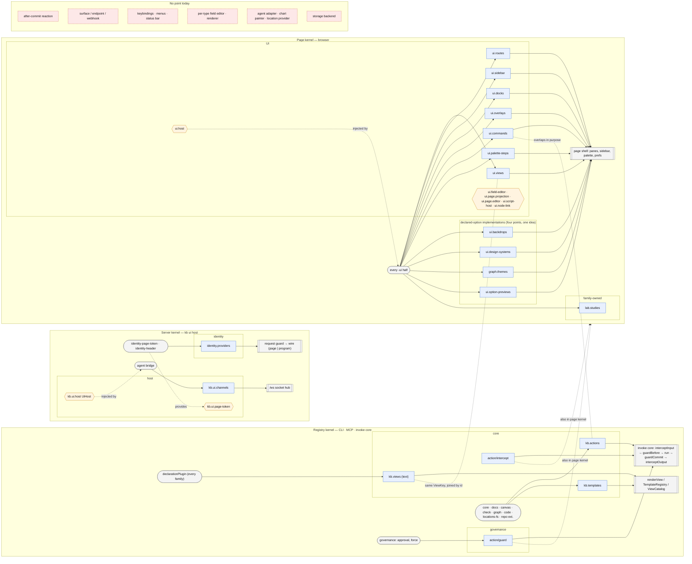

# Extension points of kb: a map, and is it MECE?

Review of branch `feat/person-identity` (head `0d55c673`), 2026-10-20. Read-only:
no code changed. Every claim below is from the source at that head; a line
number is `path:line` under the repository root. Package paths are shortened:
`contracts` is `packages/contract/contracts/src`, `ui-sdk` is
`packages/kit/ui-sdk/src`, `ui` is `packages/app/ui/src`, `server` is
`packages/app/server/src`, `runtime` is `packages/app/runtime/src`,
`operations` is `packages/application/operations/src`, `ext/<x>` is
`packages/extension/<x>/src`.

A self-contained HTML version of the map is beside this file: [`map.html`](map.html).

## 1. The mechanism

- The kernel (`packages/domain/plugin/src/kernel.ts`) offers two kinds of key
  (`keys.ts:18-35`). A **service** key has exactly one provider
  (`service-conflict`, `kernel.ts:346-352`) and a plugin that injects it waits
  until it exists. A **point** key collects many contributions, each with an id
  unique within the point (`contribution-conflict`, `kernel.ts:393-400`).
- Order is the kernel's: a plugin applies only once what it injects exists, then
  load order (`kernel.ts:287-293`). There is no priority.
- **A point has no declared combination rule and no declared host.** Whether a
  point's contributions are all used, the first one holds, the strictest holds
  or one is looked up by key is decided by whoever reads it. Which kernel
  reads it is also nobody's declaration (see finding 3).
- There are **three kernels**, each its own `makeKernel()`: the *registry*
  kernel (CLI, MCP and the `kb ui` server's invoke core; `runtime/registry.ts`),
  the *server* kernel (the `kb ui` host's own plugins; `server/plugins.ts`) and
  the *page* kernel (`ui-sdk/lib/plugins.ts`, `uiKernel`). A point is live only
  in a kernel something reads it from.

Counts: **19 points** (`Point<…>()(…)`), **9 plugin service keys**
(`Service<…>()(…)`, one of them a test fixture), and **16 host services**
(Effect `Context.Service`/`Reference`) that a plugin cannot provide.

## 2. Points

Layer names: **core** (invoke core, registry, render), **governance**,
**identity**, **host** (the `kb ui` server), **UI** (page), **family** (a point
a family mints for its own use). "Combination" is what the reader does, from
its code.

| # | Point key | Declared | Purpose | Contributors | Consumers | Cardinality / combination | Layer · kernel |
| - | --------- | -------- | ------- | ------------ | --------- | ------------------------- | -------------- |
| 1 | `kb.actions` `ActionPoint` | `contracts/extension.ts:106` | A verb any surface can invoke | core (`runtime/registry.ts:143`), `ext/ext-docs/index.ts:198`, `ext/ext-canvas/index.ts:136`, `ext/ext-check/index.ts:50`, `ext/graph/extension.ts:84`, `ext/code/extension.ts:62`, `ext/locations-fs/index.ts:38`, repo extensions (`app/test-kit/src/extension-files.ts:54`) | `runtime/registry.ts:216,289` → handler table, manifest → invoke core (`operations/invoke.ts`) → CLI, MCP, UI, agent | many, keyed by namespaced id (+aliases) | core · registry |
| 2 | `kb.templates` `TemplatePoint` | `contracts/extension.ts:109` | A render template a view spec names | `ext/ext-docs/index.ts:203`, repo extensions (`extension-files.ts:57`) | `runtime/registry.ts:295` → `TemplateRegistry` (`contracts/template.ts:45`) → `renderView` | many, keyed | core · registry |
| 3 | `kb.views` `ViewKeyPoint` | `contracts/view-catalog.ts:40` | A view's key and its *text* form (markdown, figure) | `declarationPlugin` (`contracts/declaration.ts:88`) for every family's `declaration.views`; core (`registry.ts:150`) | `runtime/registry.ts:321` → `ViewCatalog` (`view-catalog.ts:43`); the page re-reads it (`ui/lib/view-catalog.ts:55`) | many, keyed by view id | core · registry **and** page |
| 4 | `action/guard` `ActionGuardPoint` | `contracts/interception.ts:91` | Policy: allow / ask / deny a call, before it runs and before it commits | `ext/governance/extension.ts:28-29` (`approval`, `force`) | `operations/interception.ts:93` → `invoke.ts:267`, `manifest.ts:74`, `session.ts:162`; hosts `runtime/registry.ts:334`, `ui/session/runtime.ts:63` | many; every matching guard asked in order; deny ends it, first ask holds, fail or overrun = deny (`interception.ts:202-227`) | governance · registry **and** page |
| 5 | `action/intercept` `ActionInterceptorPoint` | `contracts/interception.ts:94` | Transform a call's input before, its output after | none bundled (`DESIGN.md:4567` "—") | `operations/invoke.ts:265,280` | many; input in order, output in reverse; fail or overrun aborts the call (`interception.ts:285-312`) | core · registry **and** page |
| 6 | `identity.providers` `IdentityPoint` | `contracts/person.ts:40` | Authenticate a request: the person, refused, or pass | `server/auth.ts:96` (page token), `:134` (proxy header); loaded from `startUi`'s `identity` list (`server/plugins.ts:138-160`) | `server/server.ts:251` → `identifyBy` (`auth.ts:31`) → request guard (`server/guard.ts:137`) | many; **first non-null answer holds** (Cordis `bail`) | identity · server |
| 7 | `kb.ui.channels` `ChannelPoint` | `contracts/channel.ts:36` | A plugin's own conversation on the `/ws` socket | `ext/agent/bridge.ts:330` | `server/plugins.ts:37-38` (socket hub: `find`, `all`) | many, keyed by id; unknown id answered `unknown_channel` | host · server |
| 8 | `ui.views` `ViewPoint` | `ui-sdk/lib/plugins.ts:98` | A view's *React component* and placements | `ext/outline-ui/plugin.ts:97`, `ext/collections-ui/plugin.ts:77`, `ext/chart-ui`, `ext/code-ui`, `ext/graph-ui`, `ext/canvas-ui`, `ext/lab-ui`, `ui/components/ontology/plugin.ts:20,28`, `ui/components/layout/plugin.ts` | `ui-sdk/hooks.ts:252`, `ui-sdk/lib/plugins.ts:484`, `ui/components/layout/pane-switcher.tsx:85`, `ext/graph-ui/use-renderers.ts:7` | many, keyed by view id | UI · page |
| 9 | `ui.routes` `RoutePoint` | `ui-sdk/lib/plugins.ts:171` | Path → view and frame | `ext/graph-ui`, `ext/lab-ui`, `ext/outline-ui`, `ext/canvas-ui`, `ui/components/{layout,ontology}/plugin.ts` | `ui/screen.ts:53,105`, `ui/components/layout/{pane-frame.tsx:79,node-view.tsx:57,pane-title.ts:15,pane-switcher.tsx:84}`, `ui-sdk/lib/plugins.ts:572` | many; first route that matches a path | UI · page |
| 10 | `ui.sidebar` `SidebarSectionPoint` | `ui-sdk/lib/plugins.ts:218` | A sidebar section | `ext/outline-ui/plugin.ts:108,112`, `ext/graph-ui/plugin.ts:182`, `ext/locations-ui/plugin.ts:21`, `ext/lab-ui/plugin.ts:80`, `ext/canvas-ui/plugin.ts:65`, `ui/components/ontology/plugin.ts:56` | `ui/components/sidebar/sidebar.tsx:29` | many, ordered by `order` | UI · page |
| 11 | `ui.docks` `DockPoint` | `ui-sdk/lib/plugins.ts:234` | A tool window at the workspace edge | `ext/agent-ui/plugin.ts:26` | `ui/docks.tsx:14` | many; one open at a time | UI · page |
| 12 | `ui.overlays` `OverlayPoint` | `ui-sdk/lib/plugins.ts:248` | A page-wide mounted overlay | `ext/outline-ui/plugin.ts:120` | `ui/overlays.tsx:10` | many, all mounted | UI · page |
| 13 | `ui.backdrops` `BackdropPoint` | `ui-sdk/lib/plugins.ts:308` | A page-head backdrop (an implementation of a declared option) | `ext/backdrops-ui/plugin.ts:82-85` | `ui-sdk/hooks.ts:69` | many, keyed by declared id; one chosen by a field | UI · page |
| 14 | `ui.design-systems` `DesignSystemPoint` | `ui-sdk/lib/plugins.ts:337` | A design system (token set + stylesheet) | `ext/themes-ui/plugin.ts:25,29`, `ui/design-systems.ts` | `ui/stores/design-system.store.ts:139`, `ui/lib/commands.tsx:225`, `ui/design-system-swatch.tsx:12` | many, keyed by declared id; one chosen by a field | UI · page |
| 15 | `ui.option-previews` `OptionPreviewPoint` | `ui-sdk/lib/option-preview.ts:24` | A live sample for each option of one declared kind | `ui/design-systems.ts:30` | `ui-sdk/lib/option-preview.ts:32` (`useOptionPreview`) ← field editor, `ui/components/prefs/preferences-popover.tsx` | many, but read with `.find` by field: first wins, silently | UI · page |
| 16 | `ui.palette-steps` `PaletteStepPoint` | `ui-sdk/lib/command-point.ts:106` | A picker step of the node palette | `ext/outline-ui/plugin.ts:119`, `ext/graph-ui/plugin.ts:77` | `ext/outline-ui/node-command-palette.tsx:55` | many, keyed; opened by id from a command | UI · page |
| 17 | `ui.commands` `CommandPoint` | `ui-sdk/lib/command-point.ts:155` | A page command (⌘K, node menu) | `ext/outline-ui/plugin.ts:117`, `ext/chart-ui/plugin.ts:41`, `ext/graph-ui/plugin.ts:76`, `ext/locations-ui/plugin.ts:25` | `ui/lib/commands.tsx:545` | many, ordered by load; `when` filters | UI · page |
| 18 | `graph.themes` `GraphThemePoint` | `ext/graph-ui/graph-themes.ts:311` | A graph theme (implementation of a declared option) | `ext/graph-ui/graph-themes.ts:327` | `graph-themes.ts:348`, `graph-settings.tsx:33` | many, keyed by declared id | family (graph) · page |
| 19 | `lab.studies` `LabStudyPoint` | `ext/lab-ui/kit/study-point.ts:17` | A study the lab can draw | `ext/lab-ui/plugin.ts:34,61` | `ext/lab-ui/lab-page.tsx:104` (`.find` by scene) | many, but one used per scene | family (lab) · page |

The SDK mirrors a subset for repository extensions: server surface
`ActionPoint`, `TemplatePoint`, `ViewKeyPoint`, `ActionGuardPoint`,
`ActionInterceptorPoint` (`contracts/extension.ts:133-154`,
`packages/contract/ext-sdk/src/surface.ts:442-450`); page surface `ViewPoint`,
`RoutePoint`, `SidebarSectionPoint`, `DockPoint`, `OverlayPoint`,
`CommandPoint`, `DesignSystemPoint`
(`packages/contract/ext-sdk/src/page-surface.ts:45-178`).

## 3. Plugin service keys

One provider each; consumers declare `inject` (or read with `useService` /
`followProvided`).

| Key | Declared | Purpose | Provider | Consumers | Layer · kernel |
| --- | -------- | ------- | -------- | --------- | -------------- |
| `ui.host` `BrowserHostService` | `ui-sdk/host.ts:133` | The page's host: writes, invoke, screen, sandbox bridge | `ui/browser-host.ts:102` | `inject` in `ext/{outline,graph,chart,code,collections,canvas,lab,locations,agent}-ui/plugin.ts` | UI · page |
| `ui.field-editor` `FieldEditorService` | `ui-sdk/lib/field-editor.ts:34` | The page's one field editor | `ext/outline-ui/plugin.ts:96` | `useFieldEditor` (`field-editor.ts:41`) | UI · page |
| `ui.page.projection` `PageProjectionService` | `ui-sdk/lib/page-ports.ts:75` | The page's graph projection | `ext/outline-ui/plugin.ts:93` | `ui/stores/graph.store.ts:428` | UI · page |
| `ui.page.editor` `PageEditorService` | `ui-sdk/lib/page-ports.ts:138` | The page's editor store | `ext/outline-ui/plugin.ts:94` | `ui/stores/page-editor.ts:28` | UI · page |
| `ui.node-link` `NodeLinkGraphService` | `ui-sdk/lib/node-link.ts:48` | Node-link graph extraction other halves read | `ext/graph-ui/plugin.ts:75` | `ext/lab-ui/plugin.ts:31` (inject), `lab-graph.ts:82` | family (graph→lab) · page |
| `ui.script-host` `ScriptHostService` | `ui-sdk/view-scripts.ts:96` | Sandboxed script host for views | `ext/code-ui/plugin.ts:35` | `ui-sdk/components/view-scripts.tsx:11` | UI · page |
| `kb.ui.host` `UiHost` | `contracts/channel.ts:54` | What the server offers its plugins: root, `invoke` | `server/plugins.ts:157` | `ext/agent/bridge.ts:320-323` | host · server |
| `kb.ui.page-token` `PageToken` | `server/auth.ts:44` | The page token the page-token provider holds | `server/auth.ts:95` | `server/server.ts:436` | identity · server |
| `ext.example.greeter` `Greeter` | `app/test-kit/src/example-extension.ts:37` | Test fixture for the extension contract | same file `:87` | same file `:64-67` | test only |

Host services that a plugin **cannot** provide (bound by the composition root,
`kbRuntimeLayer`): `KbIndexService` (`packages/domain/query/src/index/index.ts:86`),
`KbStore` and `KbCtx` (`contracts/session.ts:31,34`), `GraphWrites`
(`graph-writes.ts:27`), `Screens` (`screen.ts:375`), `KbRoots` (`roots.ts:60`),
`SavedQueries`, `LegacyDocsViews`, `Assets`, `CodeTrust`
(`workspace.ts:37,59,72,87`), `FamilyKernels` (`footprint.ts:44`),
`ExtensionCatalog` (`declaration.ts:144`), `CurrentInterception`
(`interception.ts:134`). Three are **bridges from points**, derived and not
provided: `TemplateRegistry` ← `kb.templates`, `ViewCatalog` ← `kb.views`,
`ActionCatalog` ← `kb.actions`. They are the right shape.

Not in the kernel at all, and carrying extension content: a family's
**declaration** (`ExtensionDeclaration`, `contracts/declaration.ts:20-80`: seed
nodes, `views`, `defaultView`, `declaredOptions`, `policies`, `refCarriers`),
factory options (`agentPlugin({adapters, secrets})`, `ext/agent/bridge.ts:314-317`;
`chartPlugin({painter})`, `ext/chart/extension.ts:29-40`; `startUi`'s `identity`
list), and the store `BACKENDS` table (`runtime/store-selection.ts:54`).

## 4. Diagram

Arrows run contributor → point → consumer. Dashed arrows are a service
provided and injected. Each box is a kernel.

## 5. Is the set MECE?

**Mutually exclusive: mostly, with five overlaps.** The core of it is clean and
the branch's new points are well separated. A guard cannot transform, an
interceptor cannot refuse (`interception.ts:14-23`), and identity answers a
different question (who) from a guard (may they). Overlap shows only where two
points describe one concept at two layers:

- an invoke core that still decides in places besides the guard point (finding 1);
- a view declared in two points, and a verb in two (findings 4, 5);
- four points for one idea, an implementation of a declared option (finding 6);
- three mechanisms for "another implementation": a service, a point and a
  factory option (finding 7).

**Collectively exhaustive: no.** The map covers *calls* (actions, guards,
interceptors, identity), *render* (templates, views), *page chrome* (routes,
sidebar, docks, overlays, commands, themes) and *conversations* (channels). It
does not cover *reacting to the graph*, *adding a surface*, *input bindings*, or
*per-type editing*. Against the references:

| Reference seam | kb |
| -------------- | -- |
| Cordis `provide`/`inject`, one provider | `Service`, `service-conflict` — **same**, by design |
| Cordis `bail` | identity (`auth.ts:31`), guard deny (`interception.ts:223`) — present |
| Cordis `waterfall` | interceptor input chain — present |
| Cordis `on`/`emit`, `parallel` | deliberately deleted (`DESIGN.md:2459-2465`); **no after-commit reaction** (`DESIGN.md:4595-4611`) |
| Cordis `isolate`/`intercept`, `timer`, `logger`, `hmr` | deliberately not offered (`DESIGN.md:4622`, `docs/brainstorms/2026-10-16-kb-cordis-layers/README.md` Non-adoptions) |
| dsh slots `single \| list \| keyed \| chain` | `Service` = single; points are all keyed lists; chain is built into two points; **cardinality is not declared** (finding 11) |
| VS Code `commands` | `ui.commands` + `kb.actions` — **both** (finding 5) |
| VS Code `views`/`viewsContainers` | `ui.views`, `ui.sidebar`, `ui.docks` — present |
| VS Code `menus`, `keybindings`, status bar | **absent** (finding 10) |
| VS Code `configuration` | by data (`sys.f.configures` fields, declaration `declaredOptions`) — present, outside the kernel |
| VS Code `themes`, `iconThemes` | `ui.design-systems`, `graph.themes`, `ui.backdrops` — present |
| VS Code `customEditors` | `ui.views`/`ui.routes` for views; **no per-field-type editor** (finding 12) |
| VS Code `authentication` | `identity.providers` — present, `kb ui` only |
| VS Code `FileSystemProvider`, `taskProviders`, `debuggers`, `languageModelProvider` | store `BACKENDS` table (not pluggable, documented), no location/import provider, agent adapters by option (findings 7, 13) |
| VS Code `onDid*` events | **absent** (finding 2) |

### Compared with `DESIGN.md` → "What kinds of extension kb supports" (`:4556-4623`)

The section is accurate about what it lists. Where it differs from the code:

1. **"Nothing else in the invoke core decides or changes a call"** (`DESIGN.md:1902`)
   and "Core contributes no guard. With none, every call proceeds" (`:2537`)
   are not true of the code: finding 1.
2. **"A repository extension … may declare and contribute whatever a bundled
   family may"** (`DESIGN.md:2336-2337`), and the "Page UI" row of the table
   (`:4570`) naming "backdrops, option previews", over-state the SDK. The page
   surface has no `BackdropPoint`, `PaletteStepPoint` or `OptionPreviewPoint`,
   and the server surface no `IdentityPoint` or `ChannelPoint`: finding 9.
   (The channel half is a recorded GAP, `DESIGN.md:2446-2450`; the rest is not.)
3. **Identity is listed under "Interception is a point with combination rules"**
   (`DESIGN.md:4581-4585`, `:2360-2362`). It does not intercept a call; it is a
   resolver read by the server's request guard. Three combination rules (strictest
   verdict, ordered transform, first answer) sit under one heading. This is
   classification only, but it hides that the combination rule is the reader's.
4. **`kb ext list` shows "each point's listeners in that order"**
   (`DESIGN.md:1934`) — only for the two interception points
   (`app/cli/src/extensions.ts:56-61`). `identity.providers`, where order decides
   the answer, is not shown.
5. The section's "Reacting after a commit" and "Isolation scopes" non-offers are
   confirmed by the code (no plugin handed a log; `KbTxLog.subscribe` read only by
   `server/server.ts` and `server/session.ts`).

## 6. Findings, ranked

Rank = how likely a plugin author or a reviewer is to be wrong, or blocked,
because of it; then how much it costs to fix.

1. **Overlap — the invoke core decides outside the guard point.**
   `systemTxRefusal` (`operations/session.ts:145`, from
   `packages/domain/model/src/system-write.ts:141`), `scriptRefusal`
   (`operations/invoke.ts:272`) and `scriptWriteRefusal`
   (`operations/session.ts:154`) refuse a call or commit beside the guards. A
   "protect this write" contribution could go to either; with `--governance off`
   (`DESIGN.md:2548`) these still refuse, so "every call runs" is false.
   *Direction:* make them core-owned *required* guards on `action/guard`, or state
   them as core invariants and correct `DESIGN.md:1902,2537,2548`.

2. **Gap — no reaction after a commit.** A plugin cannot act when a node is
   tagged, linked or changed; `KbTxLog.subscribe` is host-only
   (`DESIGN.md:4595-4611`). The most expected extension for a graph store;
   VS Code `onDid*`, Cordis `emit`. *Direction:* an `tx/after` point fed from the
   log, with the interception budgets, failure rules and nesting limit
   (`interception.ts:122-123`, `invoke.ts:236`).

3. **Overlap — which kernel reads a point is nobody's declaration.**
   `ctx.contribute` accepts any `PointKey` in any kernel
   (`kernel.ts:44-47`). A guard or interceptor contributed to the server kernel
   (a hosted family, `server/plugins.ts:138-160`) is silently inert: guards are
   read only from the registry kernel (`runtime/registry.ts:334`) and the page
   kernel (`ui/session/runtime.ts:63`). The same hazard is the known channel GAP
   (`DESIGN.md:2446-2450`). *Direction:* put the host on the key
   (`Point<C>()(name, {read: ["registry","page"]})`), have `contribute` and
   `kb ext list` flag a contribution no kernel reads.

4. **Overlap — a view is two contributions joined by id.** `kb.views`
   (`contracts/view-catalog.ts:40`) holds text, `ui.views`
   (`ui-sdk/lib/plugins.ts:98`) holds the component, both under one `ViewKey`;
   `collections-ui` aliases the key by hand (`ext/collections-ui/plugin.ts:77`),
   and the page re-derives `kb.views` from the manifest
   (`ui/lib/view-catalog.ts:55`). Nothing checks that each `ui.views` has a
   `kb.views` partner. *Direction:* one view contribution with two optional
   halves, or make `ui.views` resolve through `ViewCatalog` (a bridge, not a mirror).

5. **Overlap — `ui.commands` vs `kb.actions`.** Both are "a named verb with an
   id, a `when` and a `run`" (`ui-sdk/lib/command-point.ts:155`,
   `contracts/extension.ts:106`). A `Command` is a page closure: invisible to
   MCP, the agent and the CLI, and skipped by guards. "Add chart"
   (`ext/chart-ui/plugin.ts:41`) and "open location" (`ext/locations-ui/plugin.ts:25`)
   are verbs that belong in both worlds. *Direction:* a command is presentation
   (`sys.command` node) over an action id; `ui.commands` only for pure view-state verbs.

6. **Overlap — four points for "an implementation of a declared option".**
   `ui.backdrops` (`plugins.ts:308`), `ui.design-systems` (`:337`),
   `graph.themes` (`ext/graph-ui/graph-themes.ts:311`) and `ui.option-previews`
   (`option-preview.ts:24`) all go through `provideDeclared` (`plugins.ts:360`)
   and differ only in kind. Each new declared kind mints a point (Rule 1:
   "one mechanism per concept"). *Direction:* one point keyed by option kind, the
   preview an optional facet of the same contribution.

7. **Overlap — three mechanisms for "another implementation".** `DESIGN.md:2356-2359`
   says another implementation is another provider of a service. Yet the agent's
   adapters and secrets (`ext/agent/bridge.ts:314-317`), the chart painter
   (`ext/chart/extension.ts:29-40`) and the identity plugins (`server/plugins.ts:138`)
   arrive as factory arguments, invisible to `inject`, `kb ext list` and the
   footprint. *Direction:* `AgentAdapter` and `ChartPainter` as services (or
   points keyed by id) with the host providing the default.

8. **Gap — a plugin cannot add a surface.** No point for a CLI subcommand, MCP
   resource or prompt, HTTP route or webhook (`app/cli/src/extensions.ts` is a fixed
   table; channels "add no endpoint", `contracts/channel.ts:9-12`). With finding 2
   this blocks inbound integrations. *Direction:* a `surface.routes` point behind the
   request guard, or record the refusal in "Not offered".

9. **Gap — repository extensions cannot reach every point.** The SDK exports 5
   server points and 7 page points (`contracts/extension.ts:133-154`,
   `ext-sdk/src/page-surface.ts:45-178`); not `IdentityPoint`, `ChannelPoint`,
   `UiHost`, `BackdropPoint`, `PaletteStepPoint`, `OptionPreviewPoint`. Identity
   being closed is plausibly right (trust), but it is not stated.
   *Direction:* export the rest or list the closed ones in `DESIGN.md:2336`/`:4570`,
   and let `surface-bridge.test.ts` assert the SDK equals the public points.

10. **Gap — no keybindings, menus or status bar.** `matchGlobalShortcut` is a fixed
    ⌘K (`ui/lib/keyboard-shortcuts.ts:11-19`); `Command.when` is the only context
    hook; the node menu is the only menu. VS Code `keybindings`, `menus`,
    `statusBar`. *Direction:* `ui.keybindings` (chord → command id) and menu
    placements as a facet of a command.

11. **Gap — a point's combination rule is not part of the point.** Identity takes the
    first answer (`auth.ts:31`), guards the strictest (`interception.ts:202`),
    `lab.studies` and `ui.option-previews` use `.find` (`lab-page.tsx:104`,
    `option-preview.ts:32`), so a second preview or study for one key is shadowed
    without an error. dsh declares `single | list | keyed | chain`; kb decided not to
    (Cordis survey, Non-adoptions). *Direction:* keep the decision, but state the rule
    per point (a field on the key, shown by `kb ext list`) and make a duplicate in a
    keyed-by-field point a `contribution-conflict`.

12. **Gap — one field editor, no per-type editors.** `ui.field-editor` is a
    single service (`ui-sdk/lib/field-editor.ts:34`), provided by the outline. A
    family cannot add an editor, renderer or validator for its own field type.
    VS Code `customEditors`. *Direction:* a point keyed by field type with the outline's
    editor as the default; validators already fit `commit` guards.

13. **Gap — no import/export or location provider.** `locations-fs` is family-private
    actions (`ext/locations-fs/index.ts:38`); the outline-paste parser and the store
    `BACKENDS` table (`runtime/store-selection.ts:54`, documented) are fixed. A Git or S3
    provider forks the family. *Direction:* a family-minted service, as
    `lab.studies`/`ui.node-link` already are; no kernel point needed.

14. **Gap, low — identity answers only "the owner".** `IdentityProvider` returns one
    `Person` or a refusal (`contracts/person.ts:21-30`); the CLI and MCP have no
    identity seam, and no point maps a person to roles or an actor. Fine for a
    single-user tool (`DESIGN.md:2548`). *Direction:* leave until a second person exists.

15. **Gap, low — no telemetry or scheduling sink.** Spans exist (`kb.guard`,
    `kb.interceptor`, `interception.ts:178,292`) but no exporter point, and timers are
    Effect's. *Direction:* leave; Effect covers both.
