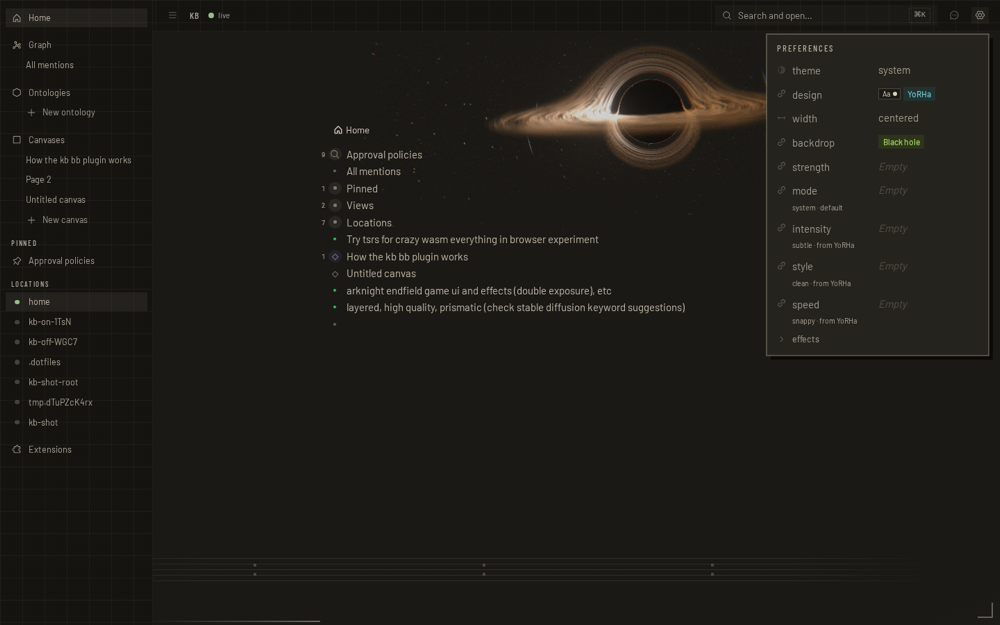
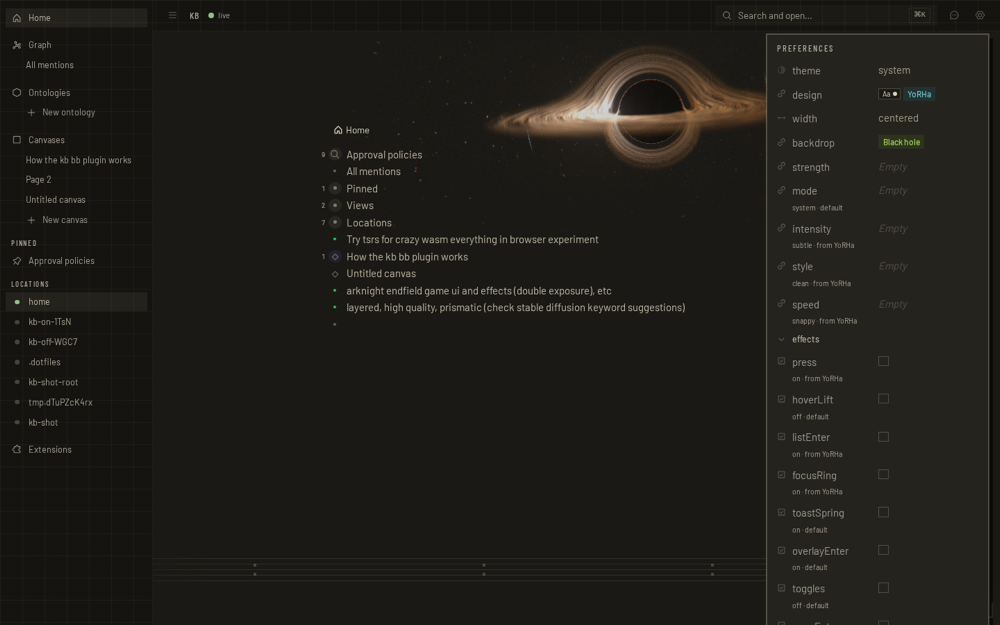
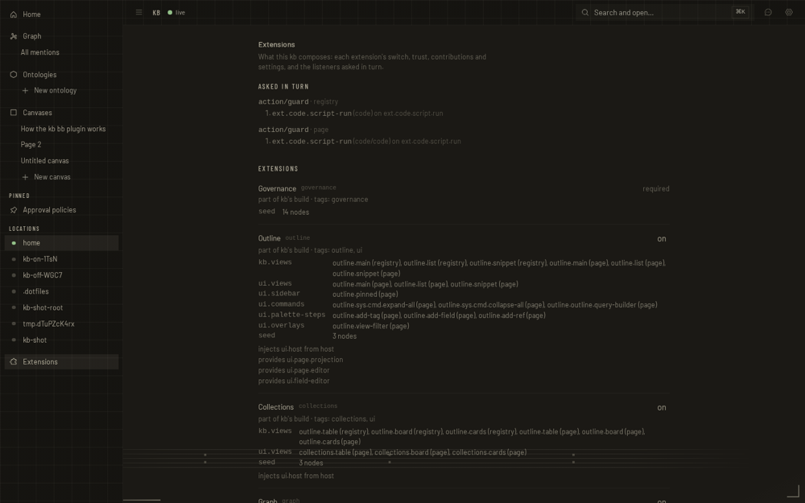
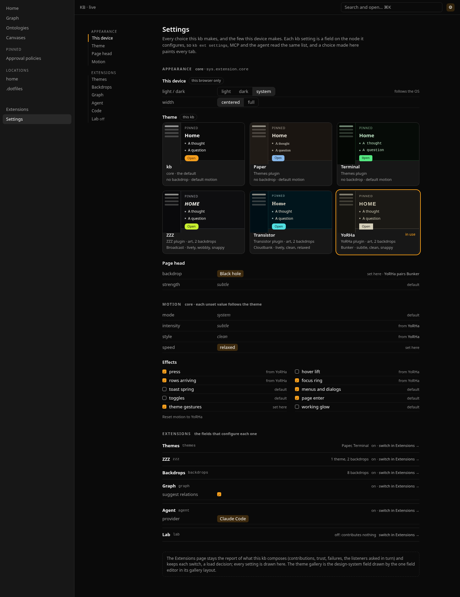

# Settings, and themes as plugins

Date: 2026-10-27. Branch `docs/settings-theme-plugins`.

The owner asked for kb to "move the theming stuff and all to plugins, instead
of configuring themes on that flyer [the Preferences popover], or probably
rework the options/configuration part entirely". This record takes stock of
every configurable thing, names what is wrong with how it is configured,
weighs three ways out, and recommends one with a phased plan. The rules it
is judged by are [AGENTS.md](../../AGENTS.md) (Rule 1, one contract,
canonical statements, drift markers); the specs it would change are
[DESIGN.md → Extension families](../../DESIGN.md#extension-families) and
[DESIGN-UI.md → Design tokens](../../DESIGN-UI.md#design-tokens),
[Extensions panel](../../DESIGN-UI.md#extensions-panel) and
[Motion options](../../DESIGN-UI.md#motion-options).

**Recommendation in one paragraph.** Option C, built B first. kb already
stores settings the right way: a setting is a system field whose
`sys.f.configures` names an extension's node, so the schema is data and
`kb set` writes it. What is missing is a way to *read* that schema through
kb's API, and one page that draws all of it. So: (1) one reader and one read
action, `extension.settings`, that every surface uses (`kb ext settings`,
MCP and the agent get it as a tool); (2) a Settings page, a kb view at
`/settings`, that replaces the Preferences popover and takes the settings
off the Extensions report, with the theme chosen from a gallery that is a
layout of the one field editor; (3) the seed's retirement table, then each
whole theme its own plugin (family), so a theme is installed, switched and
authored as a unit, as bb's `bb.themes` plugins are; (4) a theme's pieces
that are still code become data on the theme's node, closing the theme gaps
one by one. Phases 1 and 2 answer the flyer half of the ask; they move no
theme into a plugin. Phase 3 is the plugin half, and the riskiest step.

## 1. What is configurable today, and where it lives

Prod (`https://kb-popemkt.taild98079.ts.net`, 2026-10-27, read only: the
popover opened and its effects fold expanded, nothing chosen):

| Preferences popover | its effects fold | Extensions page |
| --- | --- | --- |
|  |  |  |

Every configurable thing, its scope, its storage, where it is drawn and
whether kb's API reaches it:

| Thing | Scope | Stored as | Drawn in | Through actions / CLI / MCP |
| --- | --- | --- | --- | --- |
| Light, dark or system | device | `localStorage["kb-prefs"].theme` | popover row "theme"; ⌘K Toggle theme | no (by design: `system` follows the OS) |
| Width | device | `kb-prefs.width` | popover row; ⌘K Toggle width | no |
| Sidebar open | device | `kb-prefs.sidebarOpen` | the sidebar toggle | no |
| Design system (the theme) | this kb | core's `sys.f.design-system`, a ref to an option node | popover row "design" (field editor + swatch); ⌘K Switch design system | `kb set sys.extension.core sys.f.design-system …`; not listable as a setting |
| Page-head backdrop, strength, direction | this kb, or one page | `sys.f.backdrop`, `…strength`, `…direction` on core's node or a page's | popover rows; a page's own: no gesture (gap `01M54CEM0Z5SMAS7KABS7QZ67C`) | `kb set` |
| Motion mode, intensity, style, speed | this kb; a theme's preset beneath | `sys.f.motion.*` on core's node; the same fields on the theme's option node | popover rows with "value · source" | `kb set`; no action returns the value in force (`motionChoice` is a pure function in `@kb/model` that only the page calls) |
| Ten motion effects | same | `sys.f.motion.fx.*` checkboxes | popover fold | `kb set` |
| An optional extension on or off | this kb | `sys.f.extension.enabled` on `sys.extension.<name>` | Extensions page switch | `extension.switch`, `kb action-invoke` |
| An extension's other settings (graph's *suggest relations*, the agent's *provider*, code's *scripts*) | this kb | fields that configure `sys.extension.<name>` | Extensions page card, below the contribution dump | `kb set`; not listable |
| The catalogue of themes and backdrops | this kb's build | option nodes the seed derives from declarations | the fields' pickers | `node.get`, read-only by convention |
| A theme's tokens, faces, art, overlays | the build | CSS, imports and components in `themes-ui` | nowhere | no (gaps `01M5SNSPSGYCF6AKWVXQS2GJQJ`, `01M5SNSQH2HMD784PCD51W46D5`, `01M5SNSQ4Y11AHAHDA43PCV5D6`) |

What ships: six design systems (core's `kb`; the `themes` family's Paper,
Terminal, ZZZ, Transistor and YoRHa), fourteen backdrops (eight from the
`backdrops` family: Unicorn, Gradient, Sky, Roost, Lens, Black hole, Toon
sea, Silk; six from `themes`: Broadcast, Hollow, Cloudbank, OVC, Bunker,
Arena), four motion options and ten effects. One family, `themes`, holds
five systems, their art, their faces and six backdrops; switching it off
takes all five.

## 2. The problems

1. **The flyer is the wrong container.** The popover holds 11 rows and a
   fold of 10 more, each with a second line of "value · source", in a
   320-pixel box anchored to the gear. The owner's most-used choice, the
   theme, is a dropdown chip with a 20-pixel swatch; nothing shows what a
   theme brings (its art, its backdrops, how it moves) before it is chosen.
   With the effects open, the popover runs off the bottom of a 900-pixel
   window (the second screenshot is cut at *toggles*). Each effect shows an
   empty checkbox beside "on · from YoRHa", because the box is core's
   stored value and the line under it the value in force; the effects are
   labelled by their ids (`hoverLift`, `listEnter`); *strength* reads
   "Empty" where the page shows `subtle`.
2. **It mixes two scopes and does not say so.** "theme" (light, dark,
   system) is this browser's; "design" (the theme) paints every tab and
   device. They sit one under the other, named so that the one called
   *theme* is not the theme.
3. **Settings have two homes and two grammars.** Core's settings are drawn
   by the popover; every other extension's are drawn at the bottom of the
   Extensions page, a developer report of points, contributions and seeds.
   A person looking for the agent's provider has to read past
   `ui.palette-steps` to find it. The predicate that decides what is a
   setting is `@kb/model`'s (`configures`), but the filter over the schema,
   and the exclusion of the switch, is written in the page
   (`extensions-page.tsx`), and Preferences names core's fields by hand
   (`core-settings.ts`, `motion-rows.tsx`) with nothing checking that every
   setting of core's has a row.
4. **The schema is data no caller can list.** DESIGN.md says "which fields
   configure the agent is a query", but no action runs it. An agent or the
   CLI can write any setting with `kb set` only if it already knows the
   field id; MCP has no tool that answers "what can I configure?".
5. **A theme is not a unit.** A whole theme (sheet, faces, art, its two
   backdrops, its motion preset) is spread across one family that holds
   five of them. It cannot be switched alone, a new one cannot be added
   without editing that family, and its own knobs have no home. bb, by
   contrast, lists themes from plugins (`bb.themes`) with a picker and
   per-plugin settings.
6. **A theme's look is code** (the gaps in DESIGN-UI.md → Theming: what is
   data and what is code): tokens, faces, art and overlays, the selected
   row, the graph's look and the palette's presentation are unreachable
   from kb's API.

## 3. Options

### A. Themes as kb extensions, and a Themes gallery

Split the `themes` family into one family per whole theme (`zzz`,
`transistor`, `yorha`; Paper and Terminal stay in `themes`), each a
`@kb/<theme>` and `@kb/<theme>-ui` pair, and replace the design-system
dropdown with a gallery of live cards grouped by the plugin that brings
each theme. Each theme family carries its art, faces, sheet and backdrops;
its switch is the existing `extension.switch`.

- Fixes 5, and most of 1 for the theme itself.
- Leaves 2, 3 and 4: the popover still draws backdrop and motion, the
  Extensions page still hides settings, nothing lists them.
- Costs: about six packages moved, shared art helpers (`useBeat`,
  `useGesture`, `deferred`) to a kit package, and an id migration: a
  declared id is `<family>.<local id>`, so `themes.zzz` becomes
  `zzz.<local>`, and a store whose core node chooses `themes.yorha` (prod's
  does) would fall back to the default without one.

### B. Settings as `sys.*` setting nodes, a Settings page as a kb view, and the schema through actions

Keep every setting where it already is, a system field that configures an
extension's node, and add what is missing:

- **One reader** in `@kb/model`, `extensionSettings(schema, node)`: the
  fields that configure a node, in id order (the same on every host and backend), with each one's type,
  cardinality and options, the switch excluded (it is
  `extension.switch`'s, and `extension.list` already reports it). The
  Extensions page's filter is deleted in its favour.
- **One read action**, `extension.settings {name?}`: per extension node,
  core's included, its name and label and each setting with its field id,
  label, type, one-valued or not, its options (id and label) where it is
  an option set, and the values the node holds. It repeats nothing
  `extension.list` reports (optional, on, trust). `kb ext settings [name]`
  prints it; MCP and the agent get it as a tool, as they get every read
  action. Writes stay `node.update` / `kb set` (the system-write rule
  already admits exactly these fields) and `extension.switch`.
- **A Settings view** (`@kb/views`' `SettingsView`, route `/settings`, a
  page like the Extensions view, opened by the gear and ⌘K): this device
  first (light/dark, width, marked as this browser's), then one section per
  extension the reader lists, core's first. Every setting is drawn with
  the page's field editor. Core's section groups its settings (theme, page
  head, motion, effects) and annotates motion with the value in force and
  its source, as Preferences does now; a contract over the reader holds
  every listed setting, core's included, to a row on the page, so a core
  setting added without a place fails a test rather than going missing.
  Other extensions' sections are generic. The popover is deleted; the
  Extensions page keeps the report and each extension's switch, and links
  to its settings.
- **The gallery is how the one field editor draws an option field whose
  kind previews at card size**, wherever that field is drawn; no surface
  asks for it. `OptionPreview` stays one contribution per kind, its
  `Preview` handed a `size` (`chip`, today's inline sample, or `card`) and
  declaring the sizes it draws (`sizes`). The editor lays every option of
  a one-valued option field out at once when the kind's preview draws
  `card`, each option drawn at that size, and chooses with its own write
  (`writes.updateProp`, as the picker does); otherwise it draws the row as
  before. Core's design-system plugin draws both sizes (a card is a live
  sample through `data-theme`, with the plugin that brings it, its pairing
  and preset, read from its option node). So the design-system field is a
  gallery on the Settings page and on core's own node page alike (the
  Extensions page no longer draws settings); backdrops preview at chip
  size only, so they stay a row. (Gap `01M54PYE750E2GNTTKAVRK7GCK`, done, removed a
  bespoke swatch radiogroup for this very field; the gallery must not bring
  it back.)

- Fixes 1, 2, 3 and 4; the gallery fixes the theme half of 1.
- Leaves 5 and 6.
- Costs: one action and one reader (small); one view and the removal of
  the popover (medium); no data migration.

### C. Both, B first

B's reader, action and page, then A's per-theme families on top, then the
theme gaps, each as the theme's node gaining data. The gallery groups
themes by plugin from the start, so A changes what the gallery shows, not
how it works.

## 4. Comparison

| | A | B | C |
| --- | --- | --- | --- |
| **Rule 1** (one mechanism, one owner) | the theme becomes one family's, one owner per theme; settings stay split across two surfaces with two filters | one reader and one action own "what is a setting"; one page draws all of them; the popover and the page's second filter are deleted | both |
| **Everything is a node** | unchanged | holds: the schema stays field nodes, the action is a query over them, no settings registry beside them | holds |
| **One contract, every implementation** | the design-system and theme-art contracts already run over every contributed system, a new family's included, with no test list to edit (the family itself still needs its `BUNDLED_FAMILIES` and `BUNDLED_EXTENSIONS` entries) | a new contract: every setting the reader lists is listed by the action and drawn on the Settings page, for every bundled family and a test family | both |
| **Canonical statements** | DESIGN-UI's Themes section names the families | DESIGN.md's configuration bullet gains the reader and action; DESIGN-UI's Preferences and Extensions panel sections become one Settings section | both |
| **Owner value tonight** | the theme as a plugin, the gallery | a real settings page; agents can list and set settings | the whole ask, phased |
| **Effort** | large (package moves, alias) | small + medium | B now, A next |
| **Migration** | ids change; needs the seed's retirement table (gap `01M3FK1PM9P96SNCSHXF0CJZRA`) | none (device prefs and graph settings keep their keys) | B none; A the table |
| **Risk** | breaks a chosen theme without the alias; large diff in art code | low; the popover's tests move to the page | low first, then A's |

## 5. Recommended target

**C, in the order B → A → theme data.** The settings model is already
right; the surface and the API are what is missing, and B delivers them
with no migration. A is then a packaging change the Settings page already
expects. The theme gaps come last, because each one is the theme's node
gaining a field and the page drawing it.

The target's information architecture
([HTML](assets/2026-10-27-settings-ia-mock.html), painted by kb's real
design-system sheets):

- **One page for every setting, two pages by verb.** *Settings* is what a
  person chooses: every setting the reader lists. *Extensions* is what the
  kb composes: trust, contributions, listeners, failures, and the switch,
  because the switch is a load decision whose effect (actions, views and
  MCP tools leaving) is what that page explains, and the agent's switch is
  writable only where a host composes it (gap
  `01M43H3T8XEMTNBARC024PZD2W`). Each extension links between the two.
  Other surfaces keep drawing the same fields with the same editor, as
  DESIGN.md sanctions (the agent dock's provider row, a node's own field
  rows); Settings is the one page that draws all of them.
- **Scope is said, not implied.** Device choices sit under *This device*;
  everything else is this kb's and paints every tab.
- **The theme is a gallery**: the design-system field as the field editor
  draws a kind that previews at card size, each option a live sample (its own sheet,
  through `data-theme`, as the swatch is), with the plugin that brings it,
  the backdrop it pairs with and its motion preset read from its option
  node. The options are the field's children and the write is the
  editor's, so there is one list and one write.
- **The field editor needs the outline family** (`FieldEditorService`,
  gap `01M5MWXM43Y12KDBM4JG7X1VRX`): with the outline off, Settings draws
  the device rows and the sections' headings, and no field rows, as every
  other surface that draws fields does today.
- **Motion** keeps "value · source" per option and a reset to the theme,
  the effects as a grid rather than a fold.
- **Extensions**: each with its on/off state (switched on the Extensions
  page, linked) and its settings, generic field rows.
- The gear opens the page in the focused pane; ⌘K's *Preferences* command
  opens it too; *Toggle theme*, *Toggle width* and *Switch design system*
  stay as the quick paths the popover used to be.

## 6. Phased plan

Each phase is one PR against kb main, stacked, shippable on its own, with
tests, DESIGN docs and gaps updated in the same PR.

**Phase 1 — the settings schema through the API (B).**
`extensionSettings` in `@kb/model` (the one reader, the switch excluded);
`extension.settings` in `@kb/operations` beside `extension.list`; `kb ext
settings [name] [--json]`; the Extensions page's filter replaced by the
reader. Contract: over every bundled declaration's seed and a test
family's, every system field that configures a node is listed under that
node, in id order, with its options, and nothing else is; the action and
the CLI answer the same rows. DESIGN.md → Extension families →
configuration names the reader and the action. Closes problem 4.

**Phase 2 — the Settings page (B).** `SettingsView` (`/settings`), the
device rows, one section per extension the reader lists (core's grouped and
annotated, the rest generic); the field editor's gallery for a kind whose
preview draws at card size, and the design-system preview's card size; the popover,
`prefsOpen` and the popover's half of the trigger deleted, the gear and ⌘K
*Preferences* opening the page; the Extensions page's settings replaced by
a link (its switch stays). Contract tests: every setting the reader lists
for every family on is drawn on the page; choosing a gallery card writes
core's field through the editor and paints the page; the device rows write
`kb-prefs` and nothing in the graph. DESIGN-UI: a *Settings* section
replaces Preferences; the Extensions panel's settings bullet, the
Optional-UI-plugins bullet that names Preferences, Option previews (the
card) and Field values (the layout) are updated; DESIGN.md's configuration
bullets name the page. Closes problems 1, 2, 3.

**Phase 3a — the seed's retirement table.** Gap
`01M3FK1PM9P96SNCSHXF0CJZRA` asks for exactly what the theme split needs: a
declared table in `@kb/model`, old id to replacement and option ids to
option ids, that `ensureSystemSeed` applies before seeding (the old node
deleted, props keyed by it moved, ref values to it remapped), with
`LEGACY_SEED_RENAMES` folded into it and a seed test over it. A
declaration may contribute rows (a family that renames its own options),
so the fold carries them as it carries seeds. `views.migrate`'s retired set
stays its own explicit action, so the gap narrows rather than closes (§9).

**Phase 3b — one family per whole theme (A).** `@kb/zzz(-ui)`,
`@kb/transistor(-ui)`, `@kb/yorha(-ui)`; the art helpers (`useBeat`,
`useGesture`, `deferred`) to a kit package; `themes` keeps Paper and
Terminal. Ids: a theme's design system is `<theme>.theme` (`zzz.theme`),
its backdrops keep their local names (`zzz.broadcast`, `yorha.bunker`), and
each family declares retirement rows from its `themes.*` ids, so a store
whose core node chooses `themes.yorha` is remapped to `yorha.theme` on open.
**Version skew.** `.kb/nodes.jsonl` is committed and hosts pin different
releases, so the table must hold when an older build meets a remapped
store: the older build re-seeds the old option node (the seed adds what is
missing) but writes no choice: core's choice names an option it does not
declare, so it falls through to the default as any uncontributed choice
does; the next newer open retires the re-seeded node
again (the table is idempotent: it applies wherever an old id is present).
A store merged by the `kb-jsonl` driver from a clone that still holds the
old nodes converges the same way on its next newer open. Alternating builds on one
committed store churn `.kb/nodes.jsonl` (the old node added, then
retired again); that is accepted, as the cost of never rewriting a
choice, and ends when every host runs a build with the table. Tests: open a
migrated store with the previous declarations (the choice untouched, the
old node back), merge it with an unmigrated clone (`mergeNodeSets`), open
with the current ones (remapped once, then a no-op).
Arena moves onto the shared GPU host as it moves into the YoRHa family
(closes `01M5SYY397F5NPN3CHWGCSPQSY`). Contract: a test theme family,
declared and contributed like the others, appears in the gallery, can be
switched off alone, and its retired id is remapped. Closes problem 5.
Gated on 3a.

**Phase 4 — the theme's node carries the theme.** This extends a
mechanism themes already use: a theme's option node holds data
(`SeedOption.props`, its motion preset by `motionPresetProps`; its pairing
by `chooses`). Each step adds a field to that node, read by the painter or
the art and drawn under the theme on the Settings page:

| step | closes |
| --- | --- |
| `--selected-row`, `--selected-row-ink` tokens (layer 1, contrast-guarded) | `01M5SNSR9AC5V1NA31QY8DNEX6` |
| faces declared by a family through a face point, named by tokens | `01M5SNSQH2HMD784PCD51W46D5` |
| a tokens field on the option node; the painter writes the sheet from it | `01M5SNSPSGYCF6AKWVXQS2GJQJ` |
| art renderers registered by id; the theme's node names its ground and veil renderers and their words | `01M5SNSQ4Y11AHAHDA43PCV5D6` |
| a graph-theme choice on the theme's option node | `01M5S0HPNDEZ9RSQW4W679VP03` |
| a command presentation slot contributed with a design system | `01M5S0J1FVEGHTYJVY4HRS857S` |

The translucent-text gap (`01M3BEJDX4YP2DPHSCFS66NZK1`) is not a theme
step: the Settings page is written in the solid secondary inks so it adds
no site to it.

## 7. Open questions, answered

1. **Keep a quick popover beside the page?** No. A second surface that
   draws core's settings as a set is the problem being fixed. The quick paths are commands
   (⌘K: Toggle theme, Toggle width, Switch design system), and the page
   opens in a pane, so it does not cost the page being read.
2. **Should the theme choice move to the themes plugin's node?** No. The
   choice is "which of every plugin's themes paints the page"; no one
   plugin can own a choice among all plugins. It stays core's setting
   (DESIGN-UI → Design systems → the choice is core's setting). What moves
   to plugins is the catalogue (Phase 3) and each theme's own parameters
   (Phase 4).
3. **A theme's own knobs: on the family's node or the theme's option
   node?** The option node. A family may bring several themes (`themes`
   brings Paper and Terminal), so the family's node is the plugin (its
   switch, its plugin-wide settings) and the option node is the theme (its
   preset, its pairing, later its tokens and art).
4. **Light/dark into the graph?** No. `system` follows the OS, which a
   graph value cannot, and the right variant depends on the room the
   device is in. The page says *this device* instead.
5. **Does every extension need a settings schema object (Effect Schema,
   bb-style descriptors)?** No. The field nodes are the schema (DESIGN.md:
   "There is no second registry of settings"). `extension.settings` reads
   them; a family declares a setting by seeding a field that configures
   its node, as graph and the agent already do.
6. **Settings and Extensions: merge into one page, and where is the
   switch?** Two pages, split by verb, and the switch stays on the
   Extensions page. Switching a family is a server-side load decision:
   its actions, views and MCP tools leave, which is what that page reports,
   and the agent's switch can be written only where a host composes it.
   Settings shows each extension's state and links there.
7. **Is the gallery a second picker for the design-system field?** Not if
   it is the field editor's own drawing of the field, derived from its
   kind with no call-site flag, which is what the plan builds: the
   cards are the field's children in the field's order, drawn by a preview
   its kind contributes, and a choice is the editor's write. A bespoke card
   grid with its own write would be one, and gap
   `01M54PYE750E2GNTTKAVRK7GCK` already removed such a thing once.
8. **Alias at read, or remap on open?** Remap on open, through the
   retirement table gap `01M3FK1PM9P96SNCSHXF0CJZRA` already specifies. An
   alias read in `declaredChoice` would cover only the readers that go
   through it (not datalog, not a raw `kb set` value), keep the old node
   forever, and be a third retirement list beside `LEGACY_SEED_RENAMES` and
   `views.migrate`'s.
9. **The `Preferences` command's label.** The command keeps its id
   (`sys.cmd.preferences`); the seed labels it *Settings*. A store seeded
   before keeps the text it has (the seed never rewrites a system node's
   text), and the command opens the page either way.
10. **Per-page backdrops?** Out of scope; gap `01M54CEM0Z5SMAS7KABS7QZ67C`
    stays open. The page's own field rows are where it closes.

## 8. Review before building

GPT-6.1 Sol judged the first draft against AGENTS.md: *agree with
changes*, twice. The first round raised four blocking objections, all
taken: the gallery was a
second picker (now a layout of the field editor); `formerly` was a third
retirement mechanism (now the retirement table, Phase 3a, gating 3b); moving
the switch off the Extensions page ignored that it is a load decision (it
stays); "one page draws them" overclaimed (narrowed, and held by a
contract). Its minor points are folded in: `extension.settings` repeats
nothing `extension.list` reports, the reader excludes the switch, the
outline dependency is named, three factual errors are fixed, and the
theme ids no longer stutter. The second round raised three, also taken:
the gallery is derived from the kind, not asked for by one page; one
preview contribution draws both sizes; and Phase 3a states how an older
build and the merge driver meet a remapped store, with tests for both.
Its third verdict was *agree*, with one wording note (an older build's open
writes the re-seeded node, so it "writes no choice" rather than being
read-only), taken.

## 9. Built tonight

Phases 1, 2 and 3a, as stacked PRs against main, none merged:

| PR | phase | what |
| --- | --- | --- |
| #41 | — | this document |
| #42 | 1 | `settingsOf`, `extension.settings`, `kb ext settings`; the Extensions page reads it |
| #43 | 2 | the Settings page (`/settings`), the option gallery, the design-system card; the popover deleted |
| #44 | 3a | the seed's retirement table; `LEGACY_SEED_RENAMES` folded in; ⌘K's `sys.cmd.preferences` → `sys.cmd.settings` |

Sol judged the document before building (agreed, round 3) and the batch
after (agree with changes). What its batch review changed:

- the extension contract holds `extension.settings` to the reader setting
  by setting, not by count;
- the gallery writes through the editor's own pick (one write, the old
  value replaced), with arrow keys over its cards; an uncontributed option
  shows by its label alone; the design-system card loads lazily, which
  keeps the eager bundle in budget;
- the Settings and Extensions pages read extension nodes from the whole
  graph, not the outline projection an ontology scope narrows;
- the motion notes say what is in force and where it comes from, and
  reset clears every motion field core's node holds;
- the retirement table refuses a row whose `from` is not a reserved `sys.`
  id, and pools the values of two retired fields one replacement took;
- gap `01M3FK1PM9P96SNCSHXF0CJZRA` stays open: `views.migrate` still
  deletes seeded ids of its own, after reading their values into view
  nodes, so moving them into the table would drop those values on open.

Left for later: phase 3b (one family per theme) and phase 4 (the theme's
node carries the theme); reset as one undoable write; excluding the switch
from settings by its id rather than by field; and a seeded node's label
the seed changes, which an existing store keeps (⌘K still reads
*Preferences* there, under its new id), recorded as a gap.

The trial ran the top of the stack against a copy of the owner's store on
shared-server, at https://adhoc-popemkt.taild98079.ts.net/settings.
