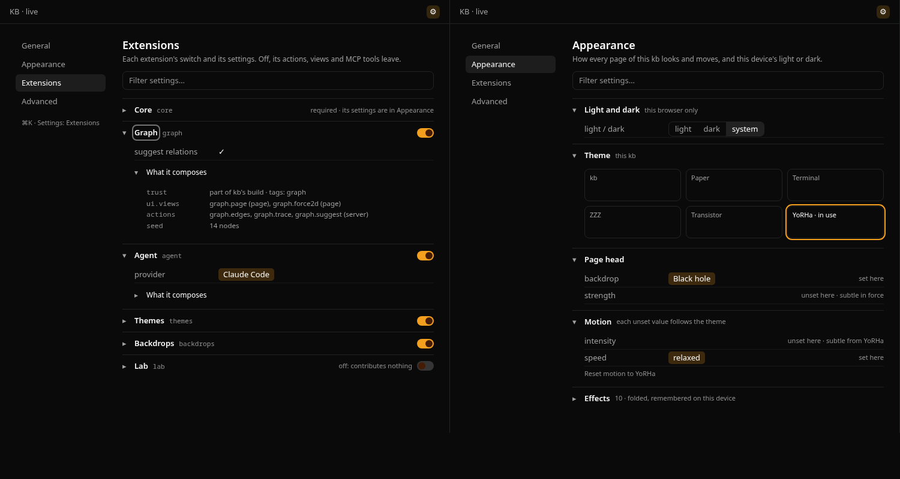

# Settings in parts, with Extensions folded in

Date: 2026-10-27. Branch `feat/settings-parts`, stacked on phase 3a (#44).
It revises the Settings page of
[the settings plan](2026-10-27-kb-settings-and-theme-plugins.md) (phase 2)
after the owner tried it, and reverses one of its decisions (below).

**The ask.** Sections that fold, remember whether they are open and toggle
from the keyboard; the Extensions page folded into Settings, each
extension switched on or off and its own settings drawn there through
phase 1's reader; the page in parts, *General*, *Appearance*,
*Extensions*, *Advanced*, each of folding sections; a filter across every
setting; ⌘K's names following, and the old routes sending a person to
the new place.

## Shape

([HTML](assets/2026-10-27-settings-parts-mock.html), painted by kb's
real design-system sheet.)

- **One page, four parts.** `/settings` is *General*;
  `/settings/appearance`, `/settings/extensions` and `/settings/advanced`
  are the others. A rail on the left names the parts, and the part is the
  path, so a part can be linked to, and back and forward move between
  parts. Under a narrow window the rail becomes a row of tabs above the
  page.
  - *General*: this device's width and sidebar, and any setting of core's
    no other part draws (so none is left off).
  - *Appearance*: light and dark (this device), the theme gallery, the
    page head, motion with the value in force and its source, the effects.
  - *Extensions*: one section per extension, its switch in its heading,
    then its settings, drawn by the one field editor as `settingsOf` reads
    them, then a fold *What it composes*: trust, tags, contributions,
    injects and provides, failures.
  - *Advanced*: the listeners asked in turn, the repository extensions
    refused, and how the CLI reaches the same settings.
- **A section is a fold.** Its heading is a button (`aria-expanded`), so
  Enter or Space toggles it from the keyboard and a screen reader says
  whether it is open. Which sections a person closed is this device's,
  kept with its other preferences (`kb-prefs`), so a reload keeps them.
- **The filter** sits above the parts. With text in it, the page shows
  every part's sections whose title, or any of whose rows, match, each
  part titled, the matching sections open whatever was remembered, and
  only the rows that match; Escape clears it.
- **⌘K.** *Settings* opens the page; *Extensions* becomes
  *Settings: Extensions* and opens that part. The seed's retirement table
  retires the old label, so an unedited store reads the new one.
- **Old routes redirect.** `/extensions` opens *Extensions* and
  `/preferences` opens *Appearance*, each replacing the path, so the
  address bar ends at the new place. The Extensions view key retires for
  Settings' in the seed's table, so a view node that named it opens
  Settings.

## The decision reversed

The plan kept each extension's switch on a separate Extensions page,
because switching is a load decision whose effect (its actions, views and
MCP tools leave) is what that page reported. The owner asked for one place.
The switch moves to the extension's section in Settings, the report moves
under it (its *What it composes* fold) and to *Advanced*, so the effect is
still read beside the switch. Nothing else in the model changes: the
switch is still `extension.switch`, the settings are still the fields
`settingsOf` reads, and the agent's switch is still writable only where a
host composes it.
