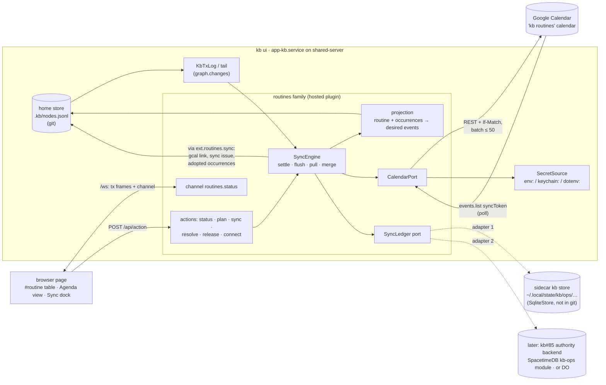
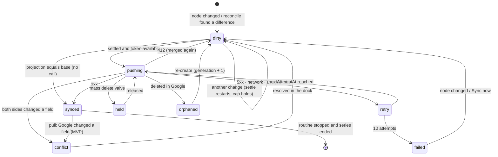

# kb routines → Google Calendar: model, sync scheme, operational store and secrets (design, for the owner to read)

Date: 2026-11-02. Base: `main` at `1740c95b`. This record designs; nothing in
it is built, and it files no gap nodes yet (§10 names them, to be filed when
the plan is approved). It builds on, and does not restate:

- [`2026-11-01-spacetimedb.md`](2026-11-01-spacetimedb.md) (kb#90): SpacetimeDB
  fits kb only as a `RemoteAuthority` adapter behind kb#85's `SyncAgent`
  (topology C), as an optional package so kb core stays MIT;
- [`2026-10-31-offline-first.md`](2026-10-31-offline-first.md) (kb#85) and
  [`2026-10-31-online-stores.md`](2026-10-31-online-stores.md) (kb#84): the
  `RemoteAuthority` port, `.kb/sync.json`, the Durable Object;
- TanaInt (`github.com/popemkt/TanaInt`, read at `1061ba5`), the Tana → Google
  Calendar sync this replaces.

Specs that own each mechanism used here: extensions, families, points and
trust — [DESIGN.md → Core boundary & extensions](../../DESIGN.md#core-boundary--extensions);
the `secret` field and `SecretSource` — [DESIGN.md → Data model](../../DESIGN.md#data-model--everything-is-a-node)
and [Agent packages](../../DESIGN.md#agent-packages); the tail, `graph.changes`
and `via` — [DESIGN.md → The transaction tail](../../DESIGN.md#the-transaction-tail--the-store-records-what-changed-in-order)
and [Action registry](../../DESIGN.md#action-registry); channels and hosted
actions — [DESIGN.md → Plugin channels](../../DESIGN.md#plugin-channels);
views and docks — [DESIGN-UI.md → UI points](../../DESIGN-UI.md#ui-points-routes-and-views)
and [Docks](../../DESIGN-UI.md#docks); the rules —
[AGENTS.md → Rule 1](../../AGENTS.md#rule-1--abstraction-before-addition).

The owner's ask, condensed: a kb plugin that syncs routines to Google Calendar,
like TanaInt; it lists the events, shows each event's status on Google, supports
RRULE and syncs as things change. *"Maybe periodically every minute idk, try to
think of a good debounce scheme."* kb holds master data, incubating master data
and knowledge-useful operational data; pure operational data may live outside
kb, behind a seam that lets it move.

"unv." marks a claim I could not verify against a primary source; §13 lists
them. Google facts are from developers.google.com (Calendar API reference,
quota, push and versioning guides), read on 2026-11-02.

## 0. Recommendation

1. **A routine is a node; Google holds a projection of it.** `#routine` nodes
   carry the rule (`rrule`, `starts`, `at`, `duration`, `timezone`) and point at
   a `#calendar` node. Each routine becomes **one recurring Google event** (a
   series with an RRULE), not TanaInt's single event that hops forward.
   Per-occurrence facts (done, skipped, moved) are `#occurrence` child nodes,
   made only when an occurrence is touched, and they become Google instance
   exceptions (§2).
2. **Push on change, pull on a timer.** kb → Google is change-driven, never
   polled: the engine reads kb's own transaction tail, waits for the routine to
   settle (**5 s quiet, 30 s cap**), and sends what is different from the last
   agreed state, in one batch. Google → kb is a cheap `syncToken` poll:
   **20 s while someone is looking, 60 s while kb is open, 5 min otherwise**.
   Google push channels are a later latency trim, not the base (§5).
3. **State-based, three-way, idempotent.** Each sync unit has a *base* (what kb
   and Google last agreed on). Changed on one side → apply it to the other;
   changed on both → a conflict a person resolves. Event ids are derived from
   the node id, so a retry or a second host can never make a duplicate, and
   updates carry `If-Match` so a concurrent Google edit is never overwritten
   blind (§5.4–5.8).
4. **kb is the master.** MVP pushes kb → Google and *reports* Google-side edits
   as conflicts without adopting them. Phase 2 adopts Google-side moves and
   skips of single occurrences, which are a person's real intent (§11).
5. **The loop is a hosted plugin inside `kb ui`**, the way the agent bridge is,
   and it runs on the host that already runs kb all day: `app-kb.service` on
   shared-server. Which host runs it is decided by **per-machine trust of the
   calendar binding** (`sandbox.trust`, the gesture agent providers use), not by
   a new switch (§4, §8).
6. **Operational state goes behind one port, `SyncLedger`**, with a shared
   contract suite. First adapter: a **machine-local sidecar kb store**
   (`SqliteStore`, never committed, browsable with `kb ui --root`). Later
   adapter: **wherever kb#85's authority lands** (SpacetimeDB topology C, or the
   Durable Object), so the owner never runs a database just for routines (§6).
7. **Only knowledge-useful outcomes enter the graph**: the event link (`gcal`)
   and a `sync issue` when a person must act. Etags, sync tokens, retry queues,
   leases and logs never touch `nodes.jsonl` (§3).
8. **Secrets never enter kb.** The `#google-account` node holds `secret`
   *references*; values live on the runner host in
   `~/.config/secrets/kb-routines.env` (0600), the same place as
   `cloudflare.env`, later rendered by sops-nix. Scope is
   **`calendar.app.created`**: kb may create its own calendar and touch only
   calendars it created (§7).
9. **The UI is mostly kb's own**: the `#routine` tag page's table is the list;
   an **Agenda** view (a projection over routines) shows occurrences with their
   Google status; a **Calendar sync** dock shows the engine, the queue, the
   conflicts and *Sync now*. Pause and dry-run are a field on the calendar
   node, not buttons with hidden state (§9).
10. **Three safety valves**: a new calendar starts in `preview` (dry run until
    you switch it on); a flush that would delete or end more than 5 series is
    held for a person; a Google-side delete is never silently re-created (§5.9).
11. **Two small core prerequisites** before P1: a `time` field type (kb's `date`
    holds a day only) and a `dotenv:` secret reference that the connect flow can
    write (§10).

## 1. What TanaInt does, and what to keep

TanaInt is a .NET Lambda that a Tana command calls with one task
(`TanaTaskDto`: name, url, date, `refString`, `doneTime`, `scheduled`).
`GCalService.SyncToEvent` inserts an event, or updates it when `refString`
already holds an event id, on one hard-coded group calendar, with scope
`CalendarEvents`, and returns `url, id` for Tana to store in an *Ext Ref* field.
A separate endpoint, `next-rrule-occurrence`, computes the next date of an
RRULE with Ical.Net, so a Tana routine is a task whose date jumps forward when
it is done. The title carries the state: `⚪` unscheduled, `📅` scheduled,
`✅` done.

| Keep | Fix |
|---|---|
| a dedicated calendar for routines | the calendar id is a constant in code → a `#calendar` node |
| least-ish scope (`calendar.events`) | narrower: `calendar.app.created` (§7) |
| state visible in Google (`✅` prefix) | kept for done occurrences; the rest is shown in kb |
| the event link stored back on the item | a `url` field, not a `"url, id"` string parsed by `Split(", ")` |
| "repeat after done" routines | kept, as `repeats from: completion` (§2.3) |
| | offset hard-coded `+07:00` → IANA zone per routine; Google expands DST (§5.7) |
| | push is fire-and-forget: a retry after a timeout inserts a duplicate → deterministic ids (§5.8) |
| | one event per routine hopping forward: the calendar shows no future → a real series |
| | no deletes, no Google → Tana path (the `gcal-to-tana` handler is a stub) |
| | credentials as files beside the code (`Files/credentials.json`, empty in git) → secret refs (§7) |

## 2. The model: routines as nodes

Everything is a node (AGENTS.md → Rule 1). The routines family seeds these
kinds and fields, the way the agent family seeds `#agent-provider`.

### 2.1 Kinds and fields

| Kind | Field | Type | Notes |
|---|---|---|---|
| `#routine` | *(node text)* | — | the event title |
| | `rrule` | text | RFC 5545 `RRULE` body, e.g. `FREQ=WEEKLY;BYDAY=MO,WE,FR`; empty = one-off |
| | `starts` | date | first occurrence (DTSTART's day) |
| | `at` | **time** (new, §10 G1) | wall-clock `07:30`; empty = all-day |
| | `duration` | number | minutes; default 30 (TanaInt's default) |
| | `timezone` | text | IANA name; empty = the calendar's |
| | `until` | date | optional end; becomes `UNTIL` |
| | `repeats from` | option | `schedule` (default) · `completion` |
| | `calendar` | ref → `#calendar` | where it syncs; empty = not synced |
| | `gcal` | url | written by sync: the event's link |
| | `sync issue` | option | written by sync: `conflict` · `deleted in Google` · `invalid rule` · `failed` · `held` |
| `#occurrence` (child of a routine) | `on` | date | the occurrence's original day (its identity) |
| | `state` | option | `done` · `skipped` · `moved` |
| | `moved to` | date + `at` | only when `moved` |
| `#calendar` | *(node text)* | — | display name |
| | `account` | ref → `#google-account` | |
| | `adapter` | option | `google` (later `caldav`) |
| | `calendar id` | text | Google's id; written by sync when kb creates the calendar |
| | `timezone` | text | default for its routines |
| | `sync` | option | `preview` (default) · `on` · `paused` |
| `#google-account` | `email` | text | |
| | `client id`, `client secret`, `refresh token` | secret | references only (§7) |

`state` is the routine family's own task model, chosen explicitly by tagging a
node `#routine`; it is not a universal "done" (AGENTS.md → kb is a graph of
everything).

### 2.2 Why a series and sparse occurrences

- A series shows the future in Google, which is what a calendar is for, and
  Google expands it (and its DST) itself.
- An occurrence node exists only when something happened to that day. A daily
  routine for a year is one node plus the handful of days you touched, not 365
  nodes. The completion history is those nodes: it is a fact about you, so it
  is master data and belongs in kb.
- One shape covers both directions: a skip in kb and a delete of one instance
  in Google are the same thing (a cancelled instance); a drag in Google and a
  `moved` occurrence in kb are the same thing (an instance exception keyed by
  its `originalStartTime`, which Google says "uniquely identifies the instance
  … even if the instance was moved").

### 2.3 Repeat after completion

`repeats from: completion` is TanaInt's model ("every 3 days after I last did
it"), which an RRULE cannot express. Such a routine is projected as **one
single event per due date**, not a series: when an occurrence is marked done,
the next due date is computed from the done day and the rule's interval, and a
new event is created for it. The done event stays, titled `✅`, so the past
stays in the calendar. Its event id includes the due date (§5.8).

### 2.4 RRULE scope

Supported: `FREQ=DAILY|WEEKLY|MONTHLY|YEARLY`, `INTERVAL`, `BYDAY`,
`BYMONTHDAY`, `BYMONTH`, `BYSETPOS`, `COUNT`, `UNTIL` (from the `until` field).
Refused with `sync issue: invalid rule`: sub-daily frequencies and `BYHOUR`
(an occurrence's identity is its local day, §5.7), and `RDATE`/`EXDATE` typed
by hand (exceptions are occurrence nodes). kb expands rules only for the
Agenda view and to key occurrences; Google's expansion is the calendar's. The
library is chosen in P1 through the supply-chain process (candidates: `rrule`,
`rrule-temporal`; unv. which keeps wall-clock time cleanly under Bun).

## 3. Data classification

| Data | Class | Lives in | Why |
|---|---|---|---|
| `#routine` nodes and their fields | master | kb (home store) | the person's intent |
| `#occurrence` nodes (done, skipped, moved) | master | kb | completion history is a fact worth querying |
| `#calendar`, `#google-account` nodes; their secret *refs* | master (configuration) | kb | which calendar, which account, where the key lives |
| A Google-side move or skip adopted into kb (P2) | incubating master | kb, as an `#occurrence` written by sync | intent captured elsewhere; it becomes master once in kb |
| Events on the calendar kb did not create ("foreign") | incubating | ledger, listed in the dock; adopting makes a `#routine` | not yours until you adopt it |
| `gcal` link on a routine | knowledge-useful operational | kb | you click it; written once, stable |
| `sync issue` on a routine or calendar | knowledge-useful operational | kb | a person must act; queryable ("routines that need me") |
| Conflict details (base, kb, Google values per field) | operational | ledger | needed only to resolve; the `sync issue` points at it |
| Event id ↔ node mapping | operational (derivable) | ledger (cache) | derivable from the node id (§5.8) |
| Base projection per sync unit, remote etag | operational | ledger | the three-way merge's base |
| `syncToken`, kb tail cursor (`rev`), last pull time | operational | ledger | resume points |
| Dirty set, attempts, next attempt time, last error | operational | ledger | the retry queue |
| Runner lease | operational | ledger | one runner per calendar |
| Sync log (bounded ring) | operational | ledger | debugging; not knowledge |
| Rate limiter, backoff timers, OAuth access token | ephemeral | memory | rebuilt on start |
| OAuth client secret, refresh token | secret | host secret store (§7) | never in kb, git or the ledger |

The line: **a value goes into kb when a person would want to read it next
month, or must act on it now.** Everything that changes on every poll stays
out, because in `nodes.jsonl` it would be a commit a minute and a merge
conflict between hosts.

## 4. Architecture



### 4.1 Packages

Following the agent family's split (a shared package, a backend adapter, a UI
half), under `packages/extension/`:

| Package | Scope | Holds |
|---|---|---|
| `@kb/routines` | shared | the seed (kinds, fields, options), the projection (pure), RRULE validation, the `CalendarPort` and `SyncLedger` ports with `calendarContract` and `ledgerContract`, the merge (pure: base, local, remote → plan), the view keys, `MemoryLedger`, a fake calendar |
| `@kb/routines-host` | backend | the hosted plugin: `SyncEngine`, `KbLedger`, the actions and the `routines.status` channel |
| `@kb/routines-gcal` | backend | the Google adapter of `CalendarPort` (fetch, OAuth refresh, batch); joins `calendarContract` against a fake Google server |
| `@kb/routines-ui` | browser | the Agenda view, the Calendar sync dock, the conflict card |
| `@kb/routines-ledger-stdb` (P3) | backend, optional | the SpacetimeDB `SyncLedger` adapter; depends on the BSL-licensed SDK, so it is optional or lives outside the repo, as kb#90 §11 Q2 decides for the authority |

It is an optional bundled family, off by default, whose seed sits in the
hosted fold (`HOSTED_FAMILIES`), as the agent's does. A repository extension
would work too, but the contract suites and the fake Google server belong in
the workspace, where `verify` runs them.

### 4.2 Where the loop runs

| Option | Verdict | Why |
|---|---|---|
| **Hosted plugin in `kb ui`** | **yes** | it already holds the graph, the tail, `changes`, the `/ws` hub and the action wires; its work hangs off the plugin's `Scope`, so switching the family off stops it; `app-kb.service` on shared-server runs all day with `Restart=on-failure` |
| A separate systemd unit (`kb routines run`) | no | a second process loading the whole graph, no channel to the page, and the same work as the plugin |
| A bb automation every minute | no | a process per minute, no memory between runs for settling, no live status; and the CLI reaches no hosted action |
| A cloud function (TanaInt's Lambda) | no | the graph is not there; it needs kb to call it, which is the coupling TanaInt had |

A hosted family's actions are reached only through `kb ui` (DESIGN.md → Plugin
channels → hosted actions), and so is its channel, which a registry family's is
not (GAP `01M579MHGHVT2FNGJJRK81J9GY`). That is why the family is hosted.

## 5. The sync algorithm

### 5.1 The sync unit

A **unit** is one Google event that kb owns, keyed by its event id:

| Unit | From | Google shape |
|---|---|---|
| series | a `#routine` with an `rrule`, `repeats from: schedule` | one recurring event |
| one-off | a `#routine` with no `rrule` | one single event |
| due | a `repeats from: completion` routine, per due date | one single event |
| exception | a `#occurrence` of a series routine | an instance of the series (`recurringEventId` + `originalStartTime`) |

The **projection** turns current kb state into the desired fields of each
unit. It is pure, so "what Google should hold" is a function of the graph, and
N edits in a row project to one answer.

Synced fields:

- **shared** (merged three ways, §5.4): title, start, end, time zone,
  recurrence, instance status (cancelled = skipped);
- **kb-owned** (overwritten without asking): description (a backlink to the
  node), `source` (`kb`, node url), `extendedProperties.private`
  (`kbNode`, `kbUnit`, `kbGen`), the `✅` prefix and colour of done instances.

### 5.2 kb → Google: change detection and the settle scheme

```mermaid
sequenceDiagram
  participant P as Person (any tab)
  participant S as kb store + tail
  participant E as SyncEngine
  participant L as SyncLedger
  participant G as Google
  P->>S: edit routine (many commits while typing)
  S-->>E: tx past cursor (≤ 1 s, store changes bound)
  E->>L: mark unit dirty (firstTouch, lastTouch); advance cursor
  Note over E: settle: due = min(lastTouch + 5 s, firstTouch + 30 s)
  E->>E: tick (1 s): take due units, project, drop no-ops
  E->>G: batch: insert(id) / update(If-Match etag) / delete
  G-->>E: new etags
  E->>L: base := pushed fields, etag := new, state synced
  E-->>P: channel routines.status (dock, Agenda badges)
```

1. **Read the tail, not the files.** The engine subscribes to the session's
   `KbTxLog` (what `graph.changes` serves) from a cursor `rev` kept in the
   ledger. A Mac's edit that arrives by `git pull` is in the tail too (the
   hand-edit fallback records it). Each transaction's written node ids map to
   units: the routine itself, an occurrence under it, its calendar or account.
2. **Mark, then advance.** Dirty marks are written to the ledger before the
   cursor moves, so a crash re-reads rather than forgets (at least once).
3. **Settle.** Per unit, a trailing debounce of **5 s** quiet with a **30 s**
   cap from the first touch. Typing a title is one push; a routine edited
   continuously still syncs every 30 s. Phase 2 adds a **focus hold**: while
   any tab's screen state has the routine focused, the quiet extends, still
   bounded by the cap.
4. **Flush.** A 1 s tick takes every due unit, projects it, and drops it when
   the projection's hash equals the base's (an edit and its undo cost
   nothing). The rest go in one batch request (≤ 50 calls), under the rate
   limiter (§5.9).
5. **Echo.** The engine's own writes into kb (the `gcal` link, a `sync issue`,
   adopted occurrences) carry `via: ext.routines.sync`; the tail reader skips
   them, and the hash check would make them no-ops anyway. Two locks, so no
   ping-pong.
6. **Sync now** (the dock, or the `ext.routines.sync` action) skips the settle
   for every dirty unit and pulls first.
7. **Reconcile on start**, and whenever `graph.changes` answers
   `complete: false` (the tail was compacted past the cursor): project every
   routine, compare with every base, mark differences dirty. A ledger unit
   whose node is gone is a delete (§5.5). This is also the answer to "what if
   the runner was down for a week".

Why not "every minute": a timer on the push side either sends stale state (an
edit waits up to a minute) or sends constantly (it has to diff everything to
know). The tail already says exactly what changed and when, so the push side
needs no timer at all beyond the settle.

### 5.3 Google → kb: polling with a sync token

`events.list(calendarId, syncToken, showDeleted=true)` returns only what
changed since the last call, exceptions and cancellations included, and costs
one request. A `410 Gone` means the token is invalid: do a full list and rebuild
the bases.

**Cadence (adaptive):**

| Situation (from the hub's screen state) | Poll every |
|---|---|
| a tab shows the Agenda view, the Sync dock or a `#routine` page | 20 s |
| any tab connected | 60 s |
| no tab connected | 5 min |
| after *Sync now* | immediately |
| daily at 04:00 in the calendar's zone | a full list without the token (drift check) |

At 60 s that is 1,440 requests a day, against 600 per minute per user and
1,000,000 per day per project (Google's quota guide). So the owner's "every
minute" is right for the pull side.

**Echo:** a pulled event whose etag equals the ledger's is our own write; skip it.

**Why not push notifications now.** `events.watch` needs a public HTTPS
address with a valid certificate; `kb ui` binds 127.0.0.1 behind the tailnet.
A notification carries no body ("you must make another API call"), channels
expire and must be renewed by hand, and Google says notifications "aren't 100%
reliable, so your application should still sync without them". So the poll is
needed anyway; push only shortens the delay. P3 can add it through Tailscale
Funnel or the kb#84 Durable Object as a receiver whose only job is "poll now".

### 5.4 Three-way merge and conflicts

For each unit with something new on either side:

```
B = ledger base (fields last agreed), L = projection now, R = Google now
per shared field f:
  L.f = B.f, R.f = B.f   → nothing
  L.f ≠ B.f, R.f = B.f   → push L.f
  L.f = B.f, R.f ≠ B.f   → MVP: conflict (report)     P2: adopt R.f into kb
  L.f ≠ B.f, R.f ≠ B.f   → equal? settle silently : conflict
kb-owned fields          → push L.f
after success            → B := merged, etag := Google's
```

Updates send `If-Match: <etag>`. A `412 Precondition failed` means Google
changed since the base: fetch, merge again, retry. So a Google edit that lands
between our read and our write is never lost.

What "adopt" writes in P2:

| Google-side change | Written into kb |
|---|---|
| one instance dragged | `#occurrence` `state: moved`, `moved to` |
| one instance deleted | `#occurrence` `state: skipped` |
| series title, time or duration changed | the routine's text, `at`, `duration` |
| series recurrence changed | conflict always (an RRULE is too easy to break by a click in Google) |
| "this and following" edit (Google splits the series into two events) | conflict `series split`; the dock offers "take the new rule" or "revert" (unv. whether the new event keeps our private properties, which is how we would recognise it) |

A conflict leaves both sides as they are, sets `sync issue: conflict` on the
routine, and keeps base, kb and Google values in the ledger for the conflict
card (§9.4). Fields of the same unit that do not conflict still sync.

### 5.5 Deletes

| Event | Default |
|---|---|
| a `#routine` node deleted in kb, its `#routine` tag removed, or its `calendar` cleared | **end the series**: set `UNTIL` to yesterday, so the past stays in the calendar; the dock lists it as "ended" with *Delete from Google too* |
| a one-off or due event whose routine is deleted | delete it if it is in the future; keep it if past |
| an `#occurrence` deleted | its exception is removed (the instance returns to the rule) |
| the series or event deleted in Google | **not re-created**: `sync issue: deleted in Google`; the person chooses *Re-create* (a new generation, §5.8) or *Stop the routine* |
| one instance deleted in Google | a skip (P2 adopts it; MVP reports it) |

The asymmetry is deliberate: re-creating what someone deleted in Google, on a
timer, is the classic zombie-event bug.

### 5.6 RRULE exceptions

kb never writes `EXDATE` lines. A skip is a cancelled instance and a move is a
modified instance, which is exactly what Google itself writes when a person
deletes or drags one instance, so both directions use one representation.

When a series' time, zone or rule changes, Google may drop or orphan existing
exceptions (unv. which, per case). The engine therefore re-applies every
`#occurrence` inside the window `[today − 30 d, today + 400 d]` after a series
update; it is idempotent because each exception has its own base. Occurrences
outside the window are history and are not pushed.

The instance to patch is found with `events.instances` over its original day,
not by building Google's instance id by hand (its format is undocumented; unv.).

### 5.7 Time zones and DST

- A timed routine stores **wall-clock time plus an IANA zone**. The engine
  sends `start.dateTime` as local time without an offset and `start.timeZone`
  (Google requires the zone on recurring events: "specifies the time zone in
  which the recurrence is expanded"). It never converts a series to UTC, so
  "07:30" stays 07:30 across a DST change, which Google handles.
- An all-day routine sends `date` and no zone.
- `UNTIL` is sent in UTC for timed series, as RFC 5545 requires when DTSTART
  has a zone; the projection converts the `until` day's end in the routine's
  zone.
- An occurrence's identity is its **local day** in the series' zone (`on`),
  which is why sub-daily rules are refused. Changing a routine's zone rewrites
  the series and keeps its occurrences, since their days do not change.
- A wall time that does not exist on a spring-forward day is Google's to
  resolve; the Agenda shows Google's instance once pulled (unv. how Google
  shifts it).
- The default zone is the calendar's; TanaInt's `+07:00` suggests
  `Asia/Ho_Chi_Minh` (open question 4).

### 5.8 Idempotency

- **Deterministic event ids.** Google accepts a client-chosen id of 5–1024
  base32hex characters (`a–v`, `0–9`), unique per calendar, and an insert with
  an id that exists fails instead of duplicating. The engine uses
  `"kb" + base32hex(sha256(calendarNodeId ‖ routineId ‖ unit ‖ generation))`,
  32 characters, where `unit` is `series` or the due date. A retry after a
  timeout, a crash between send and ledger write, or a second host all produce
  the same id; a `409` means "already there": fetch it, adopt it as the base,
  merge.
- **Generation.** Starts at 0; bumped only by *Re-create* after a Google-side
  delete, because a deleted event keeps its id (unv. whether Google ever lets a
  deleted id be inserted again; the generation makes the question moot).
- **The mapping is derivable**, so losing the ledger loses no event: a full
  list plus `extendedProperties.private.kbNode` rebuilds it, and every base
  becomes "Google's current state", which at worst re-pushes kb's values once.
- **Conditional updates** (`If-Match`) make an update idempotent against a
  changed remote (§5.4).

### 5.9 Retries, backoff, rate limits, valves

| Response | Action |
|---|---|
| `401` | refresh the access token once, retry |
| `invalid_grant` on refresh, or `403` insufficient scope | engine state `auth needed`; `sync issue` on the `#google-account`; the dock shows *Reconnect*; nothing else retries |
| `403`/`429` with reason `usageLimits` | pause the whole limiter: `min(2^n s + jitter ≤ 1 s, 64 s)` (Google's truncated exponential backoff), honour `Retry-After` |
| `409` on insert | adopt (§5.8) |
| `412` on update | fetch, merge, retry once immediately |
| `404`/`410` on update or delete | deleted in Google (§5.5) |
| `410` on list with a sync token | full list |
| `400` | permanent for this unit: `sync issue: invalid rule` (or the field Google names); no retry until the node changes |
| `5xx`, network error, offline | per-unit backoff with full jitter: 2 s, 4 s … capped at 15 min; after 10 attempts `sync issue: failed` and the unit waits for the node to change or *Sync now* |

- **Limiter:** a token bucket of 5 requests/s, burst 20, well under 600 per
  minute per user. A batch spends one token per call inside it.
- **Retry queue** is the ledger's units in state `retry` with
  `nextAttemptAt`; it survives restarts.
- **Valves:** (1) a new `#calendar` starts with `sync: preview` and only
  computes the plan; (2) a flush that would delete or end more than 5 series,
  or more than 20 % of the calendar's units, is held (`sync issue: held` on the
  calendar) until *Release* in the dock — a bad merge of `nodes.jsonl` or a kb
  bug must not empty a calendar; (3) Google-side deletes are never re-created
  without a person (§5.5).

### 5.10 A unit's states



## 6. Operational state: the `SyncLedger` port

### 6.1 The port

The guarantee belongs to the concept, not to a backend (AGENTS.md → One
contract, every implementation). In outline:

```ts
interface SyncLedger {
  // one record per sync unit, versioned; put refuses a stale version
  unit:   { get(key); put(rec, expectedVersion); due(now, limit); byRoutine(id); all(calendar) }
  cursor: { get(name); set(name, value) }          // syncToken, tail rev, last full list
  lease:  { acquire(name, holder, ttl); renew; release }  // one runner per calendar
  log:    { append(entry); tail(n) }                // bounded ring, 2,000 entries
  changes: Stream<Fingerprint>                      // armed, then news; the dock listens
}
```

A unit record: key (event id), kind, routine id, occurrence day, calendar,
generation, base fields, base hash, etag, state, `dirtySince`, `lastTouch`,
attempts, `nextAttemptAt`, last error (status and code, never a body),
conflict values, version.

`ledgerContract` (in `@kb/routines`) runs over every adapter: a stale `put` is
refused; `due` answers in `nextAttemptAt` order; a lease is exclusive until it
expires; a cursor survives close and reopen; the log stays bounded; `changes`
is armed, then news, as `EffectStore.changes` promises. A new adapter joins the
suite; a guarantee one adapter breaks turns it red.

`SyncLedger` is named for what it is, an outbound integration's memory, not for
Google. If a second integration (GitHub issues, say) arrives, it moves to a
contract package rather than gaining a twin.

### 6.2 Backend options

| Backend | Fits | For | Against | Verdict |
|---|---|---|---|---|
| **kb home store** (records as nodes in `nodes.jsonl`) | port: yes | zero infrastructure; visible in the outline | a commit per poll (sync tokens change every call), merge noise between hosts, operational data mixed into master data | **no** — only the knowledge-useful bits (§3) |
| **kb sidecar store**: a separate kb root at `$XDG_STATE_HOME/kb/ops/<home-store-id>/`, `SqliteStore`, never committed | port: yes, through `EffectStore` (CAS by version field, `changes` for free) | no new dependency; one atomic writer; still kb, so `kb ui --root …/ops/…` browses the ledger in the outliner; backed up with the home directory | per host: no shared lease, a Mac's `kb ui` cannot see shared-server's ledger | **adapter 1 (MVP)** |
| plain SQLite / libSQL tables | yes | fastest, simplest | a second storage mechanism beside `SqliteStore` for no gain; libSQL's replication adds a hosted service | no (Rule 1: kb already has a SQLite store) |
| **SpacetimeDB** (`kb-ops` module beside kb#90's `kb-authority`) | yes: `put` and `lease.acquire` are reducers (serial, so CAS needs no lock); `changes` is a subscription | the owner already runs it (`app-axioms-db`); live status to every device; a real cross-host lease; small data, so RAM is no concern | BSL; one more module to publish; tailnet only | **adapter 2, if kb#85 picks topology C** — optional package, as kb#90 says |
| Cloudflare Durable Object | yes | reachable from anywhere; alarms; can be the public receiver for Google push (§5.3) | a Cloudflare account; the data leaves the tailnet | **adapter 2, if kb#85 picks the DO** |
| Postgres | yes | familiar | another daemon to run and back up; no push | no |

**Recommendation: the ledger follows the authority.** Ship the sidecar kb store
now. A remote adapter is worth having only when a second device needs the live
status or a second runner exists, and that happens exactly when kb#85 makes
devices local-first. At that point the remote ledger goes on whichever backend
kb#85's `RemoteAuthority` uses, so the owner runs one system, not two. Moving is
a config change plus a one-off copy (or not even that: §5.8 rebuilds the ledger
from Google).

## 7. Secrets

### 7.1 What there is

| Secret | Per | Lifetime |
|---|---|---|
| OAuth client id and secret (a *Desktop app* client in the owner's own Google Cloud project) | person (one project can serve many hosts) | until rotated |
| Refresh token | person × Google account | until revoked, unused for ~6 months, or the password changes |
| Access token | process | ~1 h; memory only |

### 7.2 Where they live

- **In kb:** the `#google-account` node's `secret` fields hold references
  (`env:KB_ROUTINES_REFRESH_TOKEN`, `keychain:kb-routines/<email>`). kb's write
  check refuses a pasted key, so a token cannot reach `nodes.jsonl`
  (DESIGN.md → A written value conforms).
- **On shared-server:** `~/.config/secrets/kb-routines.env`, mode 0600, owned
  by the person's Unix user, the convention `cloudflare.env` already follows.
  `app-kb.service` gains `EnvironmentFile=-%h/.config/secrets/kb-routines.env`
  in the dotfiles. When the dotfiles move to sops-nix (their server plan), the
  same file is rendered from ciphertext and nothing in kb changes.
- **On a Mac:** the login keychain, through the existing `keychain:` reference.
- **Never:** in `nodes.jsonl`, the ledger, the sync log, a `via`, a channel
  frame, the page, or an error message (status and code only), the rule agent
  credentials already follow (DESIGN.md → Agent packages).
- **Per person:** `app-kb-bytetum.service` runs as its own user with its own
  store and its own secrets file, so another person connects their own account
  and nothing is shared.

### 7.3 Scope: least privilege

Use **`https://www.googleapis.com/auth/calendar.app.created`**: "create
secondary calendars and manage events on them", only the calendars this client
created. kb creates a "kb routines" calendar on first connect and writes its id
to the `#calendar` node; it cannot read or change the primary calendar or any
other. The cost: it cannot take over TanaInt's existing calendar, which another
client created (open question 3). The fallback, if syncing into an existing
calendar is required, is `calendar.events.owned` (events on calendars you own),
still narrower than TanaInt's `calendar.events` (all calendars).

### 7.4 Connect, trust, rotation

- **Publish the consent screen "In production".** In *Testing*, Google refresh
  tokens expire after 7 days. An unverified app in production shows a warning
  once and works for the owner's own account. Re-consent after publishing so
  the token is a production one.
- **Connect** is `ext.routines.connect` on the runner host: PKCE with a one-shot
  loopback listener on `127.0.0.1`. The dock shows the URL; when the browser is
  on another machine, the person pastes the redirect URL (it carries the code)
  back into the dock. The refresh token is written to the place the binding's
  reference names, which needs a writable `dotenv:` reference (§10 G2).
- **Trust.** The binding (adapter, account email, calendar id, the secret
  references) is trusted per machine by its digest through `sandbox.trust`, as
  an agent provider's is. The engine runs a calendar only where its binding is
  trusted. That is the per-host switch (shared-server: trusted; Macs: not), and
  it means a cloned store that points someone's reference at another endpoint
  never sends a key.
- **Rotation.** Client secret: add a new one in the Cloud console, update the
  file, restart `app-kb`, delete the old one (unv. that two can be active at
  once). Refresh token: *Reconnect*; the old one is revoked. Compromise: revoke
  the app at myaccount.google.com → the engine sees `invalid_grant` → `auth
  needed`; nothing retries in a loop.

## 8. Multi-host and multi-person

- **Today** (git-synced kb, one `kb ui` per host): the owner's devices use
  shared-server's `kb ui` over the tailnet, and edits on a Mac's own clone reach
  shared-server by git. One runner, on the host whose binding is trusted.
- **A second trusted runner** by mistake: deterministic ids stop duplicate
  inserts and `If-Match` serialises updates, so the worst case is wasted calls
  and a log line. With the sidecar ledger the lease is per host, so it does not
  prevent this; the dock warns when it sees events written by another
  `kbRunner` private property.
- **A Mac's own `kb ui`** shows "sync runs on shared-server" (the binding is
  untrusted here) and the last state it can derive from the graph: the `gcal`
  links and any `sync issue`. Live queue state needs the remote ledger (P3).
- **After kb#85**: every device is a full local kb, and the remote ledger on
  the authority's backend gives every device the live status and a real lease.

## 9. UX

### 9.1 The list: the `#routine` tag page (no new UI)

```
 #routine                                                   ⚙ table · 6 rows
┌─────────────────┬────────────────────────┬────────┬───────┬─────┬────────┬───────────┬──────────────┐
│ Routine         │ rrule                  │ starts │ at    │ min │ cal    │ gcal      │ sync issue   │
├─────────────────┼────────────────────────┼────────┼───────┼─────┼────────┼───────────┼──────────────┤
│ Morning run     │ FREQ=DAILY             │ Nov 1  │ 06:00 │  45 │ Habits │ ↗ open    │              │
│ Weekly review   │ FREQ=WEEKLY;BYDAY=SU   │ Nov 2  │ 20:00 │  60 │ Habits │ ↗ open    │ ⚠ conflict   │
│ Pay rent        │ FREQ=MONTHLY;BYMONTHD… │ Nov 5  │       │     │ Habits │ ↗ open    │              │
│ Water plants    │ FREQ=DAILY;INTERVAL=3  │ Nov 2  │ 08:00 │  10 │ Habits │ ↗ open    │              │
│ Dentist         │                        │ Nov 14 │ 15:30 │  60 │ Habits │ ↗ open    │              │
│ Stretch         │ FREQ=HOURLY            │ Nov 2  │ 10:00 │   5 │ Habits │           │ ✕ invalid r… │
└─────────────────┴────────────────────────┴────────┴───────┴─────┴────────┴───────────┴──────────────┘
```

Editing here is editing nodes. A saved query, "routines that need me"
(`#routine` with a `sync issue`), is ordinary data.

### 9.2 Agenda view (a projection over routines)

A page view (`routines.agenda`, a view node option like any other) that
expands the rules over a window and overlays each unit's status from the
`routines.status` channel. Clicking an occurrence offers done, skip and move,
which write `#occurrence` nodes.

```
 Agenda · Habits                         ◀ this week ▶        Google: ● synced 12 s ago
 ─────────────────────────────────────────────────────────────────────────────────
 Sun 2 Nov   06:00  Morning run       ✅ done      ✓ on Google
             08:00  Water plants      ○ planned    ✓
             20:00  Weekly review     ○ planned    ⚠ conflict — time changed in Google
 Mon 3 Nov   06:00  Morning run       ○ planned    ◷ syncing in 4 s
 Tue 4 Nov   06:00  Morning run       ⤳ moved 07:00 ✓
 Wed 5 Nov   06:00  Morning run       ⊘ skipped    ✓
             all day Pay rent          ○ planned    ✓
 ─────────────────────────────────────────────────────────────────────────────────
 legend  ✓ on Google · ◷ waiting to settle · ↻ retrying · ⚠ needs you · ✕ failed
```

### 9.3 The Calendar sync dock

A `DockPoint` contribution, fed by the channel; its buttons call the actions.

```
 ┌ Calendar sync ──────────────────────────────── ✕ ┐
 │ Habits → Google "kb routines"                     │
 │ ● running on shared-server · sync: on  [Pause]    │
 │ last push 12 s ago · last pull 41 s ago           │
 │ [ Sync now ]                                      │
 │                                                   │
 │ Waiting (2)                                       │
 │   Morning run     settle 4 s                      │
 │   Water plants    retry in 1 m 20 s (503)         │
 │ Needs you (2)                                     │
 │   ⚠ Weekly review   time changed in Google  [Open]│
 │   ✕ Stretch         FREQ=HOURLY not supported     │
 │ Not from kb (1)                                   │
 │   "Call mom" Sun 18:00               [Adopt] (P2) │
 │                                                   │
 │ Log ▸                                             │
 └───────────────────────────────────────────────────┘
```

*Pause* writes `sync: paused` on the `#calendar` node: a setting is a field,
so it persists, syncs across hosts, and shows in the outline. The same field's
`preview` value is the dry run.

### 9.4 The conflict card

```
 ┌ Weekly review — changed on both sides ────────────────────────┐
 │ field      was (base)   kb now       Google now     keep      │
 │ title      Weekly rev…  Weekly rev…  Weekly review  —         │
 │ at         20:00        20:00        19:00          ○ kb ● G  │
 │ duration   60           90           60             ● kb ○ G  │
 │                                                               │
 │ [ Apply ]   [ Keep kb for all ]   [ Take Google for all ]     │
 └───────────────────────────────────────────────────────────────┘
```

*Apply* calls `ext.routines.resolve`: the kept Google values are written into
the routine (via `ext.routines.sync`), the kept kb values are pushed, and the
base becomes the result.

### 9.5 First sync (preview)

```
 ┌ Habits — preview (sync: preview) ─────────────────────────────┐
 │ Google calendar "kb routines" will get:                       │
 │   + 5 series   + 1 one-off   0 changes   0 deletes            │
 │   ✕ 1 routine skipped: Stretch (FREQ=HOURLY)                  │
 │ [ Switch sync on ]                                            │
 └───────────────────────────────────────────────────────────────┘
```

The plan is `ext.routines.plan`, a read action, so an agent can show it too.

### 9.6 Actions

All hosted, so reached through `kb ui`'s wires, listed in `kb.manifest`, and
decided by the guards like any other: `ext.routines.status` (read),
`ext.routines.plan` (read), `ext.routines.sync` (write: sync now, all or one
routine), `ext.routines.resolve`, `ext.routines.release` (held deletes),
`ext.routines.recreate` (after a Google-side delete), `ext.routines.connect`,
and in P2 `ext.routines.adopt` (a foreign event → a `#routine`).

## 10. Gaps: what kb lacks

| Id | Gap | Close | When |
|---|---|---|---|
| G1 | **No time-of-day field type.** `date` holds a local day only (`field-type.ts`); a routine needs `07:30`. A text field validated by the plugin would be a parallel type system (Rule 1). | a core `time` type: local wall clock `HH:MM`, value kind `str`, the `date` type's twin (parse, editor, `acceptsValueKind`) | P0 |
| G2 | **Secret references cannot be written, and `env:` needs a restart.** `SecretSource` reads `env:` and `keychain:`; a headless Linux host has no secret service, and the connect flow must store a refresh token somewhere. | a `dotenv:<path>#<KEY>` reference, read at use (so a rotated value is picked up live) and writable only by an action whose binding is trusted, only to the file it names; sops-nix renders the same shape | P0 |
| G3 | **Outline columns show fields only.** The live status (settling, retrying) cannot be a column of the `#routine` table without writing it into the graph. | a family-supplied, never-committed column value (an "ephemeral field"); would also serve CI or PR status. Until then: the Agenda view and the dock | P3, if wanted |
| G4 | **No notion of which host runs a background job.** | per-machine trust of the binding as the switch, plus the ledger's lease; a general job-runner concept only if a second background family needs one | named, not built |
| — | Registry-family channels are not served (existing GAP `01M579MHGHVT2FNGJJRK81J9GY`) | the family is hosted, so it does not hit it | — |

## 11. Phased plan

**P0 — core prerequisites** (separate PRs, each with its tests): G1 `time`
field type; G2 `dotenv:` references.

**P1 — MVP: kb → Google, honest status.**

- `@kb/routines`: seed, projection, RRULE validation, the two ports and their
  contracts, `MemoryLedger`, fake calendar.
- `@kb/routines-gcal`: Google adapter (insert with id, update with `If-Match`,
  delete, instances, list with `syncToken`, batch), OAuth refresh, joins
  `calendarContract` against a fake Google server.
- `@kb/routines-host`: engine (tail reader, settle, flush, limiter, retries,
  reconcile), `KbLedger` (sidecar store), actions, channel.
- Series, one-offs, all-day and timed, zones; done and skipped occurrences
  pushed (`✅`, cancelled instance); deletes end the series; pull detects
  Google-side edits and deletes and **reports** them as conflicts.
- `@kb/routines-ui`: dock (status, Sync now, Pause, preview, release, connect)
  and the `#routine` table conventions.
- dotfiles: `EnvironmentFile` on `app-kb.service`.
- **Exit test:** a routine made in a browser tab is in Google within 10 s; 20
  edits in 10 s cost at most 2 writes; killing `kb ui` mid-push makes no
  duplicate; revoking the app shows *Reconnect* and stops retries; an hour
  offline catches up on its own; deleting all routines in one commit is held.

**P2 — two-way and the Agenda.** Adopt Google-side instance moves and skips and
series title/time/duration; the conflict card; the Agenda view; `repeats from:
completion`; focus hold; foreign events and *Adopt*.

**P3 — movable ops and latency.** The remote `SyncLedger` adapter on kb#85's
authority backend, with a real lease; Google push through Tailscale Funnel or
the DO as a "poll now" hint; G3 if wanted; a CalDAV adapter of `CalendarPort`.

## 12. Open questions (with my default)

1. **Two-way, or kb → Google only?** Default: P1 one-way with Google-side edits
   reported; P2 adopts single-occurrence moves and skips and series
   title/time/duration; recurrence edits in Google stay conflicts.
2. **Deleting a routine node: end the series or delete it?** Default: end it
   (`UNTIL` yesterday), keeping the past in Google; *Delete from Google too* in
   the dock.
3. **A fresh calendar, or reuse TanaInt's?** Default: fresh "kb routines"
   calendar under `calendar.app.created`; TanaInt's calendar is left as an
   archive, nothing imported. Reuse would need `calendar.events.owned`.
4. **Default time zone, and travel?** Default: `Asia/Ho_Chi_Minh` on the
   calendar node, overridable per routine. Google has no floating time, so
   "07:00 wherever I am" is not offered; say if you need it.
5. **Which host runs the sync?** Default: shared-server's `app-kb.service`
   only; Macs never trust the binding.
6. **Operational store.** Default: sidecar kb store now; remote adapter on the
   same backend kb#85 picks, only in P3.
7. **"Repeat after done" routines in the MVP?** Default: P2; P1 covers
   schedule-based rules, which most routines are.
8. **How should state look in Google?** Default: `✅` prefix and graphite
   colour on done instances, skipped instances removed, nothing on planned
   ones (TanaInt's `⚪`/`📅` dropped: kb shows that).
9. **Reminders.** Default: the calendar's default reminders on series; none on
   done instances (TanaInt cleared them too).
10. **OAuth app.** Default: your own Google Cloud project, *Desktop app* client,
    consent screen published "In production", unverified.
11. **Other people (bytetum).** Default: the family works per store; each person
    connects their own account on their own service; nothing shared.
12. **Pull cadence.** Default: 20 s / 60 s / 5 min as in §5.3; push
    notifications only in P3.

## 13. What I could not verify (unv.)

- Whether Google lets an insert reuse the id of a deleted event (the
  generation makes it moot).
- How Google treats existing exceptions when a series' time or rule changes.
- Whether a "this and following" split copies private extended properties to
  the new event.
- The format of Google's instance ids (we look instances up instead).
- How Google places a wall time that does not exist on a DST day.
- Whether two OAuth client secrets can be active at once during rotation.
- The maximum expiry of an events watch channel.
- Which RRULE library keeps wall-clock time cleanly under Bun.

## Sources

- TanaInt, `github.com/popemkt/TanaInt` at `1061ba5`: `GCalService.cs`,
  `TanaTaskDto.cs`, `CalendarHelperService.cs`, `TanaInt.Sam/Functions.cs`,
  `Files/tana-template.json`.
- Google Calendar API: [scopes](https://developers.google.com/workspace/calendar/api/auth),
  [events resource](https://developers.google.com/workspace/calendar/api/v3/reference/events)
  (ids, `recurrence`, `originalStartTime`, `extendedProperties`, `timeZone`),
  [quotas](https://developers.google.com/workspace/calendar/api/guides/quota),
  [push notifications](https://developers.google.com/workspace/calendar/api/guides/push),
  [ETags and conditional modification](https://developers.google.com/workspace/calendar/api/guides/version-resources).
- Refresh tokens expiring after 7 days in *Testing*:
  [Google Ads API common errors](https://developers.google.com/google-ads/api/docs/get-started/common-errors).
- kb: `DESIGN.md`, `DESIGN-UI.md`, `AGENTS.md` at `1740c95b`; kb#84, kb#85,
  kb#90 records linked above.
- Host: `systemctl cat app-kb.service` on shared-server; dotfiles
  `configs/specs/app-service-contract.md` and
  `docs/shared-nixos-server-plan.md` (sops-nix plan).
