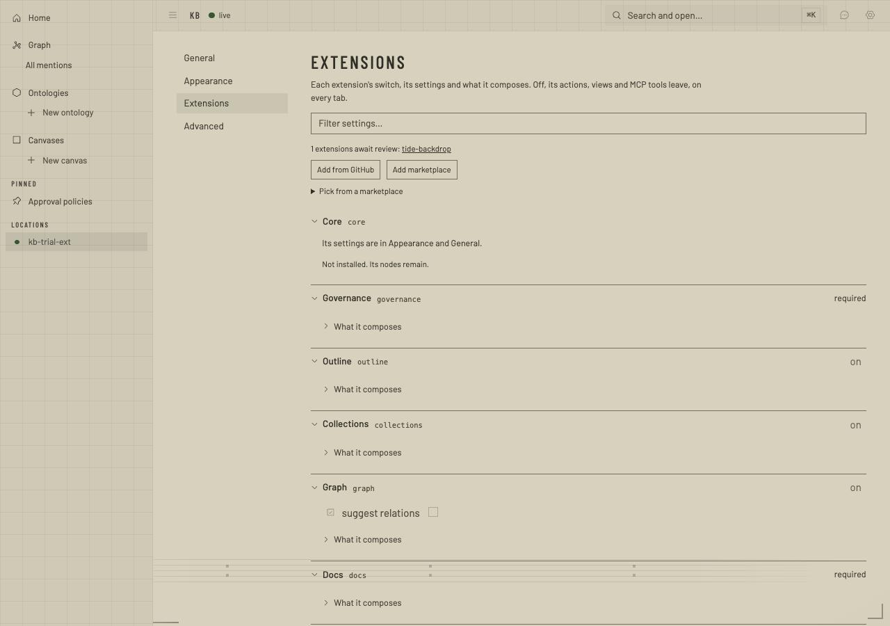
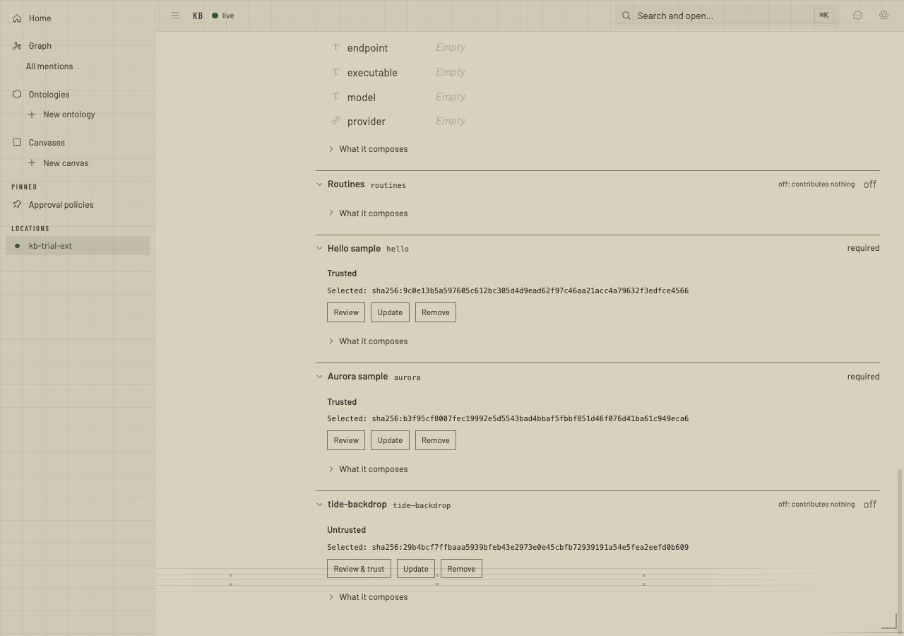
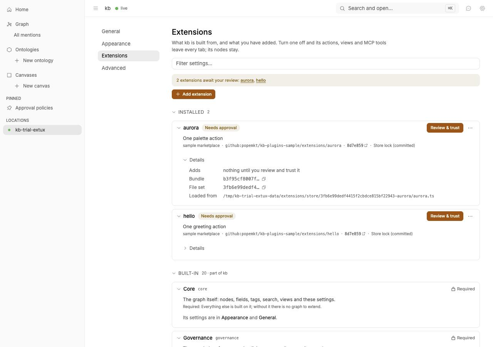
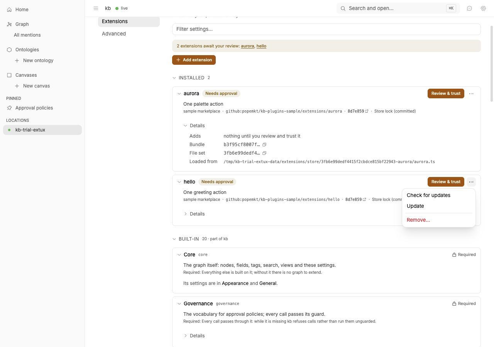
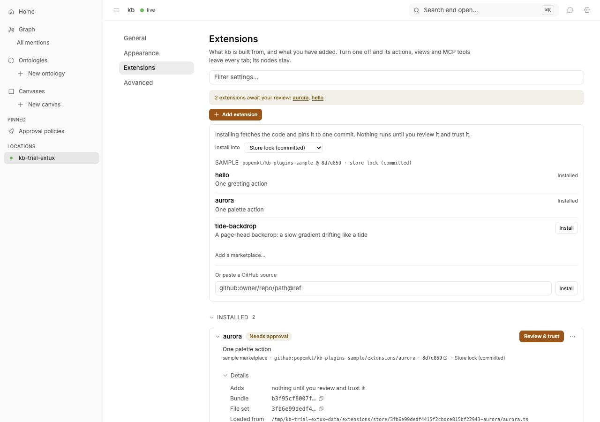
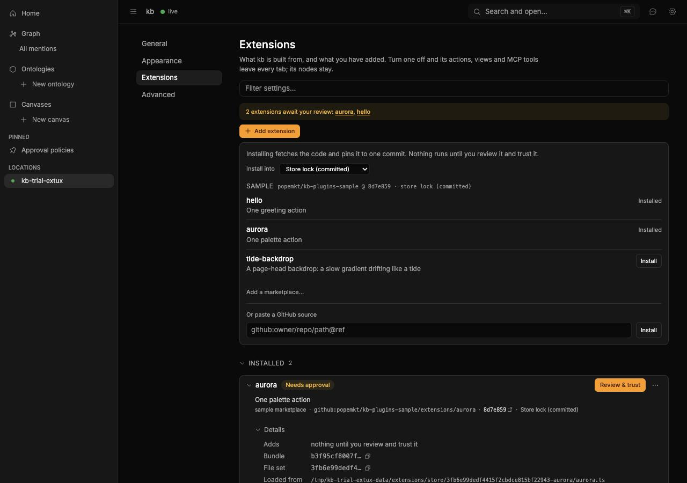
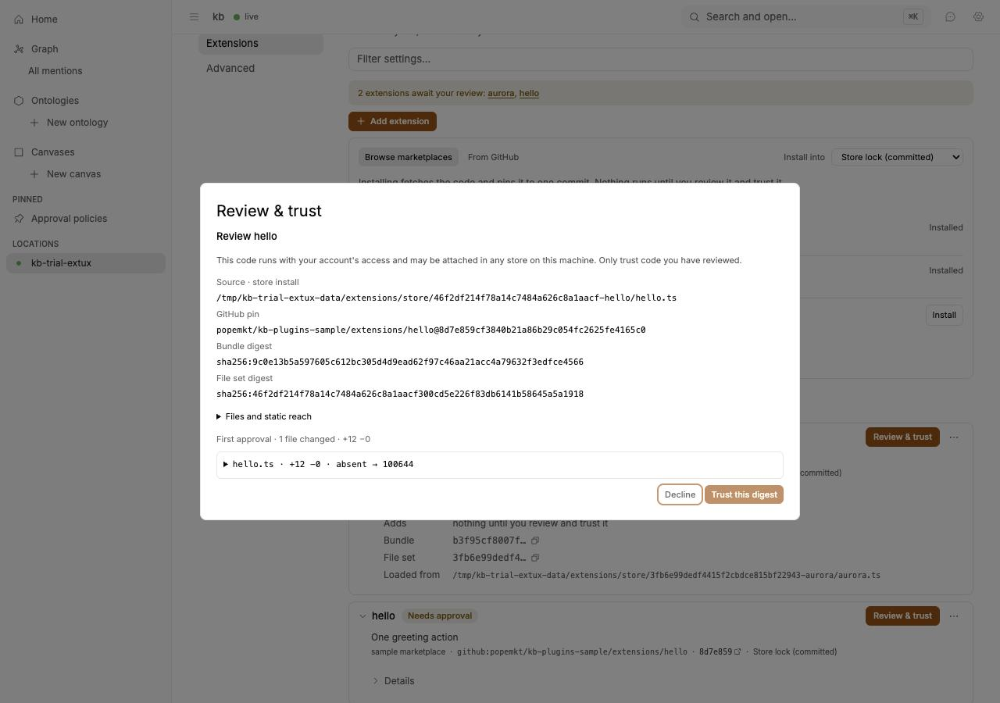
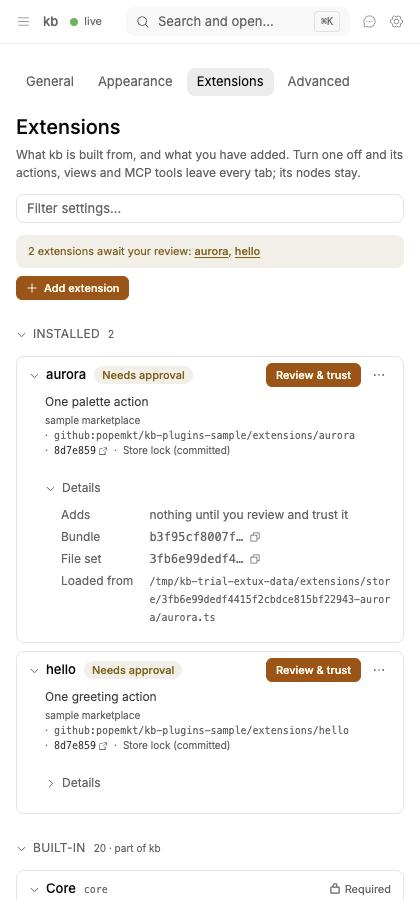
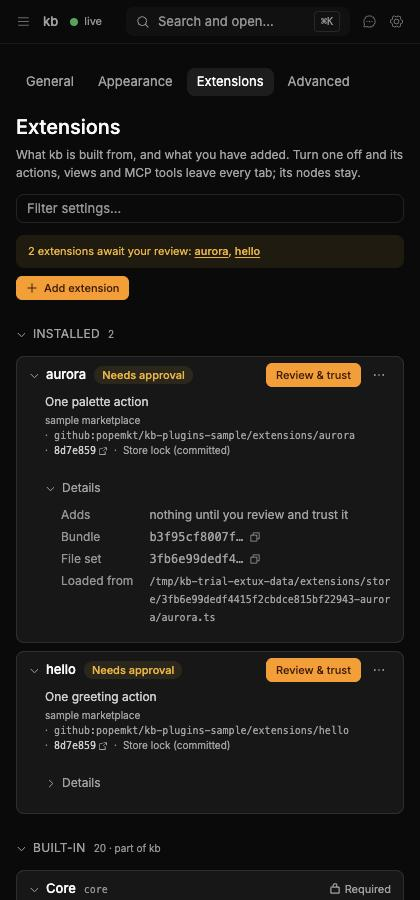

# Extension management UX pass — 2026-11-08

What Settings → Extensions became on top of #125, the trial it was checked
in, and a recommendation on which bundled families could become installable
first-party extensions. The specification is DESIGN-UI.md → Settings →
Extensions. This record holds the evidence and the recommendation, not the
rules.

## Trial

https://shared-server.taild98079.ts.net:10011/settings/extensions

The trial server runs this branch against `~/Projects/kb-trial-extux`, with
`KB_HOME=/tmp/kb-trial-extux-home`, `KB_DATA=/tmp/kb-trial-extux-data` and
`KB_CACHE=/tmp/kb-trial-extux-cache`. The sample marketplace
(`popemkt/kb-plugins-sample`) is already added, and `hello` and `aurora` are
installed into the store lock but not trusted. The owner can review and
trust them from their cards, or install `tide-backdrop` from Add extension.

The screenshots were taken in the BB desktop browser on popemkt-personal,
in one tab that was closed after capture. They show only the trial store.

## Before (#125's head)

| Top | Installed rows |
| --- | --- |
|  |  |

These are the problems the pass fixes:
- Installed extensions read _required_.
- Core read _Not installed. Its nodes remain._
- Every row led with a 64-hex digest, and the store path sat under _What it composes_.
- Adding an extension meant choosing between two bare inputs.

## After

| | |
| --- | --- |
|  |  |
|  |  |
|  | |
|  |  |

What the screenshots show:
- The Installed shelf comes first, then Built-in.
- Each card has a status pill, its one line and its source: the marketplace, the GitHub path, the pin linked to GitHub, and the scope.
- Each card has one primary action and an overflow menu.
- Required families show a lock and give their reason.
- Details stay folded, with short digests to copy.
- There is one Add panel: marketplace entries with Install, then a paste field.
- The review sheet is unchanged from #125.

## What could move out of built-ins?

This is a recommendation only, and nothing here is moved. "Move" means the
family stops shipping in kb's build and becomes a first-party extension in a
popemkt marketplace. It is installed, pinned and trusted like any other
extension, and the Settings shelves above show it the same way.

### What moving buys, and what it costs

**What moving buys:**
- A smaller default surface: fewer contributions, views and commands in a fresh kb.
- A family can be released on its own schedule.
- Families that are about taste or one workflow stop being part of what kb means by default (CLAUDE.md: projections and task models are choices, not kb's meaning).
- The install path gets used for real: if kb's own family cannot be written against `kb-ext-sdk`, the SDK is what is wrong.

**What moving does not buy: first paint.**
- A built-in family that is switched off already costs the page nothing.
- `BROWSER_EXTENSIONS` loads only enabled families' halves, and lazily.

**Three costs apply to every candidate:**

1. **The SDK surface.**
   - A bundled page half compiles against all of `@kb/ui-sdk`, plus `@kb/views`, `@kb/scene` and `@kb/scene-gpu` where it needs them.
   - An installed page half gets only `kb-ext-sdk/page`: views, routes, sidebar sections, docks, overlays, commands and design systems. Backdrops are added in #126.
   - Moving a family means either widening that surface, with its type bridge and versioning promise, or keeping a second, privileged load path for first-party installs. Rule 1 rules out the second path. So each move costs exactly the SDK growth it needs.
2. **Trust.**
   - An installed family asks for review on first use.
   - Pre-trusting kb's own families would be a new trust path. It must not exist, because #125's guarantee is that only a person's click trusts.
   - So a moved family adds one review per store. That is honest, but it is friction.
3. **Isolation.**
   - A trusted page half today has the page's full power: gap `01M6WVFMGB5PP2AANF0E5R921V`, "a trusted backdrop has the page's power; the SDK's types confine nothing".
   - The isolation research ([#128](../2026-11-08-plugin-ui-isolation.md#6-recommendation-for-general-page-halves)) says page power (its tier T3) "is never the default for anything installed from a marketplace".
   - Moving a page-power family into a marketplace before the lower tiers exist would teach people to trust marketplace code with the page for features kb used to ship.

### Family by family

| Family | Recommendation | Why |
| --- | --- | --- |
| core, governance, docs, check | **Stay, required** | Each is the platform or a gate's guarantee. Their lock now gives that reason in words. |
| outline | **Stay** | The default way to read and edit a node, and 10.7k lines tied to the editor host (`NodeTextHost`) and the rest of `@kb/ui-sdk`. It is T3 by nature. |
| collections | **Stay** | Table, board and card views inside the outline. It is small and leans on `@kb/views`. |
| graph | **Stay** | "kb is a graph of everything": the graph page is the product's own projection. Its page half reads `@kb/bundled` and the scene/GPU kits. |
| canvas | **Stay, for now** | A core projection, 34k lines, page power and canvas scripts in the sandbox. It could move only after the SDK grows a T1 drawing surface that can carry it, which is far off. |
| code | **Stay** | It hosts code views in the sandbox, which is core's mechanism for guest code. Moving the host out would put the sandbox's front door in installed code. |
| locations | **Stay** | Per-machine: the sidebar, the palette and the filesystem on the server. It is small, and every kb ui wants it. |
| themes (Paper, Terminal) | **Stay** | About 100 lines of tokens (T0), and they give the design-system picker real choices on a fresh kb. |
| agent | **Stay, for now** | Hosted by `kb ui`, and it holds credentials for its adapters. The adapters (`agent-claude`, `agent-openai`) are the later candidates, not the dock. |
| lab | **Move, after T2** | A sketchbook that is off by default, a leaf (nothing depends on it), but scene/GPU code. It fits once scenes run in the sandbox (T2). Until then it stays off by default, as now. |
| chart | **Move, after the view surface widens** | A leaf, with its weight in `chart-vega` (98 lines of adapter, plus Vega itself). Its page half uses `@kb/views`, which the SDK does not expose. |
| gallery | **Move, as a known-author T3 install** | A niche composer over a person's image library: 11k lines, a network half, nothing depends on it. #128 allows T3 for known authors; the trust sheet already says "page power". |
| routines | **Move** | The strongest conceptual case. Routines and Google Calendar sync are one task model, and CLAUDE.md says a task model is chosen, never kb's default meaning. Cost: its server half (`routines-host`, `routines-gcal`) and its OAuth credentials move into installed code. |
| zzz, transistor, yorha | **Move, with the backdrops** | Fan themes, taste rather than function. Their tokens are T0, but their art and two backdrops each are scene/GPU code (`@kb/theme-art`, `@kb/scene-gpu`). They move when the backdrops do. |
| backdrops | **Split, then move most of them, after #126 and T2** | See below. |

### The owner's "maybe all of the backdrops"

The answer is most of them, but not yet, and not the machinery.

- **Keep in kb:**
  - the backdrop point, the stage, the frame meter (`meterFrames`), Backdrop Studio and the GPU host;
  - one or two quiet defaults (Gradient, Tint), so a fresh kb has a page head with nothing installed.
  These are the mechanism every backdrop, kb's or a plugin's, runs on. #126 puts that mechanism behind the SDK.
- **Move the showcase:** Unicorn, Black hole, Astral, Toon sea, Silk, Orbs and the rest of `backdrops-ui`'s 18.9k lines, with their shaders.
  - They are pure T2 (a canvas and knobs), a leaf, with no server half.
  - Nothing depends on them, and they are the largest family by size.
  - They are also the best test of #126's surface: if kb's own Unicorn cannot be written against `kb-ext-sdk/page`'s backdrop kinds, the SDK is not done.
- **Not before two things land:**
  1. #126 itself, which is stacked on Studio #117 and waiting for the owner.
  2. The sandboxed scene tier, [#128 §5](../2026-11-08-plugin-ui-isolation.md#5-recommendation-for-backdrops): a Worker in kb's existing opaque frame drawing to a transferred `OffscreenCanvas`.
- **Why the order matters:**
  - With #126 alone, an installed backdrop runs with the page's full power (gap `01M6WVFMGB5PP2AANF0E5R921V`). Moving kb's decorative scenes there first would make "trust a marketplace backdrop with your session" the normal path to a nice page head.
  - Once scenes run in the frame, a backdrop reaches only its canvas, its knobs and its budget, and a marketplace is the right home for them.

### Order, if the owner wants any of it

1. Now, without SDK work: nothing has to move. If the default surface should shrink sooner, make routines, gallery and the three fan themes off by default.
   - This is the lab's existing pattern (`byDefault: "off"`).
   - The cost is a migration: stores that use them today need an "on" switch node written first, or they lose them silently.
2. After #126 and the T2 scene tier: the backdrop showcase, then zzz, transistor, yorha and lab.
3. After the SDK's view surface widens, or as known-author T3 installs: routines, gallery and chart.
4. Everything else stays built in.
