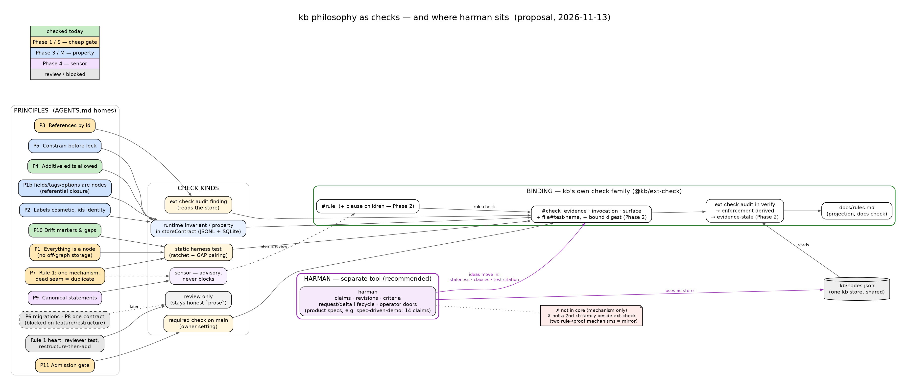

# Philosophy as checks, and where harman sits

Research note, 2026-11-13. Status: **proposal**. Nothing here is adopted until
the owner decisions at the end are made. The rules it talks about have their
homes in `AGENTS.md`; this note links to those homes and does not restate them.

**In one screen:**

- **Yes, encode the philosophy, but honestly.** About half of it can be
  checked by a machine (a harness test, a property or a contract over the
  store). The rest can only be watched by a sensor or judged in review. Keep
  calling the reviewed part `prose` instead of hiding it behind a check that
  cannot fail.
- **kb already has a small harman.** `#rule` → `rule.check` → `#check`
  (evidence file, invocation, surface), proved by `ext.check.audit` in
  `verify`. That is spec binding at rule level. The missing parts are
  harman's best ideas: **evidence that goes stale when the claim changes**,
  and **claims split into criteria**.
- **harman stays a separate tool that uses kb as its store**, as it does
  today. Don't put it in core, and don't make it a second kb family next to
  `ext-check`, because two rule→proof mechanisms in one repo is a mirror
  (Rule 1). Bring the two ideas into the check family instead.
- **Scale:** citing a test for every claim of all 44 rules, at `file:line`,
  would not be maintainable. Binding a **core-philosophy subset of about 12
  claims**, cited by file plus test name and resolved by the audit, would be.
- **The first step is small:** two philosophy rules move from `prose` to
  `harness`, using machinery that already exists.

## 1. The question

The owner asked two things:

1. Should kb's core philosophy become an enforceable set of
   tests/invariants, the way spec binding works in spec-driven-demo?
2. Should harman be a kb plugin, and can it work at kb's scale?

Today `docs/rules.md` lists **44 rules**: 19 `harness`, 3 `ci`, 3 `lint`,
1 `hook`, **18 `prose`**. Almost all of the core philosophy is in the
`prose` group: Rule 1, Canonical statements, Everything references by id,
Constrain before you lock, Families migrate their own data, One contract
every implementation, Admission gate, Spec-first, Editor first. The two
data-plane rules that are checked (additive edits, labels are cosmetic) are
the exception, and they show the pattern to follow.

## 2. What already exists (don't rebuild it)

| Mechanism | Where | What it holds today |
|---|---|---|
| Harness | `harness/tests/*.test.ts` (36 files), tables in `harness/src/constraints.ts` | layer and scope direction, the isomorphism fence, the family axis and composition roots, the UI zone matrix, public surface, budgets, the lazy 3D fence, the determinism seam, skip pairing, suppression grammar, the warn ratchet, advisory-signals |
| Contract suites | `packages/app/test-kit/src/*-contract.ts` (11) | store, log, tail, seed opening, surface, writers, reactions, sandbox, extension, view migration, commit record, each run over every backend |
| Rule→check binding | `@kb/ext-check`: `ext.check.audit`, `ext.check.sync`, `check:gaps` | 26 `#check` nodes. Each has `surface`, `evidence` (a file), `invocation` and `blocking`. The audit proves that the evidence exists, that the invocation is wired into its surface, and that the home resolves. It also derives `rule.enforcement`, so the column in `rules.md` cannot lie |
| Projection + drift | `kb docs materialize` / `kb docs check` (pre-commit) | `rules.md` and `todos.md` are one-way projections of nodes. A hand edit is refused |
| Debt accounting | `#gap` nodes (353), `// GAP [[id]]`, the `gap-markers-resolve` check | every deferred clean shape is named, and a marker without its node fails |
| Approval vocabulary | `@kb/governance` `#approval-policy` nodes | policies are data. **Enforcement is deferred**, and the gap "a call's actor and approval are declared by the caller, not proven" is open |

The mechanism a philosophy check needs is already here: a rule node, a
check node, an audit that keeps the enforcement column honest, a ratchet
for debt that is known, and GAP pairing for exceptions. What is missing is
the checks themselves, plus two binding features (§4.3).

## 3. Audit: principle → check

Kinds: **static** is a harness test over the tree. **runtime** is an
invariant the commit or the store keeps, proved by a contract property.
**property** is a metamorphic property test (the "invariance" keeper class
in [DESIGN.md → Testing doctrine](../../DESIGN.md#testing-doctrine)).
**sensor** reports a number to a human, or goes through a ratchet, and never
judges on its own. **review** means only a person can judge it.

Cost: **S** is one PR inside an existing harness module. **M** is a new
module or a contract property, about one wave item. **L** needs a feature or
a restructure first.

| # | Principle (home) | Check kind | Concrete check | Today | Cost |
|---|---|---|---|---|---|
| P1 | Everything is a node: no bespoke storage ([Rule 1 corollary](../../AGENTS.md#rule-1--abstraction-before-addition)) | static + ratchet | **Off-graph persistence lane**: `localStorage`, `sessionStorage`, `indexedDB` and fs writes are counted outside the store and `file-write` packages. The count is frozen, a rise fails, and each kept site carries a GAP or a "device-local" reason | nothing. 13 production files touch browser storage (prefs, design-system, workspace stores, gallery draft, graph page) | **S** |
| P1b | Everything is a node: fields, tags and options *are* nodes | runtime | **Referential closure**: after every commit, every prop key resolves to a field node, every `sys.f.type` ref resolves to a node tagged as a tag, and every children-sourced option value is a child. Proved as a `storeContract` property over generated transactions | the seed is pinned (`seed-golden`, `kinds.test.ts`). A search found no store-wide closure invariant, so a sweep should confirm that before building | **M** |
| P1c | Everything is a node: "if a feature needs its own widget, the model is wrong" | review | none can be mechanical. Cite the corollary in review | prose | — |
| P2 | Labels are cosmetic; ids are identity ([home](../../AGENTS.md#data-plane-freedom)) | property | **Rename invariance**: relabel every node, `sys.*` included, at random. Every saved query's result ids, every view's member set and every audit's findings stay the same; only the strings shown change | `seed-opening-contract` proves that a label the person edited survives the seed (`ci`). That covers the seed half, not the reference half | **M** |
| P3 | Everything references by id ([home](../../AGENTS.md#data-plane-freedom)) | static over **data** | **Stored-reference audit**: no query node, lens, view filter or `#check` matches `:node/text` against a literal. It reads the store, so it is an `ext-check` finding, not a code grep | prose. `rules.md` already names this exact gate | **S** |
| P3b | same, in code | sensor | text-equality on node text outside search and the entry-point resolvers. A first grep finds about 46 production files with text-equality, mostly display, so this is too noisy to gate | none | M |
| P4 | Additive edits always allowed ([home](../../AGENTS.md#data-plane-freedom)) | runtime | already `surface-contract.ts`, over every action surface | **ci** ✓ | 0 |
| P5 | Constrain before you lock ([home](../../AGENTS.md#data-plane-freedom)) | runtime | the ref-field target constraint is enforced at commit, and the managed-field lock is a contract property (the gate `rules.md` names, gap `01M74AS94FM8GDGF3W10M84P43`) | prose | M |
| P6 | Families migrate their own data ([home](../../AGENTS.md#data-plane-freedom)) | runtime | a migration-runner contract: idempotent, applied in one transaction, and the person's nodes survive | prose, and blocked: gap "a family cannot declare a migration" | **L** |
| P7 | Rule 1: one mechanism per concept, "a dead seam is still a duplicate" ([home](../../AGENTS.md#rule-1--abstraction-before-addition)) | sensor + ratchet | **Zero-consumer exports**: `harness/src/symbol-consumers.ts` already joins every public name to its production importers. A public name with no importer becomes a ratcheted count | the data exists, but no lane uses it | **S** |
| P7b | Rule 1: bridges over mirrors | sensor | a token-shingle clone sensor over `packages/`, advisory like the mutation score. A human reads the top pairs | none | M |
| P7c | Rule 1: the reviewer test, restructure-then-add commits, boolean forks | review | cite the symptom by name, as the Testing doctrine does for property anti-patterns | prose | — |
| P8 | One contract, every implementation ([home](../../AGENTS.md#one-contract-every-implementation)) | static | every port with more than one implementation has a registry that one contract suite runs over | prose, and blocked: the ports are not all discoverable yet (scene handle, renderers and design systems are object-literal registries). Restructure first | **L** |
| P9 | Canonical statements ([home](../../AGENTS.md#canonical-statements)) | sensor | **Restatement overlap**: sentence-shingle similarity across `AGENTS.md`, `DESIGN*.md` and live `docs/` (not `docs/waves` records, not generated docs). A pair above a threshold is a candidate. `ext-check` already proves each rule has one resolvable home | prose | S–M |
| P10 | Drift markers and gaps ([home](../../AGENTS.md#drift-markers-and-gaps)) | static | skip-pairing, gap-markers-resolve, suppression grammar | **harness** ✓ | 0 |
| P11 | Admission gate ([home](../../AGENTS.md#gate-run-first)) | ci setting | make `validate.yml`'s verify a **required check on `main`**. Then a commit made without the hook still meets the same gate, and the rule becomes `ci` | prose. The hook exists, but nothing stops a `--no-verify` commit from merging | **S** (owner setting) |
| P12 | Core is mechanism only: core names no feature ([home](../../DESIGN.md#extension-families)) | static | a scan of core packages for the vocabulary of `BUNDLED_FAMILIES` names (the open extension-boundaries gaps) | the family axis is **harness** ✓; the vocabulary half is prose | S–M |
| P13 | Spec-first changes ([home](../../DESIGN.md#spec-first-changes)) | sensor | a PR that moves a reviewed surface budget (`harness/surface-budgets.json`) without touching `DESIGN*.md` gets flagged | prose | M |
| P14 | Editor first ([home](../../DESIGN-UI.md#decisions-from-qa)) | runtime (UI) | an editor-surface test that walks every seeded field a person may set and asserts the editor draws a writable widget for it (the gate `rules.md` names) | prose | M |

Read row by row, the table says:

- **Four principles can be gated cheaply (S)** with what kb already has:
  P1, P3, P7 and P11.
- **Five need a property or contract (M):** P1b, P2, P5, P13 and P14. These
  are the high-value ones, because they say what the data plane promises,
  not only what the code looks like.
- **Two are blocked on a feature or a restructure (L):** P6 and P8. Each
  already names its gate, and building the check first would produce a
  dead seam.
- **The heart of Rule 1 is review-only (P1c, P7c), and that is fine.** The
  sensors around it (P7, P7b, P9) give a reviewer something to point at.
  Gating them would teach agents to satisfy a number instead.

### 3.1 What makes a philosophy check honest

These rules come from what the harness already does:

1. **A red case first.** Each check's file header names how to make it go
   red, as `advisory-signals.test.ts` does. If nothing can make a check go
   red, it is not a check.
2. **Known debt goes through a ratchet, never an allowlist that grows.** P1,
   P7 and P3b start with sites. They take the existing
   [two-mechanism](../../AGENTS.md#drift-markers-and-gaps) path: about 30
   sites or fewer means error plus a GAP on each site, more than that means
   a ratchet lane.
3. **Sensors never block.** P7b, P9 and P13 follow
   [Coverage is a signal](../../DESIGN.md#testing-doctrine). An
   `advisory-signals`-style guard keeps them from turning into gates.
4. **A property states the rejecting side.** P2 must show that a
   text-matching query *does* change result under relabelling, so the
   property is falsifiable and not a round-trip.

## 4. harman: where it belongs

### 4.1 What harman is, in kb's terms

| harman concept | kb today | Notes |
|---|---|---|
| claim (id, immutable revisions) | `#rule` node | kb rules have no revisions; an edit is in place |
| criterion | **missing** | a rule is one block of text; one check "proves" all of it |
| evidence (`claim + revision + criteria`, `locator`) | `#check` (`evidence` file, `invocation`) | kb **resolves** the evidence file and the wiring. harman does not: its locator is never resolved, a gap in its own §10 |
| staleness (B3: the evidence names an old revision) | **missing** | editing a rule's principle leaves its check looking current |
| projection + `project --check` | `kb docs materialize` + `kb docs check` | the same idea, already gated |
| S\*/B\*/C\* invariants | `ext.check.audit` findings, warn ratchet | kb has the same shape: a typed finding union |
| request / delta lifecycle (XState) | none | a task model; kb rules change by ordinary edits plus review |
| operator doors (`--actor`, approve/merge) | `@kb/governance`, enforcement deferred | both sides have the same open problem: the actor is declared, not proven |
| store | **kb nodes already** (`harman.f.owner`, `@kb/client`) | harman maps its `Db` document onto owned nodes in `.kb/nodes.jsonl` |

### 4.2 Three homes, compared

| | In kb core | As a kb family (plugin) | Separate tool that uses kb (**recommended**) |
|---|---|---|---|
| Boundary | ✗ Core is mechanism only ([Shape](../../AGENTS.md#shape)). A request inbox with a lifecycle is a task model, and kb's own rules say a task model is never kb's default meaning | ✓ allowed in principle | ✓ it already is one: its store is kb nodes |
| Rule 1 | ✗ | ✗ **A second rule→proof mechanism next to `ext-check`.** That is the mirror Rule 1 forbids. Collapsing it would mean rewriting one in terms of the other | ✓ one mechanism per repo: kb uses `ext-check`, product repos use harman |
| Port cost | L | **L**: harman is zod + XState + commander on Node, with a whole-document CAS write path. A kb family is Effect v4 actions under the kernel, inside the harness's families, budgets and fences. Very little would carry over | 0 |
| Fit to need | — | the lifecycle and doors matter for *product specs*, where an agent must not merge intent nobody signed. kb's philosophy changes rarely, and only by the owner | ✓ |
| Scale | — | see §4.4 | ✓ demo-sized corpora, which are what it was built for |

The recommendation: **harman stays a separate tool using kb as its
store.** kb does not depend on harman. Two of harman's ideas move into the
check family, where kb's rule→proof concept already lives (§4.3). This is
Rule 1's "bridges over mirrors": one concept, one owner per repository,
with one shared store underneath.

**Revisit if** kb itself starts needing signed intent. For example, many
agent threads proposing changes to a philosophy rule, with the owner
approving them. At that point the right shape is the check family gaining
a door through `@kb/governance` (once the actor is proven), not harman
moving in beside it.

### 4.3 What to take from harman

1. **Staleness by binding, not by flag (harman B3).** A `#check` records a
   digest of the principle it was bound to. If the rule's principle text
   changes, `ext.check.audit` emits `evidence-stale` until someone re-binds
   it on purpose through `ext.check.sync`. This is an edge on an existing
   node. It needs no new concept.
2. **Clauses, not new tags (harman criteria).** A philosophy rule's clauses
   are **child `#rule` nodes**, each with its own `rule.check` or `gate`.
   The parent's enforcement becomes its weakest clause, shown as "2/4
   clauses checked", which makes partial coverage visible. "Core names no
   feature" already writes "Not checked yet: …" into its principle by hand,
   and this would make that structural. A clause's text is a short label
   plus the home anchor, never a restatement
   ([Canonical statements](../../AGENTS.md#canonical-statements)).
3. **Test-level citation, resolved.** `evidence` grows an optional test
   name (`file#test name`), and the audit checks that the title occurs in
   the file. That is narrower than a file and survives edits, unlike
   harman's `file:line`.

**Leave in harman:** the request/delta lifecycle, the `next`/`adopt` loop,
`proves-by` kinds and the narrowness rule B4. They earn their cost where
agents author product intent. For kb's rules they would be ceremony.

### 4.4 Scale

The numbers kb would bind against: **44 rules, 26 checks, about 80
packages, 2,263 package source files, 795 test files**, and 353 open gaps.
The spec-driven-demo corpus harman runs today has **14 claims**.

- **Binding every rule at claim and criterion level is not maintainable.**
  Splitting 44 rules into criteria gives on the order of 150 bindings.
  harman's B4 asks for a narrow test (arity ≤ 2) per claim, so most of
  those would need a test written only to be cited. The many structural
  rules (budgets, boundaries, ratchets) are already proved best by one
  harness file. For them a file-level `#check` is the right granularity.
- **`file:line` locators rot at kb's pace.** Many agent threads land PRs
  every day. Any edit above a cited test moves its line, so the locator
  either churns in every PR or quietly points at the wrong test. Since
  harman never resolves a locator, it would be the second.
- **A scoped subset is maintainable.** The core philosophy is about **12
  claims**: P1, P1b, P2, P3, P4, P5, P7, P8, P9, P11, P12, P14. Each would
  be bound by clause, cited by file plus test name, resolved by the audit,
  and checked for staleness. That is about the size of the demo corpus,
  where the model is known to work, and these rules change rarely, so
  re-binding is a real event and not noise.
- **Runtime cost is not the constraint.** `ext.check.audit` already reads
  the whole graph inside `verify`. A dozen digests and title lookups add
  milliseconds.

## 5. Phased plan

Each phase is one PR or a small batch. Each names what it proves and the
signal that would show it was wrong.

### Phase 1: two philosophy rules leave `prose` (S)

- **P3 stored-reference audit**: a new `ext.check.audit` finding kind,
  `ref-by-text`, over query, lens, filter and check nodes.
- **P1 off-graph persistence lane**: a harness test plus a baseline in the
  ratchet ledger. Each of the 13 current sites gets a GAP or a "device-local"
  reason (owner decision D6).
- Each check gets a `#check` node bound to its rule, so `rules.md` moves two
  rows from `prose` to `harness` through derivation, not by hand.

**Proves:** philosophy can be mechanized with what kb has today, with no
new concept and no harman. **Fails if:** a seeded red case (a saved query
`[?n :node/text "todo"]`; a new `localStorage.setItem` in a UI store) does
not turn the build red, or if more than about 5 sites need a reason that
amounts to "this is fine", which would mean the check has the wrong
boundary.

### Phase 2: clause-level binding in the check family (M)

- Clauses become child `#rule` nodes (§4.3.2), only for the core-philosophy
  rules.
- `evidence-stale` comes from the bound digest (§4.3.1).
- Test-name citation is resolved (§4.3.3).

**Proves:** harman's binding model works inside kb at rule scale, under
kb's own mechanism. **Fails if**, within two weeks of use, either (a)
re-binds outnumber real check edits by more than 3:1, meaning people
re-sync without reading (rubber-stamping), or (b) the clause rows make
`rules.md` harder to scan than today. Either one means pulling it back to
file-level.

### Phase 3: the data-plane promises as properties (M each)

P1b referential closure, P2 rename invariance and P5 constrain-before-lock
go into `storeContract`, so they run over JSONL and SQLite. **Proves:** the
philosophy holds for *data*, not only for code shape. **Fails if** a
property cannot be stated from the rejecting side (Testing doctrine). Then
it is quantifier theatre and is dropped.

### Phase 4: sensors around Rule 1 (S–M, advisory)

The P7 zero-consumer ratchet (gating), plus the P7b clone sensor, P9
restatement overlap and P13 spec-first flag (all advisory, guarded by
`advisory-signals`). **Fails if** the top-N output is mostly false
positives after one calibration pass. Then the sensor is deleted, not
tuned forever.

### Phase 5: blocked work, after its prerequisites

P6, once the migration runner exists. P8, after one registry form for
every port. A governance door on *weakening* a philosophy rule (deleting a
check, editing a principle), once the actor is proven. None of these
starts before its prerequisite, because a check that arrives before its
subject is a dead seam.

## 6. Owner decisions

| # | Decision | Recommendation |
|---|---|---|
| D1 | Encode the core philosophy as checks? | **Yes, as an honest mix.** Gate what is mechanical (P1, P3, P7, P11, the properties), run sensors where judgement is involved, and leave the heart of Rule 1 as `prose` + review |
| D2 | Where harman lives | **A separate tool that uses kb as its store**, not core and not a kb family. Bring staleness, clauses and resolved test citation into `@kb/ext-check` |
| D3 | How much gets claim-level binding | **The core-philosophy subset (about 12 claims), not all 44 rules.** Structural rules keep file-level `#check`s |
| D4 | Citation granularity | **File + test name, resolved by the audit**, never `file:line` |
| D5 | Make verify a required check on `main` | **Yes.** It turns the Admission gate from `prose` into `ci`, and it is a setting, not code |
| D6 | Is device-local UI state (prefs, design system, workspace layout) data? | **Each site is decided once, in Phase 1.** Either it becomes nodes, or it carries a "device-local" reason. This decision sets where P1's boundary is, so the owner should make it |
| D7 | Rule 1 sensors: advisory or gating? | **Advisory**, except the zero-consumer ratchet, which is a count with one meaning |
| D8 | First PR after this note | **Phase 1**: the two checks and their `#check` nodes, in one PR |
