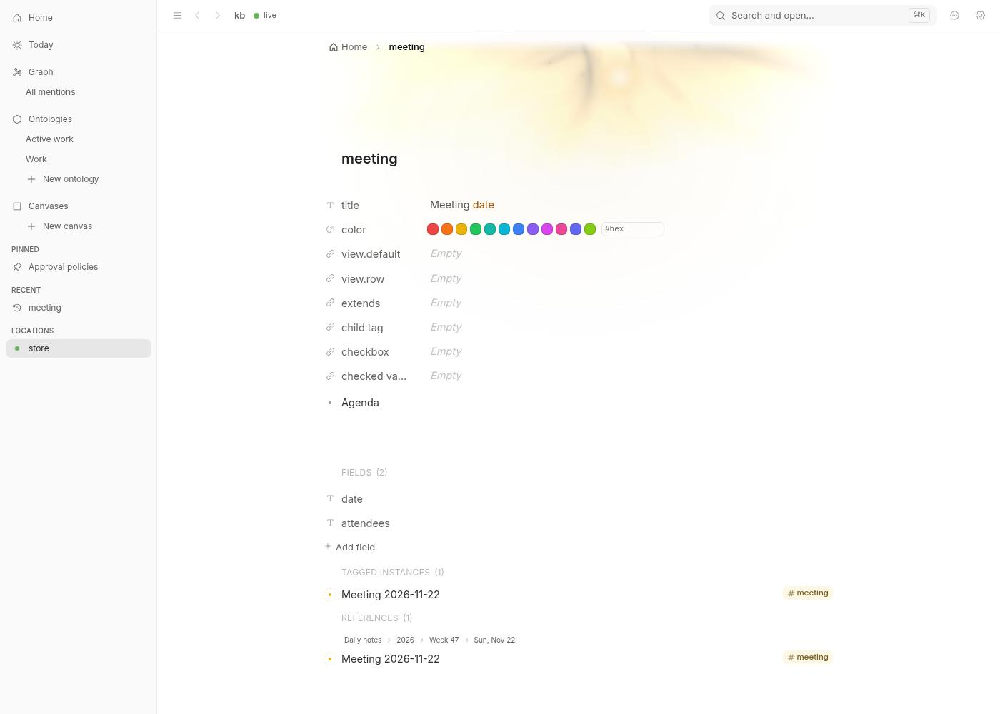
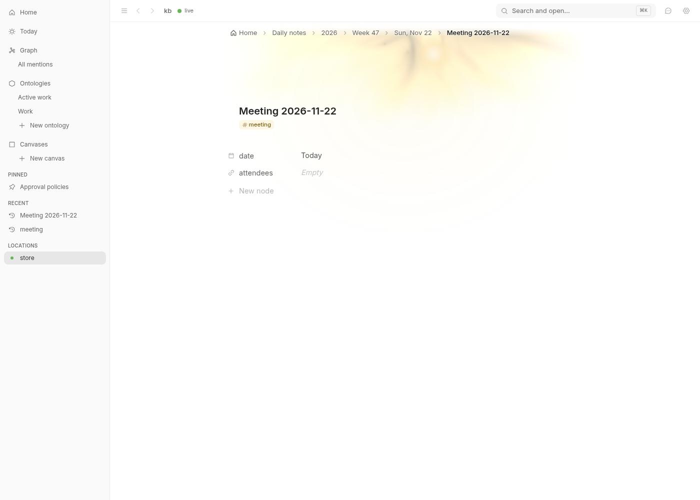

# Supertags as an extension surface: config sections, and templates resolved when a node is created

Research and a design proposal for the owner, 2026-11-22. The question as
asked: _"Research how we should open up supertags as an extension surface for
other surfaces to plug into. Tana's supertag config has sections (Building
blocks, Content template, AI and Commands, Voice chat, Advanced options),
which extensions could probably plug into or add to. Especially the template
part, where we can not only prefill things but also have values resolved
dynamically at creation time. That would be very powerful, and it would be
really good if plugins could extend that templatability too. All of this
should be outliner-specific and data-based."_

This is a record, not a spec. Where it describes kb today it points at the
canonical home (DESIGN.md, DESIGN-UI.md, code). Where it proposes something,
nothing is decided until the owner says so. If the proposal is taken, its
statements move into DESIGN.md → Data model → tag behaviours and DESIGN-UI.md
→ Node pages, and this file stays as the record.

> **Superseded in part (2026-11-22)** by
> [resolvable values](2026-11-22-resolvable-values.md), which makes a
> template's dynamic value, an extension setting's value and a placement
> one kind (a handler node in a resolvable ref field, or bound to a field in
> a template):
> - §4.2's point `tag.resolvers` becomes `value.resolvers`;
> - a resolver answers `{values, upserts}`, or `unresolved`, instead of
>   `PropValue[]`;
> - §6.5's failure rule is replaced by that doc's §2.4 (a stored value that
>   cannot resolve reads as empty and is reported; an explicit one fails);
> - §6.6's rule that `createdAt` and every clock resolver read the same
>   instant is replaced by that doc's §2.3: the accepted clock sample
>   controls resolution only, and stored timestamps stay the committing
>   process's.
>
> An initializer is that doc's handler with an `init.field` binding.
> Everything else here stands.

## 0. Verdict

1. **Most of this is already in kb.** A tag's settings are already fields on
   the tag node. A family adds a setting by adding a field to `sys.tag`'s
   template, which is an additive list. One tag behaviour, `fill from`,
   already fills a field when a node is created, in the same write.
2. **Sections are data.** A section is a node. A setting field names its
   section. A component names a section too, through the one existing point,
   `ui.node-sections`. The page takes a section's title, order and default
   collapse from that node. Sections belong to the outline family, so other
   views ignore them.
3. **A template is a node, and dynamic values are nodes in it.** The tag
   points at a template node (`sys.f.tag.template`):
   - the template node's field values are the static defaults;
   - its children are the default content;
   - an _initializer_ child says "fill field F with resolver R", and R's
     arguments are its fields.

   A **resolver is a tag** (it extends `sys.resolver`), and its template
   fields are its parameters. So the CLI, MCP, the page, JSONL and SQLite
   handle it with no new verb and no new storage shape.
4. **Resolvers are pure, synchronous functions of one context.** That
   context is a clock sample, the actor, and the graph as the caller may read
   it, scoped before anything resolves. Query answers are evaluated for each
   planned call, over the scoped graph that call sees. Families contribute
   resolvers in their declaration, so the page and the server run the same
   code.
   Anything that does I/O (AI, the network, a calendar) is not a resolver.
   It is a command run on an event, in a second transaction with its own
   undo.
5. **Instantiation runs where `fill from` runs today**, inside the write plan
   (`planNodeAdd`, and `planNodeUpdate`, which the update plan becomes so it
   can carry copies). That gives one transaction, one undo step, for creating
   and for tagging alike, every surface alike, and nothing scheduled.
   Copied content gets ids derived from the instance's id, which makes it
   idempotent and keeps the page and the server agreeing on ids.

## 1. How Tana and the others do it

Every fact below was fetched on 2026-11-22. `tana.inc/docs/<x>` now
redirects to `outliner.tana.inc/learn/features/<x>`, so that is where the
links go. Anything not confirmed on a source page is in §10.

### 1.1 Tana

**The config panel.** The supertags page
(<https://outliner.tana.inc/learn/features/supertags>) lists these parts, in
this order:

| Part | What it holds |
| --- | --- |
| Colors, "Used X times", Delete | |
| Content template | default content (fields with `>`, pinned fields, search nodes, plain nodes), static default values, Extend, Optional fields, Show as checkbox with Done state mapping, Base tags |
| AI and Commands | Custom autofill behaviour, Audio-enabled supertag, Command palette (Compact and Full menus since 2025‑01‑31), Trigger commands on events, AI instructions |
| Voice chat | Voice greeting, Voice instructions (added 2025‑12‑19; <https://outliner.tana.inc/learn/guides/mobile-voice-chat-supertag>) |
| Advanced options | Build title from fields, Default child supertag, Related content, Shortcuts |
| Meeting agent | shown only when the base type is Meeting |

The supertags page does not use the name "Building blocks". The meeting-agent
page and the templates page do
(<https://outliner.tana.inc/learn/features/meeting-agent>,
<https://outliner.tana.inc/learn/features/tana-templates>). On those pages,
base type and Extend sit under Building blocks, before Content template. So
the live order is probably Building blocks → Content template → AI and
Commands → Voice chat → Advanced options, but no single page states it. The
changelog says "Supertag config sections stay open between tabs" on
2025‑12‑05 (<https://outliner.tana.inc/changelog>). The move into sections
has no dated entry of its own.

**Content templates.**

- "Every time you apply the supertag to a node, this template gets applied."
  The template is the nodes under Default content.
- Extend is "a projection". A subtype cannot move or delete what it inherits,
  but it may add to it and override a default value.
- A template is applied once and never kept live. Auto-initialize runs "only
  … when a node gets the supertag applied". A field added to the tag later
  does not reach nodes tagged before, and moving a node re-initializes
  nothing (<https://outliner.tana.inc/learn/features/fields>).
- Re-applying is a command: "Update existing instances on default value
  change", or convert a template node to a field and back (2024‑12‑06).
- **2026‑11‑02:** queries, titles, AI and the API read only "the value a node
  holds". A node that does not hold the field is empty "even when its
  supertag has a default value". The same entry says "Applying a supertag no
  longer adds a default value twice".

**Dynamic values: auto-initialize, set on the field** (fields page):

| Option | Field types |
| --- | --- |
| to value from ancestor with this field | all |
| to ancestor with this supertag | options from supertag |
| to random node with this supertag | options from supertag |
| to current date | date |
| to date of ancestor day node | date |
| to current user | user ("a bit of a stub") |

Tana has no "now", no "parent node" and no expression language for
defaults.

**Title expressions** use `${field}`, `${name}`, `${field|30…}` and
`${field|?}`, plus `${sys:*}` variables: `cdate`, `ctime`, `sys:owner` (the
parent), `sys:lastEditedBy`, `sys:doneTime` and others (supertags page). AI
prompts add `${sys:context}`, `${sys:currentDate}` and `${sys:nodeId}`
(<https://outliner.tana.inc/learn/features/ai-for-builders>).

**Commands on events.** A tag can trigger commands On capture, On added, On
removed, On checked and On unchecked (supertags page). Commands are nodes
whose child steps run top to bottom, and their parameters are fields
(<https://outliner.tana.inc/learn/features/command-nodes>). One built-in
command, "Insert a cloned copy of a node", "can be used to emulate template
behaviour". An event that repeats on an AI-made node within 60 s turns the
event system off until a reload. Changes made through the API trigger no
events.

**AI.** A tag has a custom autofill (title, fields, description, with fields
to exclude). A field can be AI-enhanced (a ✨ button) and carry its own
instructions. Autofill runs from the button, the autofill command, voice
memo processing and the end of a voice chat. It is not documented to run on
its own when a tag is added.

**Everything is a node.** "In Tana Outliner, everything is a node: The
fields, the views, the commands, the settings…"
(<https://outliner.tana.inc/learn/features/nodes-and-references>). A
supertag definition is "a node … that stores the configuration … its name,
template, and commands".

### 1.2 The others

| Tool | Where a template lives | Dynamic values | When they resolve | Plugins add resolvers? |
| --- | --- | --- | --- | --- |
| Notion | template pages per database; one default | `@today` / `@now` mention flagged "date when duplicated"; button mentions "user upon duplication"; a linked database in the template filtered to "this page" rebinds per copy | on duplication; the API resolves in `template[timezone]` | no |
| Capacities | per object type; a starred default is applied automatically | `{date:YYYY-MM}` in the title; date property = Day, Week, Month or Year of creation; "This object" in queries | on apply | no |
| Anytype | an object of type `template` with `targetObjectType`; the default applies on create only | "Author = Current User" in the docs; how it is stored is not shown | on create | no |
| Logseq (file) | a block with `template::` | `<% today %>`, `time`, `current page`, natural-language dates | on insert, written as text or links | community plugin only |
| Logseq (DB) | a `#Template` block with "Apply template to tags" | defaults for text, number and checkbox only | on tag or create | no |
| Obsidian Templater | a file | `<% tp.date.now(...) %>`, prompts, arbitrary JS, user scripts (`tp.user.*`) | on insert or new file; `<%+ %>` on render (deprecated) | yes, unsandboxed code |
| Roam SmartBlocks | a block | `<%DATE:5 days from now%>`, `INPUT`, ... | on run | yes, `registerCommand`; JS commands deprecated in 2022 for safety |
| Coda | a column's "value for new rows" | any formula (`User()`, `Now()`) | on row create, stored as a value | no |
| Airtable / Fibery | field defaults | "current date" (GMT, which gives off-by-one days); Fibery needs an automation | on create | no |

Sources: Notion <https://www.notion.com/help/database-templates>,
<https://www.notion.com/releases/2021-09-08>,
<https://www.notion.com/releases/2020-05-13>,
<https://developers.notion.com/guides/data-apis/creating-pages-from-templates>;
Capacities <https://docs.capacities.io/reference/templates>; Anytype
<https://doc.anytype.io/anytype-docs/getting-started/types/templates>,
<https://github.com/anyproto/anytype-heart/blob/main/core/block/template/templateimpl/impl.go>;
Logseq <https://github.com/logseq/docs/blob/master/pages/templates.md>,
<https://github.com/logseq/docs/blob/master/db-version.md>; Templater
<https://silentvoid13.github.io/Templater/>,
<https://silentvoid13.github.io/Templater/settings.html>; SmartBlocks
<https://github.com/RoamJs/smartblocks/blob/main/docs/050-command-reference.md>;
Airtable
<https://community.airtable.com/t5/base-design/quot-default-to-created-time-quot-uses-wrong-timezone/td-p/198158>.

### 1.3 What carries over

- **Resolve once and store a plain value.** Every tool does this at creation
  except two: Templater's deprecated `<%+ %>`, and Logseq DB's tag
  properties, which show live. Tana moved to "the value a node holds" in
  November 2026. kb's model already says this: `fill from` writes values,
  and a title is a display rule.
- **Structured tokens beat expression strings.** Notion's flag, Capacities'
  "Day of creation" and Tana's auto-initialize options are each a choice
  from a list, with no parser. Only the code-first tools use strings, and
  both of those later restricted their arbitrary-code forms on safety
  grounds.
- **Only two tools let plugins add resolvers, and both run unsandboxed
  code.** kb can do better, because it already has a sandbox with grants.
- **The time zone is the one determinism control anyone documents**
  (Notion's `template[timezone]`; Airtable's GMT bug). kb has the same
  question, and an answer to borrow (§6.6).
- **Rebinding to the instance** ("this page", "This object", `current
  page`) is the dynamic value people use most after dates.

## 2. kb today

Read on `main` at `751c5039`.

**A tag's settings are fields on the tag node.** `sys.tag` templates
`color`, `view.default`, `view.row`, `extends`, `child tag`, `title`,
`checkbox` and `checked value` (`packages/domain/seed/src/seed.ts`, the `tag`
node). A tag's page draws them as ordinary field rows, flat and in template
order, under its title (screenshot 1). A family adds a setting to every tag
by adding its field to that list. The list is additive on a seeded node, and
the field carries `sys.f.configures` → `sys.tag`
(DESIGN.md → Data model, "a value of a field that configures it"; [Extension
families](../../DESIGN.md#extension-families) → configuration).



_Screenshot 1. `#meeting` on a scratch store: eight setting rows, the tag's
own child "Agenda", then the Fields block, Tagged instances and
References._

**Tag behaviours.** DESIGN.md → Data model → "A tag shapes the nodes it is
on" names five settings, and `packages/domain/model/src/tag-behaviour.ts`
is their one reader:

- `child tag` and `fill from` act **inside the write**: `planNodeAdd`, and
  `projectPropEdits` for `node.update`, in
  `packages/domain/model/src/node-write.ts`. They land in the same
  transaction and undo with it.
- `title` and `checkbox` are read where the node is drawn.

`fillOnTagging` is kb's only dynamic default today. When a tag is gained,
each field the gained tags template that the node holds no value of, and
whose field node names a `fill from` field, takes that field's values from
the nearest ancestor. It is per field, not per tag, as Tana's auto-initialize
is.

**Write-time phrases.** `kb add … --prop date=today` stores the local date,
because `parseTypedValue` reads relative phrases against the writer's today
(`packages/domain/model/src/field-value.ts`). Screenshot 2 shows the result.
This is resolution at the entry point, not a stored default.

**A tag's children are not a template.** The tag's "Agenda" child was not
copied to the new `#meeting` instance (screenshot 2). Nothing in kb copies
content when a node is tagged.



_Screenshot 2. The instance. `title` builds "Meeting 2026-11-22" from the
date field. No content was copied._

**The page's sections.** `packages/extension/outline-ui/src/outline-editor.tsx`
draws the zoomed root in this order:

1. the head rows (title, tags, field rows);
2. the outline;
3. `SchemaSection`, which holds `TagFieldsConfig` (the template field list)
   and "Tagged instances";
4. References;
5. `NodeSections`, the `ui.node-sections` contributions:
   `{tags, order, title, shown?, Component}` (`packages/kit/ui-sdk/src/lib/node-sections.ts`;
   DESIGN-UI.md → Node pages).

Only days contributes a section today. `SchemaSection` is a bespoke section
drawn beside the point that exists for this purpose. That is a dead seam in
Rule 1's sense, recorded as a gap in this commit (§8, WP‑1). A repository
extension cannot contribute a section at all (GAP
`01M74PDWPASZ30SBGA95EV0X0M`).

**The page writes first, then the server.** An isomorphic action runs on
the page's replica, then the same invocation goes to the server. An action
that declares `mints` pins the ids the page minted (DESIGN-UI.md →
Architecture; DESIGN.md → `node.batch`). The server's image replaces the
page's when its receipt arrives.

**Other relevant pieces:**

- **Transaction reactions** (`tx/after`; DESIGN.md → Transaction reactions)
  run after the commit, in their own transactions, at most once, in the
  committing process.
- **The sandbox** (DESIGN.md → Sandbox) runs untrusted code in QuickJS under
  a grant. Its driver, `runGuest`, is message-based and asynchronous.
- **Commands as nodes** (`docs/research/2026-11-17-commands-as-nodes.md`):
  `#call` exists, and the runner and phases 0–2 are not shipped.
- **Behaviour belongs on tags, not field types** (GAP
  `01M7KVYBVC5N8VJSBBJCYE74SE`, the owner's framing). This proposal follows
  it: resolvers are tags, not field types.
- **Two open questions.** The outliner parity study ranked "static defaults
  on tag templates" 15th and said it "changes the data plane; it needs a
  design pass" (`docs/research/2026-11-20-outliner-tana-parity.md` §8,
  item 5). Its Brief 8 puts an AI instruction on field nodes.

## 3. The proposed model

### 3.1 Sections are nodes

A **section** is a node, an option of the outline family's field
`sys.f.outline.section`. It has the option-set shape: the options are the
field node's children, as `sys.f.show`'s are. A section node carries:

- its **label** (its text), which the person may rename;
- its **order**: its sibling rank among the options. Core's options come
  first, a family's are appended by the seed's union, and a person's own are
  added after them;
- `sys.f.outline.section.collapsed` (a checkbox): closed until opened. Which
  sections a person has opened is screen state, not graph data;
- `sys.f.outline.section.place`, an option set: `settings`, drawn with the
  node's field rows in the head (the default), or `below`, drawn after
  References, as days' sections are today.

`sys.f.outline.section` is a **field display setting**. It sits beside
`show` and `pinned` on `sys.field`'s template, because it answers the same
question: where a field's row is drawn. It is one-valued, its show level is
*tucked*, and it is read by one reader in `@kb/outline`. A field that names
no section is drawn where field rows are drawn today. So every person's tag
and node looks the same as now until someone assigns a section.

Seeded sections and what goes in them:

| Section (id) | Place | Holds |
| --- | --- | --- |
| Building blocks (`sys.section.blocks`) | settings | `extends`, the template field list (`TagFieldsConfig`, as a component), `child tag` |
| Content template (`sys.section.template`) | settings | `template` (§3.2), as a component that edits the template node |
| Display (`sys.section.display`) | settings | `title`, `color`, `checkbox`, `checked value`, `view.default`, `view.row` |
| _A family's_, e.g. AI (`sys.section.agent.ai`) | settings | the agent family's autofill instruction, when Brief 8 ships |
| Commands and events (`sys.section.commands`) | settings | on added, on removed, on checked (WP‑6), once commands as nodes ship |
| Advanced (`sys.section.advanced`, collapsed) | settings | anything a family files there |
| Tagged instances (`sys.section.instances`) | below | today's `SchemaSection` list, as a component |

A section is drawn on a node's page when one of these holds:

- one of its fields is drawn on that node, under field display's own rules;
- a component contributed to it applies to the node (§4.1).

An empty section is not drawn. That is the whole visibility rule, and it
reuses what exists: `show` (tucked, hidden) still decides each row, and
`kindsOf` still decides which components apply.

The same mechanism serves field pages (a field's settings could be grouped
into Type, Options, Display and Fill) and a person's own tags. A `#project`
can group its own fields into "Planning" and "Details". Nothing here is
specific to tags: a section groups field rows on a page.

Example, in JSONL (abridged: no `createdAt`, `updatedAt` or `order`):

```jsonl
{"id":"sys.f.outline.section","text":"section","props":{"sys.f.type":[{"t":"ref","v":"sys.field"}],"sys.f.fieldType":[{"t":"ref","v":"sys.ft.ref"}],"sys.f.cardinality":[{"t":"ref","v":"sys.cardinality.one"}],"sys.f.configures":[{"t":"ref","v":"sys.field"}],"sys.f.show":[{"t":"ref","v":"sys.show.tucked"}]},"children":["sys.section.blocks","sys.section.template","sys.section.display","sys.section.advanced","sys.section.instances"]}
{"id":"sys.section.advanced","text":"Advanced","props":{"sys.f.outline.section.collapsed":[{"t":"bool","v":true}]},"children":[]}
{"id":"sys.f.tag.childTag","text":"child tag","props":{"…":"…","sys.f.outline.section":[{"t":"ref","v":"sys.section.blocks"}]},"children":[]}
```

### 3.2 A template is a node

A tag gains one setting, **template** (`sys.f.tag.template`). It is
one-valued, its value is a node, and it lives in the Content template
section. Its value is the **template node** _P_:

- **P is not tagged.** It is not an instance, so it shows in no instance
  list, and no title template or checkbox applies to it.
- **P's field values are the static defaults.** Copying skips the structure
  fields (`sys.f.type`, `sys.f.fields`, and anything else whose show is
  *never*). P's own text is its label ("Meeting template") and is never
  copied, because the instance's text is what the person typed.
- **P's children are the default content**, copied in order, whole subtrees.
- **An initializer** is a child, of P or of any content node under it, that
  is a node of a resolver (§3.3). It is not copied. It fills a field of the
  copy of its parent: an initializer directly under P fills the instance,
  and an initializer under a content child fills that child's copy. So a
  content row "Follow up" can carry "due ← in 7 days" as its own child.
- **P is placed under the tag** when the Content template section makes it.
  The tag's outline does not draw the child its template names, because the
  section draws it (D1). A family that ships a template seeds P with its
  tag. The data-plane freedom rules then apply as usual: a person may add
  content to it and may not delete what the family shipped.

```text
#meeting                                   (sys.tag)
  template:: → Meeting template
  ├─ Meeting template                      (P; untagged)
  │    status:: Planned                    static default
  │    ├─ date ← today                     initializer: #today, field = date
  │    ├─ project ← ancestor #project      initializer: #ancestor with tag, field = project, tag = #project
  │    ├─ Agenda                           content
  │    │    └─ (empty row)
  │    └─ Follow up                        content, tagged #task
  │         └─ due ← in 7 days             initializer under content: #relative date, field = due, phrase = "in 7 days"
  └─ (the person's own notes on the tag)
```

In JSONL (abridged as before):

```jsonl
{"id":"01MEET…TAG","text":"meeting","props":{"sys.f.type":[{"t":"ref","v":"sys.tag"}],"sys.f.fields":[{"t":"ref","v":"01DATE…"},{"t":"ref","v":"01STATUS…"},{"t":"ref","v":"01PROJECT…"}],"sys.f.tag.template":[{"t":"ref","v":"01MEET…TPL"}]},"children":["01MEET…TPL"]}
{"id":"01MEET…TPL","text":"Meeting template","props":{"01STATUS…":[{"t":"ref","v":"01PLANNED…"}]},"children":["01INIT…DATE","01INIT…PROJ","01AGENDA…","01FOLLOW…"]}
{"id":"01INIT…DATE","text":"date ← today","props":{"sys.f.type":[{"t":"ref","v":"sys.resolver.today"}],"sys.f.init.field":[{"t":"ref","v":"01DATE…"}]},"children":[]}
{"id":"01INIT…PROJ","text":"project ← ancestor #project","props":{"sys.f.type":[{"t":"ref","v":"sys.resolver.ancestorTagged"}],"sys.f.init.field":[{"t":"ref","v":"01PROJECT…"}],"sys.f.resolver.tag":[{"t":"ref","v":"01PROJECT…TAG"}]},"children":[]}
{"id":"01FOLLOW…","text":"Follow up","props":{"sys.f.type":[{"t":"ref","v":"01TASK…TAG"}]},"children":["01INIT…DUE"]}
{"id":"01INIT…DUE","text":"due ← in 7 days","props":{"sys.f.type":[{"t":"ref","v":"sys.resolver.relativeDate"}],"sys.f.init.field":[{"t":"ref","v":"01DUE…"}],"sys.f.resolver.phrase":[{"t":"str","v":"in 7 days"}]},"children":[]}
```

**Why not store the dynamic value in the field slot itself?** A date field
accepts only a `YYYY-MM-DD` string, and the commit refuses anything else
(`valueConformanceError`). Storing `"today"` or a ref to a resolver there
would need a "template context" exemption in the commit's value check. That
is a guard that exempts one caller, which Rule 1 names as a symptom. Making
the initializer a node keeps every stored value valid for its field. The
page can still _draw_ an initializer inside its field's slot, as a "⚡ today"
chip, because that is a display rule (WP‑3).

**Why not use the tag's own children?** A tag's children are the person's
outline about the tag today ("Agenda" in screenshot 1), and families seed
none. Turning them into a template would change what every existing tag's
children mean, which is a data-plane change with no migration. A field that
points at P is opt-in, and it can point at a template the person keeps
somewhere else. It also leaves room for D1's second option: several
templates, one of them the default.

### 3.3 Resolvers are tags; an initializer is a node of one

- **`sys.resolver`** is a seeded tag. Each resolver is a tag that extends
  it. A resolver's template fields are its **parameters**:
  `#relative date` templates `phrase` (text), and `#ancestor with tag`
  templates `tag` (a ref whose targets are tags).
- **An initializer** is a node of a resolver. It names the field it fills
  with `sys.f.init.field`, and the field is the whole declaration of its
  role, as `sys.f.ref.target` is for a contextual reference. Its parameter
  values are ordinary field values, so they are typed and checked by the
  commit like any value. A ref parameter emits `:node/mentions`, so
  `kb backlinks <#project>` lists every template that resolves to it, and
  renaming a field or tag changes no initializer's meaning (everything
  references by id).
- **The implementation** is a function a family declares for the resolver's
  id (§4.2). The node is the identity, the label and the parameter schema.
  The function is what runs. This is the same split a command node and its
  registered code have today.

Nothing new is needed to write one from the CLI or MCP:

```bash
kb add "due ← in 7 days" --parent <P> --tag "relative date" \
  --prop "sys.f.init.field=<due-field-id>" --prop "phrase=in 7 days"
```

**`fill from` becomes a resolver without a migration.** The field-level
setting `sys.f.fillFrom: X` is read as an implicit initializer of the
built-in `#from ancestor` resolver with `field = X`. The stored setting stays
as it is. This bridges the two, rather than keeping two fill paths side by
side (Rule 1: "Bridges over mirrors"). It is the same move `show` made over
the old `hidden` checkbox.

**The fields an initializer can fill come from the tags, not from a template
node.** Today `fillOnTagging` fills every field the gained tags template,
their chains included (`templateFieldsOf`), whether or not any template node
exists. That stays exactly as it is:

- The set of fields comes from `sys.f.fields` along the gained tags'
  chains, as now. Each field the template node holds a value or an
  initializer for is added to that set, so a template can also fill a field
  the tag does not template. That is legal, because tags never restrict
  fields.
- For each field in the set, the one reader, `initializersOf(chain,
  field)`, returns the nearest template node's explicit initializer or
  static value for the field. If no template node in the chain says
  anything (and none needs to exist), it returns the field's `fill from`
  lowered to `#from ancestor`.

So a tag with no `sys.f.tag.template` behaves exactly as today: a gained
`#task` still fills `project` from the parent project, through the field's
`fill from`. WP‑0's equivalence test covers this case with no template node
anywhere in the graph.

### 3.4 What is stored is a plain value

An instance holds plain values and plain children. Nothing on it points back
at the initializer or the template. Tana (2026‑11‑02), Notion, Coda and
Logseq all do the same. So a query, the title template, an export and an
agent read the instance as written, and a later change to the template
reaches no existing instance. "Update instances from template" is a separate
action, out of scope here (§8).

## 4. Contribution points

The proposal needs one existing point, reshaped, and one new point. Both go
through the one kernel, as every other point does.

### 4.1 `ui.node-sections` (core, page; reshaped, not duplicated)

```ts
interface NodeSection {
  readonly tags: readonly string[];          // the kinds whose nodes show it (sys.tag for every tag's page)
  readonly section: NodeId;                  // the section node: title, order, place, collapsed come from it
  readonly shown?: (nodes: SchemaIndex) => boolean;
  readonly Component: ComponentType<NodeSectionProps>;
}
```

- **`title` and `order` leave the contribution** and are read from the
  section node. Days seeds its section nodes with `place: below` and keeps
  its components. This is the restructure commit of WP‑1. It changes no
  behaviour, and `node-sections` tests prove it.
- **A section for every tag's config page** is a contribution with
  `tags: ["sys.tag"]`. A tag is a node of kind `sys.tag`, so `kindsOf`
  already answers this. Nothing tag-specific is added.
- **Field rows and components meet in the section node.** The page draws a
  section's field rows (those that name it, in template order, after
  `pinnedFirst`) and then its components, in contribution order.
- **A repository extension** gets the point on its page surface. That is
  GAP `01M74PDWPASZ30SBGA95EV0X0M`'s fix, and WP‑1 closes it.

### 4.2 `tag.resolvers` (core, every kernel; new)

```ts
interface Resolver<A> {
  readonly id: NodeId;                       // the resolver tag's id (keyed point; one implementation per id)
  readonly args: Schema.Schema<A>;           // decoded from the initializer's field values, by field id
  readonly reads: ReadonlyArray<"clock" | "actor" | "nodes" | "query">;
  /** The queries it will ask for these args, so a plan attempt can answer them before planning ("query" only). */
  readonly asks?: (args: A) => readonly QueryRef[];
  readonly resolve: (ctx: ResolveContext, args: A) => readonly PropValue[];
}

interface ResolveContext {
  readonly clock: ClockSample;               // one sample per write: nowMs, timeZone (DESIGN.md → Query layer)
  readonly actor: Actor;                      // who makes the write
  readonly instance: { id: NodeId; parent: NodeId | undefined; props: Readonly<Record<NodeId, readonly PropValue[]>> };
  readonly field: NodeId;                     // the field it fills, so a resolver can read its type and cardinality
  /** This attempt's graph as the CALLER may read it (readableNodes), not the graph. */
  readonly nodes: ScopedReads;
  /** Answers to the queries `asks` named, EVALUATED over the graph this call is planned on, as the caller may read it. */
  readonly answers: QueryAnswers;
}
```

- **Reads are the caller's, applied before anything resolves.** A resolver
  never sees the raw graph. The plan builds `ctx.nodes` from the attempt's
  nodes through `readableNodes(invocation, nodes)` (`@kb/sandbox`'s
  `script-reach.ts`), the function that already bounds what a script's
  canvas actions read. For a person, an agent or the CLI, nothing is
  narrowed today, so the view is the whole graph. For a script whose grant
  does not read the graph, a node beyond its subject and the vocabulary is
  bare: an id with no text, fields or children.
  - **Queries are evaluated over that scoped graph, not filtered
    afterwards.** `readableQuery` evaluates over the full index and then
    drops rows that name an unreadable id. That is enough for id rows, but
    a scalar or an aggregate (a count, a max, a text value) computed from
    unreadable nodes would pass through it and could reach a field or
    QuickJS. So `ctx.answers` is evaluated over an index of the scoped
    graph itself, built from `readableNodes` (§6.6). Bare nodes contribute
    their ids and nothing else, so a scalar can reflect only what the caller
    reads. What stays visible is whether an id exists, which DESIGN.md →
    Sandbox already accepts. `readableQuery` is not used for resolvers.
  - **This has to happen before resolving, not at the commit.** The commit
    catches a script's write that comes to _reference_ a node beyond its
    reach (`scriptWriteRefusal` follows every carrier of the reference
    relation). It cannot catch a value read from such a node and copied as
    plain text. A `#from ancestor` that copies a text field from a parent
    outside the subject leaves no reference behind.
  - With the view scoped first, that ancestor reads as bare, there is
    nothing to copy, and the field is reported `beyond-reach` (§6.5).
  - The same scoped view is the only source for what is handed to a
    sandboxed resolver (§4.3).
  - The template's own nodes are read under the same rule. See §6.5 and D11.
- **The contract.**
  - `resolve` is synchronous and pure in `ctx`. It writes nothing, does no
    I/O, and returns the same values for the same context. A resolver that
    reads `query` gets its rows only through `ctx.answers`, answered before
    the pure plan runs (§6.6). It never calls a query runner itself.
  - A family declares its resolvers in its declaration
    (`defineExtension({…, resolvers})`), beside `refCarriers` and
    `declaredOptions`, which are also functions. The declaration plugin
    contributes them to every kernel the point's spec accepts (registry,
    server, page). So the page's local plan and the server's plan run the
    same code (§6.6).
  - `reads` is a declaration, not a capability. The host builds only the
    parts of `ctx` a resolver names, which bounds what a sandboxed resolver
    receives (WP‑5).
- **Kernels and tier.** Keyed by `id`. Kernels: registry, server, page.
  Tier T3, because it is trusted code like `refCarriers`.
- **Repository extensions** contribute through the same declaration part,
  since a repository extension is a family. **Untrusted code** never
  contributes here directly (§4.3).
- **Contract suite.** Following "one contract, every implementation", a
  `resolverContract` in `@kb/test-kit` runs over every contributed resolver,
  core's and every bundled family's:
  - it decodes its arguments from a sample initializer;
  - it is deterministic (two calls over one frozen context agree);
  - what it returns conforms to a field of each type it claims
    (`valueConformanceError`);
  - it leaves the context's graph untouched.

### 4.3 Untrusted resolvers (later; WP‑5)

A resolver tag may name a `#script` (`sys.f.resolver.script`) instead of
having a declared implementation. Its code is evaluated in QuickJS as a
**pure function**: the host serializes the `ctx` slices the tag's `reads`
declares, together with the decoded arguments, and passes them in. It
serializes them from the caller-scoped view (`ctx.nodes`, `ctx.answers`,
§4.2), never from the attempt's raw nodes. So what crosses into QuickJS is
already what the caller may read, and a bare node crosses as an id. The guest
gets no `kb.*` API, no grant and no calls. It returns JSON, which is
checked like any value. Trust works as it does for every script, by digest
(DESIGN.md → Trust). This is narrower than any grant: what it can read is
exactly what it was handed. The open question is whether QuickJS can
evaluate synchronously inside the write plan with the module warmed
(§10). If it cannot, a script resolver runs in a step before the plan
(§6.5).

### 4.4 What is deliberately not a point

- **Content generators** ("insert the open tasks of the parent project"). A
  `#query` resolver into a ref field covers the data case. A query node
  inside the template content covers the live-view case, because a query
  node copied into the instance is a live search under it, as Tana's
  "search nodes" in templates are.
- **Event hooks on a tag** (on added, on removed, on checked). These are
  commands as nodes run by a `tx/after` reaction: a second transaction,
  their own undo, and possibly I/O (§5.3; WP‑6). Making them part of
  instantiation would put I/O inside the write plan.
- **AI autofill.** It spends money, is slow and gives different answers each
  time. It is a proposal the person applies (Brief 8), and the AI section
  holds its settings.

## 5. Resolver catalogue

### 5.1 Built in (core)

| Resolver tag | Parameters | Fills | Reads | Notes |
| --- | --- | --- | --- | --- |
| `#today` | none | date | clock | the writer's local date (§6.6). Tana: "to current date" |
| `#now` | none | time; text (ISO instant) | clock | same instant as the write's `createdAt` |
| `#relative date` | `phrase` (text) | date | clock | through `parseDateInput`, the one phrase reader (`in 7 days`, `next fri`) |
| `#parent` | none | ref | nodes | Tana's `sys:owner`; Capacities' "This object" inverted |
| `#instance` | none | ref | none | the new node itself, for a content child's "belongs to" field; Notion's self-reference |
| `#ancestor with tag` | `tag` (ref → tag) | ref | nodes | the nearest ancestor that is a node of the tag (`isA`). Tana: "to ancestor with this supertag" |
| `#from ancestor` | `field` (ref → field) | any | nodes | what `fill from` does today, named. Tana: "to value from ancestor with this field". Covers "the date of the day it sits under", as `fill from` does with `sys.f.days.key` |
| `#query` | `query` (ref → query node), `limit` (number, default 1) | ref | query | the first `limit` rows, in the query's order. Parameter-free EDN only, as `targetQuery` |

### 5.2 Built in, after a decision

| Resolver | Blocked on |
| --- | --- |
| `#counter` (next number among the tag's instances' values of the field) | A race: two writes can both read N and write N+1. It needs a commit guard ("unique among the tag's instances") that fails the second write, which then replans (D6). |
| `#current person` (Tana's "current user") | kb has no person node. `Person` is a name from `identity.providers`. A resolver would need a node whose key field holds the identity's login (a `KeyRef`, as days find a day by its date). See D5. |
| `#random tagged` | Tana has it. It is deterministic only if seeded by the instance id. There is no evidence anyone uses it; backlog. |

### 5.3 From families (examples), and what is out

| Family | Resolver | Kind |
| --- | --- | --- |
| days | `#this week` / `#this month`: the period node containing today | pure; reads clock and nodes |
| routines | `#next occurrence` of a routine (a parameter): the date of its next event | pure over the stored rule |
| locations | `#this location`: the location node of the root the write is in | pure; reads the location registry kept in the home store, so it needs a design note |
| canvas | `#canvas of`: the canvas a node is placed on | pure; reads nodes |
| a repository's own | `#ticket prefix` built from a project field | pure |
| **out** | an issue tracker id, an AI summary, a calendar event id, a URL title | I/O. These are commands on `on added` (WP‑6), or the AI section's autofill. |

## 6. When and how instantiation runs

### 6.1 The trigger is a tag gained by a write

Instantiation runs exactly where `fill from` runs now. It is
`fillOnTagging`, grown into `instantiate(ctx, graph, node, gained)` in
`tag-behaviour.ts`. It has two callers:

- `planNodeAdd`, for adds, outline pastes, batches, captures and families
  planning their own;
- a new **`planNodeUpdate`**, for `node.update`, both on its own and inside
  `node.batch`.

Today `projectPropEdits` returns only props. That is enough for `fill
from`, which writes values on the node itself, but a template's content is
new nodes. So the shared update plan grows to the shape `planNodeAdd`
already has: `planNodeUpdate(graph, node, edits, ctx)` writes the node's
props and the gained templates' copies into the working graph and returns
`{props, written}`. `node.update`'s handler (`operations/src/actions.ts`,
where it calls `projectPropEdits` today) upserts everything in `written`,
in the same transaction as the edit. So tagging an existing node commits
and undoes its template content in one step, exactly as an add does.
`projectPropEdits` stays as a projection of the same plan (its `props`), for
readers that only predict props, such as days' untag interceptor
(`extension/days/src/untag.ts`). It is not a second planner.

Instantiation runs in each case below:

- **Creating a node with tags**, those named and those added by the parent's
  `child tag`.
- **Tagging an existing node**: a `node.update` whose `sys.f.type` gains a
  tag. Tana applies the template "every time you apply the supertag". See D3.
- **Adding a second tag.** Only the gained tag's template runs.
- **Re-tagging** (removed, then added again). The tag is gained, so its
  template runs, and §6.4 keeps it from doubling anything.
- **Moving a node** gains no tag and runs nothing, as Tana documents.
- **Removing a tag** removes nothing. The values and content the template
  made are the person's now (data-plane freedom).

### 6.2 Which templates, in what order

For each gained tag, in the order the write names its tags (named tags, then
child tags, as `planNodeAdd` orders them today), the templates come from its
chain (`tagAncestors`: the tag, then its parents breadth first, each once).
A diamond reaches a shared tag's template once, and a cycle ends where it
closes, as with every chain read.

### 6.3 Field values: one precedence

For each field F, the first of these that yields a value wins. The rest are
not consulted:

1. a value this write sets explicitly (`--prop`, the page's input);
2. a value the node already holds;
3. the nearest template along the chain that says something about F: a
   static value on P, or an initializer for F;
4. the field's own `fill from`, read as an initializer (§3.3).

This is "nearer wins", as DESIGN.md states it for every ordered chain read,
plus "fill only what is empty", as `fill from` does today. Initializers
resolve after the statics, in template order, and each sees the instance's
props as planned so far. So `#from ancestor` can read a value that a static
just set. Cardinality is the field's: a one-valued field takes the first
value a resolver returns. A value that fails `valueConformanceError` or the
field's `allowedRefIdsOf` is dropped, and the drop is reported (§6.5).

### 6.4 Content: copies with derived ids

- **The copy.** P's children, deep, without initializer nodes, are appended
  after the node's existing children in the same transaction. Each copy is
  an ordinary node: its text, its fields (statics, then its own
  initializers) and its tags. A copy that gains a tag instantiates that
  tag's template in turn, bounded by a depth cap. That is how Tana's nested
  supertags behave.
- **Order across templates.** Each template's content stays together.
  Templates are taken farthest ancestor first, so a base tag's content reads
  before a subtype's, as a document reads (D4). Within a tag's chain each
  template appears once.
- **Ids are derived, not minted.** A copy's id is
  `copyId(instanceId, templateNodeId)`. It keeps the instance's ULID time
  prefix and replaces the random part with a hash of the pair, so it is a
  valid ULID that sorts with its instance. Three things follow:
  - **Idempotence.** A copy whose id already exists is skipped. Re-tagging
    adds nothing twice, and neither does a page write the server replans.
    That is Tana's "no longer adds a default value twice", by identity.
  - **Page and server agree on ids** without a new input key. The instance's
    id is already pinned by `mints`, and every other id follows from it.
  - **Merges converge.** Two branches that instantiate the same instance
    produce the same ids, and `mergeNodeSets` merges them by id.
- **A write that brings its own children skips the template's content.** An
  outline paste or an import of a tagged item that has children states its
  content, just as an explicit value beats a default (rule 1 of §6.3). So
  pasting a Tana export does not double its agenda. `node.update` and
  `node.add` never bring children, so tagging and creating always get the
  content.
- **A deleted copy comes back on re-tag.** Its id no longer exists, so it is
  copied again. This is rare, and it is the honest reading of "the template
  applies when the tag is gained". See D7.

### 6.5 One transaction, and what happens on failure

- **One write, one undo step.** The instance, its filled values and every
  copy are one transaction, planned by one function. Guards see all of it.
  The commit runs its checks on every copy: outline integrity, value
  conformance, the system-write rule and a script's reach.
- **A resolver failure never fails the write.** A missing implementation
  (the family is off, or a repository extension is not trusted), a throw, a
  budget overrun, or a value the field cannot hold all leave the field
  **empty**. The write goes ahead, and its receipt carries
  `unresolved: [{node, field, initializer, reason}]` with one of `missing`,
  `failed`, `refused` or `beyond-reach`. The page shows one toast ("date
  was not filled: #fiscal week is not loaded"). The CLI prints a line and
  `--json` returns the list. A family that is off reads as unavailable, as
  its views already do. D2 is the alternative.
- **A script's writes.** A script's add or update is planned over the
  script's readable view (§4.2), so what it cannot read never reaches a
  value or a copy:
  - **Values read through a resolver** from a node beyond its reach come
    back empty and are reported `beyond-reach`. That covers a ref, which
    the commit would refuse (`scriptWriteRefusal`), and plain text copied
    from it, which the commit could not catch.
  - **The template's own nodes are read under the same rule, and stay
    scoped.** A template node P and its content are not vocabulary
    (`isVocabulary` in `@kb/sandbox`: `sys.*`, a tag, a field, a field's
    option). So a script reads P in full only when P is within its own
    reach. Otherwise P reads bare, and the gained tag's template is skipped
    and reported `beyond-reach`, not copied. P is deliberately not made
    vocabulary. `sys.f.tag.template` may point at any existing subtree, so
    vocabulary status would expose that subtree to every script and exempt
    new references to it from the write-reach check. Giving scripts broader
    access is a separate publication decision (D11).
  - **Copies sit under the instance**, inside the subject, so writing them
    is within reach.
- **Asynchronous resolvers (scripts, WP‑5)**, if synchronous evaluation
  turns out not to be possible, join the step that answers queries (§6.6).
  Each plan attempt's Effect runs them over the scoped view and hands the
  pure plan their values, so there is still one commit, retried as a whole.
  A planner with no services (an interceptor or a capture target) sees
  those fields as `missing`. That is the one place this design gives up "a
  planner reads the very answer the action writes", and it is why WP‑5 is
  last.

### 6.6 Determinism: clock, time zone, page versus server

- **One clock sample per write**, as one query run takes one
  (`ClockSample`, DESIGN.md → Query layer). The write's `createdAt` and
  every clock resolver read the same instant.
- **Whose day "today" is.** The rule is borrowed from `ext.days.today`: the
  caller's zone if the call carries one (the page's), else the store's (the
  days family's `time zone` setting), else the process's. A
  thin client's day on the server is GAP `01M5E2YBN75HF5C8HZPG62CAJH`'s
  question, and this inherits that answer rather than adding a second one.
- **Queries are answered for each planned call, over the graph that call
  sees.** Core does not plan under the store lock. `persistPlannedEffect`
  (`operations/src/session.ts`) catches up, plans over `ctx.nodes`, and
  commits on the condition that the store is still at the state it read
  (`expected`). If another writer got in first, it plans again over what
  the store now holds. Within one attempt, `node.batch` plans its calls in
  order over one working copy, and each call sees the earlier calls'
  writes. So a single prepass over the attempt's starting state would miss
  data an earlier call added. Query-dependent resolvers are therefore
  answered at the point each add or update is planned, inside the
  attempt's `plan` Effect:
  1. `queriesNeeded(graph, call)`, a pure function, lists the initializers
     this call's gained templates will run that read `query`, and the
     queries their resolvers `asks` for. Most calls list none, and then
     steps 2 and 3 cost nothing.
  2. The plan evaluates them over **the staged graph this call sees**,
     scoped to the caller: `readableNodes(invocation, staged)`, where
     `staged` is the attempt's nodes plus the batch's earlier writes. When
     nothing is staged and the caller is not narrowed, that graph is exactly
     the session index after `reloadEffect`, and the index answers. When
     the graph differs from the index (a later call in a batch, or a
     narrowed caller), the plan builds a one-off index over that graph.
  3. The pure plan for this call (`planNodeAdd` or `planNodeUpdate`) reads
     the answers from `ctx.answers`.

  The batch still ends in one conditional commit. If that commit fails, the
  next attempt replans every call, re-answering each over its new staged
  graph. So the answers a commit carries are always those of the graph
  each call was planned on. It stays one commit, one transaction and one
  undo step. Building a one-off index costs time in proportion to the
  graph, and only calls that run a query initializer pay it. Whether that
  is affordable is an open question (§10). If it is not, the fallback is
  to answer query initializers only where no index has to be built, and
  report the rest `failed`, not to answer them over another state.
- **The page defers query-dependent resolvers to the server.** The page's
  query engine runs in a worker, so it answers asynchronously and can lag
  the replica. The page's local plan therefore does not ask it. An
  initializer whose resolver reads `query` is left **pending** in the local
  plan: the field stays empty locally, and nothing is reported as
  `unresolved`. The server's plan of the same invocation answers it as
  above, inside the one commit the server makes. The receipt's image fills
  the field under the existing hold rules. Nothing on the page writes a
  second time.
- **Otherwise the page plans first, and the server is the truth.** The
  resolvers that read only the clock, the actor and nodes run on the page
  over its replica, so the row appears filled at once. The server replans,
  and its image replaces the page's on the receipt. A clock value may move
  by a few milliseconds. A resolver the page lacks is pending in the same
  way as a query one. The page acts as an accelerator ("Hosts are
  accelerators", applied to the page).
- **Nothing is scheduled.** Everything happens at write time. Planning
  happens before the lock, and the commit is conditional on the state that
  was read, so a one-shot `kb add` gets the same result as a page with
  `kb ui` running.

### 6.7 Every change to the write path, named

| Change | Where | Kind |
| --- | --- | --- |
| `planNodeAdd` takes a `WriteContext` (`at`, `ClockSample`, actor, the caller's read scope, resolvers, the attempt's query answers) instead of `at` | `domain/model/src/node-write.ts` and every caller (operations, days, canvas, capture) | restructure, behaviour-preserving (WP‑0) |
| `planNodeUpdate(graph, node, edits, ctx) → {props, written}` becomes the shared update plan; `node.update`'s handler (and `node.batch`'s update calls) upserts `written`; `projectPropEdits` becomes its props projection | `node-write.ts`; `operations/src/actions.ts` (node.update), `node-batch.ts`; `days/src/untag.ts` keeps the projection | restructure, behaviour-preserving (WP‑0): `written` is just the node until templates exist |
| `fillOnTagging` becomes `instantiate`, with `fill from` as its first initializer source, and the field set still from the gained tags' templates (§3.3) | `tag-behaviour.ts` | restructure (WP‑0) |
| each planned call answers its templates' queries before its pure plan (`queriesNeeded`, then evaluation over the caller-scoped staged graph that call sees: the session index when nothing differs, else a one-off index) | the `plan` Effects handed to `persistPlannedEffect` (node.add, node.update, node.addTree, and node.batch per call) | addition (WP‑3) |
| the plan may add copy nodes besides the instance and its parent, from an add **or an update** | `planNodeAdd`'s and `planNodeUpdate`'s `written`; `node-add-tree`, `node-batch` | addition (WP‑2) |
| receipts gain `unresolved` | `@kb/contracts` action output for `node.add`, `node.addTree`, `node.batch`, `node.update` | wire change; record the fingerprint in that commit (WP‑3) |
| `copyId` | `@kb/model` | addition (WP‑2) |
| a `#counter` commit guard | a core guard, or the family that ships `#counter` | addition (WP‑4) |
| nothing in `persistEffect` | — | the commit's checks already cover copies |

No new storage shape, no new action and no new verb is needed. Every piece
is a node, a field or a tag behaving like the others.

## 7. Risks

1. **Every Enter pays for it.** Creating a node walks its kinds' templates.
   Most tags have none, and then the cost is O(kinds), as `fill from` costs
   today. A template with deep content costs a subtree copy. WP‑2 adds a
   timing to the add path's existing measurement.
2. **Resolver tags crowd the `#` picker.** A dozen `#today`-like tags would
   show up there. The picker should offer tags that are `sys.resolver` only
   in the template section's "Add dynamic value…" step. This is the same
   kind of filter GAP `01M66PBRBD1S692MW017T9ERV3` asks for off families'
   tags.
3. **Tagged template content counts as real.** A `#task` row inside P is a
   `#task`, so it shows in "all open tasks". Tana has the same shape. The
   clean fix is a derived relation, "is inside a template" (an entry in the
   derived table, like `:node/is`), which instance lists and default
   queries leave out (D8). Until then the noise is visible and labelled.
4. **Counter races** (§5.2). The commit guard is required, not optional.
5. **Clock zone near midnight.** A page in UTC+7 and a server in UTC can
   disagree about "today" for seven hours a day unless the call carries the
   zone (§6.6).
6. **Third-party code.** Resolvers run inside the write plan. A trusted but
   buggy resolver can slow every add. A budget per resolver (as transaction
   reactions have) turns that into `failed`, not a hang.
7. **The data plane.**
   - A person may set a template on a family's tag (it configures
     `sys.tag`, so this is allowed), and may add content to a family's
     seeded P.
   - A family that changes its seeded template ships a declared migration
     (AGENTS.md → Families migrate their own data), and existing instances
     are never touched.
   - A family may make its template field *managed*, not locked.
8. **People lose their bearings.** Moving setting rows into sections
   changes the tag page's layout. Screenshot both states in WP‑1, and keep
   the template field list where people look for it (Building blocks, open).

## 8. Work packages

Each WP is one branch with small commits. Restructure commits come before
additions (Rule 1). Every WP runs the cheap chain plus the tests named.

**WP‑0. Restructure the write plan (no behaviour change).**

- Introduce `WriteContext` (with the caller's read scope) and thread it
  through `planNodeAdd` and its callers.
- Introduce `planNodeUpdate → {props, written}` as the shared update plan.
  `node.update` and `node.batch` upsert its `written`, and `projectPropEdits`
  becomes its props projection, so days' untag interceptor is unchanged.
  `written` holds only the node until WP‑2.
- Rename `fillOnTagging` to `instantiate`, with `initializersOf` lowering
  `fill from`. The fields still come from the gained tags' templates (§3.3).
- *Tests:*
  - the existing `node-write`, `tag-behaviour`, node.update and `node.batch`
    tests pass unchanged;
  - a property test shows the new path equals the old over random graphs,
    including tags that fill from with **no template node anywhere**;
  - `untag.test.ts` still predicts what the action writes.
- *Acceptance:* zero diff in `fill from` behaviour, and the wire fingerprint
  is unchanged.

**WP‑1. Sections as data.**

- Restructure commit: `ui.node-sections` takes `section` from a seeded node.
  Days seeds its section nodes.
- Addition: `sys.f.outline.section` with its section options, `place` and
  `collapsed`. Core's tag and field settings are assigned. The page groups
  head rows by section.
- `SchemaSection`'s blocks become two contributions (Building blocks: the
  template field list; below: tagged instances). This closes the new gap
  `01M7ZKJGQ06YDE93NSCCP49VR0`.
- `NodeSectionPoint` joins the repository extension page surface, which
  closes `01M74PDWPASZ30SBGA95EV0X0M`.
- *Tests:*
  - `node-sections` unit tests (order from the node, empty sections hidden,
    `sys.tag` reaches every tag);
  - a tag page component test;
  - `page-surface-bridge.test.ts`;
  - `repository-extension.acceptance.test.tsx` contributes a section;
  - before and after screenshots of a tag page and a day page.
- *Acceptance:* a family adds a setting to a section with a seed change
  alone, a repository extension adds a section, and a day page looks as it
  did.

**WP‑2. Static templates and content.**

- `sys.f.tag.template`, and the Content template section: "Add template"
  makes P, P's rows are edited in place, and P is not drawn twice.
- Static values and content copies, with `copyId`, in every path through
  `planNodeAdd` and `planNodeUpdate`.
- A script's add or update reads the template under its scope (D11's
  answer, or skipped and reported).
- *Tests:*
  - model tests for precedence, inheritance order, a diamond, idempotence
    on re-tag, and explicit children skipping content;
  - an action test over the CLI, MCP and the page invoke with one result
    and one undo step, for **both** creating a tagged node **and tagging an
    existing node** with `node.update` (its copies are in the same
    transaction, and one undo removes them with the tag);
  - a script test: an add whose template is outside the script's reach
    copies nothing it cannot read;
  - a page-versus-server test showing equal ids;
  - a merge-driver test with both branches instantiating;
  - a browser check on a scratch store, creating a `#meeting` with Enter.
- *Acceptance:* Tana's "Default content" behaviour through every surface,
  undone with one ⌘Z.

**WP‑3. Built-in resolvers.**

- `sys.resolver` and the §5.1 tags with their parameters, the
  `tag.resolvers` point and the `resolvers` declaration part.
- `unresolved` on receipts, with the toast.
- Per-call query answers (`queriesNeeded`, evaluated over the
  caller-scoped staged graph) in the `plan` Effects, and "pending" for
  query initializers in the page's local plan.
- An "Add dynamic value…" palette step in the template section, and the
  "⚡" chip drawing an initializer in its field slot.
- *Tests:*
  - `resolverContract` over every resolver;
  - failure cases (family off, a throw, non-conforming, beyond reach);
  - a scope test: a script whose grant does not read the graph gets
    `beyond-reach`, not text, from `#from ancestor` over a parent outside
    its subject;
  - a contention test: a `#query` initializer whose answer changes between
    two attempts commits the second attempt's answer, in one commit;
  - a batch test: a `#query` initializer in a batch's second call sees a
    node the first call added, in one commit;
  - a scope test for queries: a narrowed caller's `#query` that counts or
    reads text of nodes beyond its reach answers as if those nodes were
    bare;
  - a page test: a `#query` field is empty locally, filled by the receipt,
    with one push and no second write;
  - the zone rule at a midnight boundary;
  - the wire fingerprint recorded in the commit.
- *Acceptance:* `#meeting` gets today, its project and a follow-up due in
  seven days, created from the CLI, MCP and the page alike.

**WP‑4. Counter and current person.** Only after D5 and D6. Adds the
commit guard and a person key.

**WP‑5. Sandboxed resolvers.**

- A `#script`-backed resolver, evaluated pure in QuickJS, with inputs
  serialized from the caller-scoped view only.
- *Tests:*
  - run it through `sandboxContract`'s hostile cases (loop, memory,
    oversized output) as `failed`, never a hung write;
  - assert that the serialized input holds no words, fields or children of
    a node the caller reads bare.

**WP‑6. Commands and AI sections.** These depend on commands as nodes
(phases 0–2) and Brief 8.

- On added, on removed and on checked become tag settings in the Commands
  section, whose values are command nodes. They run as a `tx/after`
  reaction: a separate transaction with its own undo, and a loop cap (Tana:
  60 s; kb: `MAX_REACTION_DEPTH`).
- The AI section holds the agent family's autofill settings.

**Not planned:** "update existing instances from template", which would be
a previewed migration-like action; text interpolation of initializers in
content text (`[[initializer]]` tokens), a small follow-up to WP‑3;
multiple templates per tag (D1b); Tana's Voice chat (no kb surface).

## 9. Decisions for the owner

1. **Where does a template live?**
   - **Recommended:** a template node named by `sys.f.tag.template`,
     placed under the tag and drawn in the Content template section, not
     twice.
   - Alternatives: (b) several templates per tag with one default, as
     Notion and Capacities do (later, the same field made many-valued plus a
     picker on create); (c) the tag's own children (rejected in §3.2).
2. **What happens when a resolver cannot answer?**
   - **Recommended:** the write succeeds, the field stays empty, and the
     receipt and a toast say why.
   - Alternative: refuse the write. Then switching a family off would break
     creating nodes of a tag.
3. **Is content added when an existing node is tagged?**
   - **Recommended:** yes, as Tana does, except when the write brings its
     own children.
   - Alternative: only when a node is created (Anytype).
4. **In what order does inherited content come?**
   - **Recommended:** base tag first.
   - Alternative: nearest first, to match how field rows are ordered.
5. **Should "current person" come with person nodes?**
   - **Recommended:** defer it until kb has a person node keyed by login.
     Until then a template uses `#ancestor with tag` or a static value.
6. **Should `#counter` ship?**
   - **Recommended:** yes, in WP‑4, with its commit guard. Without the
     guard, no.
7. **Does a deleted copy come back on re-tag?**
   - **Recommended:** accept it (one rule: the template applies when the
     tag is gained; ids give idempotence).
   - Alternative: a per-instance record of applied templates, which is
     state beside the data.
8. **Should tagged nodes inside a template show in instance lists?**
   - **Recommended:** exclude them later, through a derived "inside a
     template" relation (§7 risk 3). Accept the noise in WP‑2.
9. **Are sections one concept with days' foot sections?**
   - **Recommended:** yes, one point with `place` on the section node.
   - Alternative: keep `ui.node-sections` foot-only and group field rows
     separately. That gives two titles and two orders for "a region of a
     node's page", which is the mirror Rule 1 warns about.
10. **Should sandboxed (third-party) resolvers be allowed at all?**
    - **Recommended:** yes, in WP‑5, pure evaluation only.
    - Alternative: trusted families only, for good.
11. **Should a template ever be readable beyond a script's reach?** By
    default it is not. A script reads a tag's template only when the
    template is within its own reach. Otherwise the template is skipped and
    reported, and the script's tagged nodes get only what the script writes
    itself (§6.5).
    - **Recommended:** keep templates scoped by default, as specified.
      Do not make them vocabulary. `sys.f.tag.template` may point at any
      existing subtree, so vocabulary status would expose that subtree to
      every script and exempt new references to it from the write-reach
      check.
    - **Open:** whether to add an explicit, per-template **publication**
      gesture later: a person marks a template "readable by scripts",
      knowing what that exposes, and the reach rules read that mark. This
      needs its own design (what a published template exposes, and whether
      copying from it counts as reach), and is not proposed here.

## 10. Not verified

- **Tana:**
  - the panel's order with "Building blocks" first (inferred from two
    pages);
  - the date sections were introduced;
  - how two tags' templates merge on one node;
  - whether a tag can extend several tags, and in what order;
  - whether fields stay when a tag is removed;
  - the names of the "calculated system fields" (the table did not
    render).
- **Notion:** the default template's menu labels; "Me" as a template's
  person value; which value wins when a template is applied to a page that
  has values.
- **Others:** how Anytype stores "Current User"; whether Logseq DB defaults
  are stored or only displayed; anything dynamic in Heptabase; the Airtable,
  Coda and Fibery facts, which come from community threads, not docs.
- **kb, by reading code rather than running it:**
  - whether QuickJS can evaluate synchronously in the write plan once
    warmed. `@kb/sandbox-quickjs` calls `evalCode` synchronously within a
    turn, but loads its module asynchronously;
  - whether any code assumes an id's ULID time part is the node's
    `createdAt` (`copyId` keeps the instance's prefix, so both readings
    agree);
  - whether the page's invocation already carries the person's zone to the
    server for every write, or only for `ext.days.today`;
  - whether the session's index (`ctx.index`) answers datalog synchronously
    and exactly at the state `reloadEffect` leaves for the attempt.
    `readableQuery` takes a synchronous runner, and `persistPlannedEffect`
    reloads before each `plan`. If the index lags, step 2 of §6.6 builds a
    one-off index over the attempt's nodes instead;
  - the cost of building a one-off index over a staged or caller-scoped
    graph for a call that runs a query initializer (§6.6). It is not
    measured, and it decides whether `#query` is affordable inside a batch
    or for a narrowed caller;
  - `readableQuery`'s existing callers. It filters rows after evaluating
    over the full index, so a value-returning query asked on a narrowed
    caller's behalf could reflect unreadable nodes. Today's callers ask
    queries whose rows are node ids (target queries), and I found no
    scalar case, but I did not audit every caller. If one exists, it is a
    gap of its own, separate from this proposal;
  - that the scoped index omits timestamps for bare nodes.
    `readableNodes` keeps `createdAt` and `updatedAt` today, and the query
    index exposes both, so the id-only rule needs regression coverage in the
    WP that builds the scoped index (WP‑3).
- **Looked at in the browser:** only the tag page and an instance on a
  scratch store, about five minutes. Screenshots 1–2.

## 11. Revision, 2026-11-22 (review by the coordinator's reviewer)

Four changes after review. The premise held: `fillOnTagging` runs inside
the shared add and update planners, in the same transaction.

1. **§3.3: `fill from` without a template node.** The fields an initializer
   may fill still come from the gained tags' templates, as today. A tag
   with no `sys.f.tag.template` keeps filling its fields through `fill
   from`.
2. **§4.2, §4.3, §6.5: reads are scoped to the caller before resolving.**
   `ctx.nodes` and `ctx.answers` come from `readableNodes` and
   `readableQuery`. QuickJS inputs are serialized from that view only.
   Scoping matters because a value read from an out-of-scope node and copied
   as plain text leaves no reference for the commit to catch. D11 is new:
   can a script read a tag's template?
3. **§6.6: queries are answered per plan attempt.** Core plans before the
   lock and commits conditionally (`persistPlannedEffect`), so query answers
   are taken inside each attempt over that attempt's graph, and retried
   with it. The page's local plan leaves query initializers pending, and the
   server fills them in its one commit.
4. **§6.1, §6.7, §8: tagging an existing node instantiates in one step.**
   The shared update plan becomes `planNodeUpdate → {props, written}`.
   `node.update` and `node.batch` upsert the copies in the same transaction,
   and `projectPropEdits` becomes its props projection. WP‑0 makes this
   restructure, and WP‑2 tests creating and tagging alike.


### Second revision, 2026-11-22

1. **§4.2: query answers are evaluated over the caller-scoped graph, not
   filtered afterwards.** `readableQuery` drops rows naming unreadable ids
   after evaluating over the full index, so scalars and aggregates could
   leak. It is not used for resolvers.
2. **§6.6, §6.7, §8: queries are answered per planned call, over the staged
   graph that call sees**, so a later call in a `node.batch` sees earlier
   calls' writes. It is still one conditional commit, and every call is
   replanned on contention. The cost of a one-off index is open (§10).
3. **§6.5, D11: templates stay scoped by default** and are not vocabulary,
   since a template can point at any subtree. Broader access for scripts is
   an open, separate publication decision.
